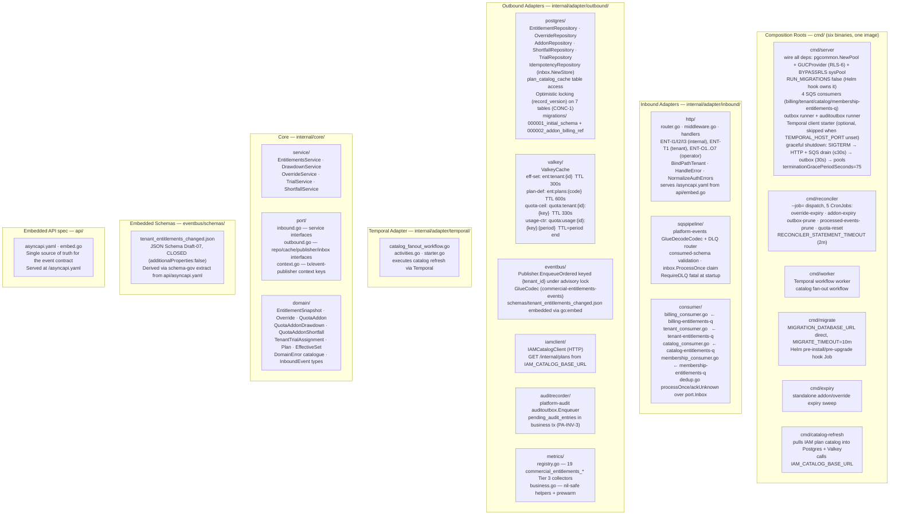
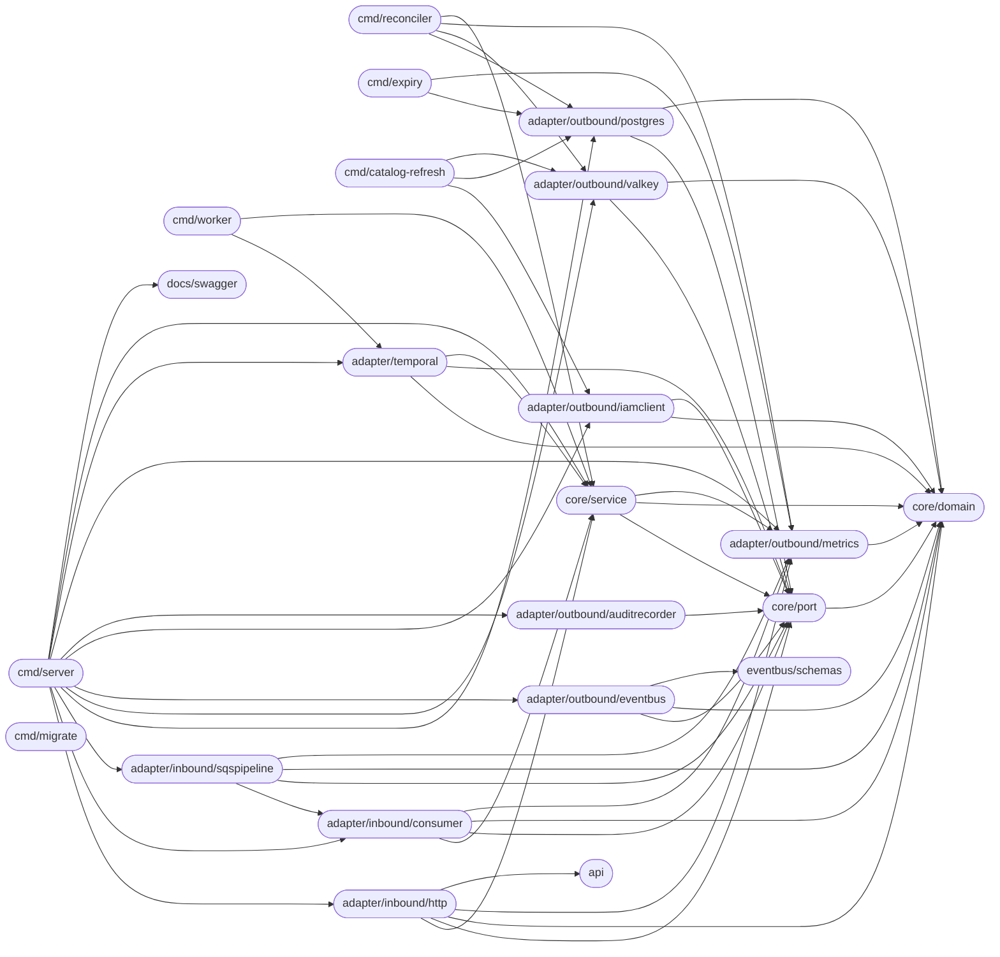

# Architecture

This document describes the internal structure, dependency rules, and runtime data flows of `commercial-entitlements`.

`commercial-entitlements` is a **private Go service** (`github.com/BCBP-SOLUTIONS-FZC-LLC/commercial-entitlements`, Go 1.26.11) deployed as a containerised microservice (HPA 2–8 replicas). It owns the **entitlement layer** of the XpertPMS commercial domain — per-tenant entitlement snapshots, quota addon packs, manual overrides, trial assignments, drawdown requests, and shortfall workflows. It is the source of truth for plan-based limits, quota ceilings, and usage counters consumed by Billing and other commercial services. It ships as **six binaries from one image**: `cmd/server` (the full HTTP surface — internal/tenant/operator — plus four inbound SQS consumers, the transactional outbox runner, the platform-audit outbox runner, and an optional Temporal workflow starter), `cmd/reconciler` (a single binary dispatched by `--job=<name>`, covering 5 CronJobs), `cmd/worker` (Temporal workflow worker for catalog fan-out), `cmd/migrate` (applies the schema once per release as a Helm pre-install/pre-upgrade hook Job), `cmd/expiry` (standalone addon/override expiry sweep), and `cmd/catalog-refresh` (pulls the IAM plan catalog into Postgres + Valkey).

**Owns:** entitlement snapshots (`entitlement_snapshots`), overrides (`entitlement_overrides`, `entitlement_override_history`), quota addons (`quota_addons`, `quota_addon_drawdowns`, `quota_addon_shortfalls`), trial assignments (`tenant_trial_assignments`, `trial_entitlement_overrides`), plan catalog cache (`plan_catalog_cache`), inbox dedup (`processed_events`), transactional outbox (`outbox_events`), audit outbox (`pending_audit_entries`).

**Does not own:** billing subscription lifecycle, payment processing, Keycloak/IAM user management, department/membership data (IAM Org Membership), raw plan definitions (IAM Catalog Admin — this service reads them via `IAM_CATALOG_BASE_URL`), audit records (Audit Log).

---

## Layer model

The service is organised in concentric Clean Architecture layers. Inner layers have **zero knowledge** of outer layers; dependencies always point inward.

> Source: [`docs/architecture/mermaid/layer-model.mmd`](docs/architecture/mermaid/layer-model.mmd)

**Rule:** `domain` ← `port` ← `service` ← `adapter` ← `cmd`. Nothing in `core/` imports `adapter/`. `service` may import `internal/adapter/outbound/metrics` directly (business-outcome counters at the point of the outcome). The inbound side has two components: `adapters_inbound` (`http`, `consumer`) and `inbound_pipeline` (`sqspipeline`, which wraps every consumer's `Handle`). Enforced in CI by `go-arch-lint` (`.go-arch-lint.yml`, `deepScan: false`).

---

## Package dependency graph

> Source: [`docs/architecture/mermaid/package-dependencies.mmd`](docs/architecture/mermaid/package-dependencies.mmd)

---

## HTTP request flow — recompute hot path

> Source: [`docs/architecture/mermaid/request-flow.mmd`](docs/architecture/mermaid/request-flow.mmd)

`POST /api/v1/internal/tenants/:id/entitlements/recompute` (ENT-I1b):
1. `BindPathTenant` middleware injects `tenantID` into request context; sets `app.tenant_id` GUC via `pgcommon.GUCSetFromContext` for the tx.
2. `EntitlementHandler.Recompute` → `EntitlementsService.RecomputeEntitlements(ctx, tenantID, cause)`.
3. Inside `RunInTx`: read `entitlement_snapshots` (with `record_version` for CONC-1), load plan from `plan_catalog_cache` (fall back to `IAMCatalogClient` on miss), apply active overrides + addons + trial profile.
4. If computed set differs from stored (ENT-INV-6): `UpsertSnapshot` (WHERE `record_version = current`, ENT-INV-1) + `Publisher.EnqueueOrdered(tx, TenantEntitlementsChanged, orderingKey=tenantID)` (EVT-10, advisory lock).
5. COMMIT — snapshot + outbox row atomic. Invalidate `ent:tenant:{id}` in Valkey.
6. Outbox runner polls every 500ms → `GlueCodec.Encode` → `sns:Publish(commercial-entitlements-events)`.

---

## Write flow — transactional outbox

> Source: [`docs/architecture/mermaid/write-flow.mmd`](docs/architecture/mermaid/write-flow.mmd)

---

## Data model

> Source: [`docs/architecture/mermaid/data-model.mmd`](docs/architecture/mermaid/data-model.mmd)

Ten tables in `commercial_entitlements`:

| Table | Optimistic lock | Purpose |
|---|---|---|
| `entitlement_snapshots` | ✓ | Per-tenant effective set + plan state (ENT-INV-1) |
| `entitlement_overrides` | ✓ | Manual limit overrides (ENT-INV-4/5) |
| `entitlement_override_history` | — | Immutable override audit trail |
| `quota_addons` | ✓ | Quota addon packs |
| `quota_addon_drawdowns` | — | Idempotent usage deductions (ENT-INV-3) |
| `quota_addon_shortfalls` | ✓ | Shortfall resolution state |
| `tenant_trial_assignments` | ✓ | Trial profile assignment |
| `trial_entitlement_overrides` | — | Per-limit trial overrides |
| `plan_catalog_cache` | — | Soft-synced plan definitions from IAM Catalog |
| `processed_events` | — | Inbox dedup (platform-events) |

Plus platform library tables: `outbox_events`, `outbox_dead_letters`, `pending_audit_entries`.

Optimistic locking (`record_version` in `WHERE`, `ErrOptimisticLockConflict` on 0 rows) is on 7 of the 10 tables (CONC-1).

---

## Valkey cache strategy

> Source: [`docs/architecture/mermaid/cache-strategy.mmd`](docs/architecture/mermaid/cache-strategy.mmd)

| Key pattern | TTL | Written by | Invalidated by |
|---|---|---|---|
| `ent:tenant:{tenantID}` | 300s | `RecomputeEntitlements` | Override/addon/trial mutation |
| `ent:plans:{planCode}` | 600s | `catalog-refresh` | Billing plan-change event |
| `quota:tenant:{tenantID}:{limitKey}` | 330s | `RecomputeEntitlements` | Addon grant/expire/refund |
| `quota:usage:{tenantID}:{limitKey}:{period}` | period end | Drawdown commit | `quota-reset` reconciler |

**CACHE-1:** Valkey is advisory only. Cache errors degrade gracefully — service falls back to Postgres. No RLS on Valkey; tenant isolation is enforced at the repository layer before any cache write.

---

## Event / consumer topology

> Source: [`docs/architecture/mermaid/event-outbox-flow.mmd`](docs/architecture/mermaid/event-outbox-flow.mmd)

**Produced:**

| Event | Topic | Registry |
|---|---|---|
| `TenantEntitlementsChanged` | `commercial-entitlements-events` | `commercial-entitlements-events` |

**Consumed:**

| Queue | Source topic | EventType filter |
|---|---|---|
| `billing-entitlements-q` | `billing-events` | `TenantPlanChanged`, `TenantSubscriptionCancelled`, `TenantReactivated`, `TenantQuotaAddOnChanged` |
| `tenant-entitlements-q` | `iam-tenant-events` | `TenantIdentityProvisioned`, `TenantSubscriptionUpdated`, `TenantMembershipsPurged`, `TenantConverted`, `TenantOffboarded` |
| `catalog-entitlements-q` | `iam-catalog-events` | `PlanCatalogChanged` |
| `membership-entitlements-q` | `iam-membership-events` | `TenantMembershipsPurged`, `TenantStateChanged` |

---

## RLS / GUC flow

> Source: [`docs/architecture/mermaid/rls-guc-flow.mmd`](docs/architecture/mermaid/rls-guc-flow.mmd)

Every tenant-scoped table has `ROW SECURITY ENABLED + FORCE ROW SECURITY`. The `tenant_isolation` RLS policy checks `current_setting('app.tenant_id')` against `tenant_id`. The GUC is set as `SET LOCAL app.tenant_id = …` (transaction-local only) via `pgcommon.GUCSetFromContext` → never session-scoped, never leaks across PgBouncer pooled backends (**RLS-6**).

---

## Observability

> Source: [`docs/architecture/mermaid/observability-stack.mmd`](docs/architecture/mermaid/observability-stack.mmd)

See [`docs/observability/README.md`](docs/observability/README.md) for the full metric inventory, tier breakdown, and CI enforcement rules.

| Label | Value |
|---|---|
| `domain` | `commercial` |
| `service` | `commercial-entitlements` |
| `environment` | `APP_ENV` (`local\|dev\|test\|staging\|prod`) |

Three-tier metrics: Tier 1 `platform_*` (platform libraries), no Tier 2 yet, Tier 3 `commercial_entitlements_*` (19 collectors in `internal/adapter/outbound/metrics/registry.go`).

Reconciler CronJobs share the server identity and push to `PROMETHEUS_PUSHGATEWAY_URL`, grouped by `cronjob`.
