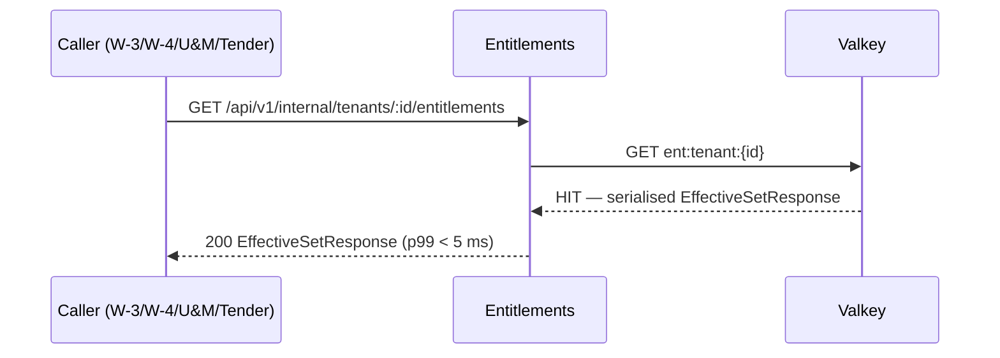
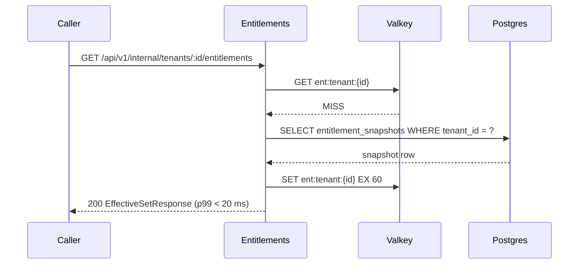
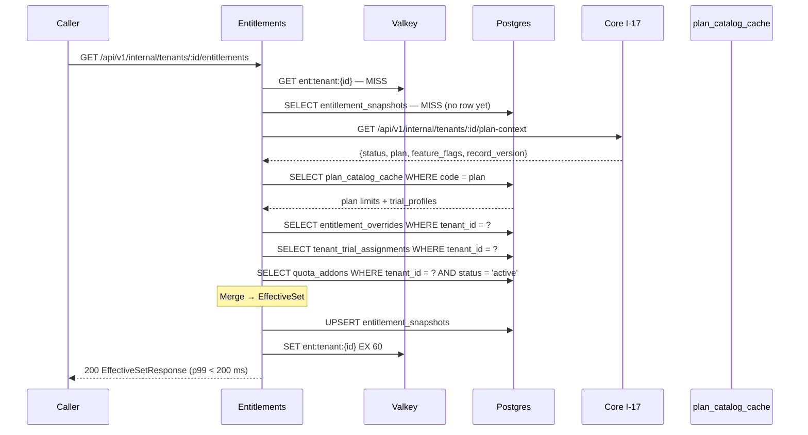
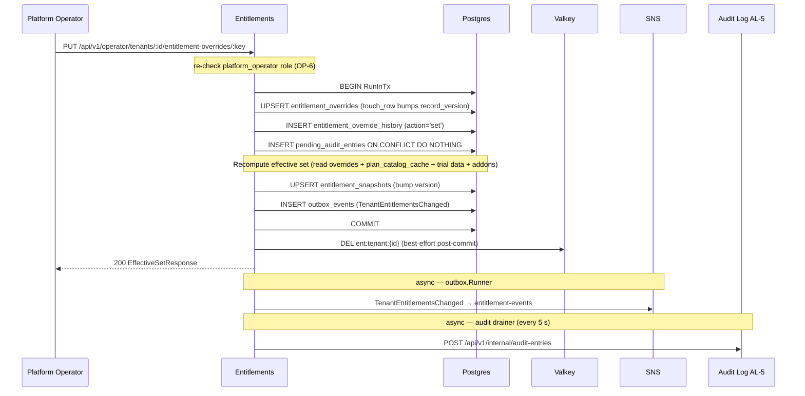
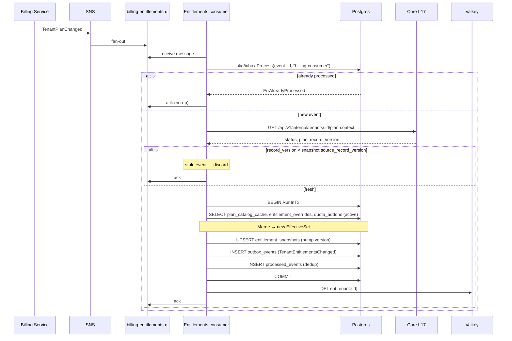

# Entitlements Service — Low-Level Design

## Tender Management SaaS Platform — Commercial Domain

| Field | Value |
|---|---|
| Document type | Low-Level Design (LLD) |
| Service | Entitlements Service (`commercial-entitlements`) |
| Go module | `github.com/BCBP-SOLUTIONS-FZC-LLC/commercial-entitlements` |
| Version | 1.15 |
| Date | November 2026 |
| Status | Draft for review |
| Owner | Commercial Team |
| Namespace / service account | `commercial` / `commercial-entitlements` |
| Base HLD | Commercial Domain HLD **v0.62** §5.2 |
| Sibling LLDs | `iam-lld-org-membership-service.md` (Core, rev 2.41), `iam-lld-catalog-admin-config-service.md` (Catalog, **v1.57**), `iam-lld-audit-log-service.md` (Audit Log, v0.29) |
| Deployment stage | Phase 1 (MVP) — not yet deployed to any environment |

### Revision history

| Rev | Date | Change |
|---|---|---|
| 1.18 | 2026-11-24 | **BL-OQ-4 / BL-OQ-20 (W-7): add-on event ownership and AL-5 audit path documented.** §7.1: explicit no-event statement — Entitlements never publishes an add-on-specific event; operator corrections and pack expiry are audited exclusively via AL-5 (`billing.token_addon.granted`, `.revoked`, `.expired`). §7.2: `TenantQuotaAddOnChanged` consumer row expanded with `reason` enum (`purchase` \| `refund`) and both code paths. §8.4: flow diagram updated to show purchase and refund dispatch, `billing_ref`-based idempotency for purchase, and `purchase_ref` lookup for refund. |
| 1.17 | 2026-11-22 | **ENT-D7 closed.** `TenantConverted` trial-deletion code confirmed complete (`membership_consumer.go` → `handleConverted`); "approved pending Product confirmation" caveat removed from §16.2. ENT-D6 trial profile limit numbers remain the only Product/Finance decision outstanding. |
| 1.16 | 2026-11-22 | **Workflow team response incorporated; Commercial confirmations recorded.** Five LLD wording corrections: §5.2 adds `x-tenant-roles` to ENT-I1 internal-route header check; fail-closed row scoped to gated limits with W-4 queue-grant exception; freshness row updated to actual built behaviour (60 s TTL, stale-while-revalidate up to 2× TTL, 10-minute fallback, configurable via `ENTITLEMENTS_STALE_TTL`); `dedicated_workflow_queue` sentence corrected to pick-start-queue-and-register-as-side-effect; §7.1.2 Workflow subscriber rows removed (not needed at Phase 1, note added). ENT-D10 updated with: Workflow confirmation of non-conflicting queue names and Go SDK v1.46.0; Commercial confirmations of port 8080 (final, `deploy/helm/values.yaml`), pod label `app.kubernetes.io/name: commercial-entitlements` (final, `deployment.yaml`), 10-min freshness fallback accepted, and Commercial SDK currently v1.30.0 (upgrade path noted). §16.3 Workflow Team sign-off updated to Conditionally Ready. Only remaining Commercial action: publish LLD v1.15 to design repository. |
| 1.15 | 2026-11-18 | **ENT-D3 framed as Product decision PD-LLM-1 (Commercial HLD v0.62).** Nine principles recorded (tiers differ only for draft and judge; common platform models elsewhere; sole `bge-m3` and `bge-reranker-v2-m3`; cross-family judge; Sonnet default with Opus for defined scenarios; fixed-task aliases mapped to exact Bedrock IDs by configuration; English and Arabic evaluation before any replacement) and four confirmations required before approval (ap-south-1 availability, Arabic evaluation, Finance quota validation, `draft-premium-max` routing rules). No Entitlements change. |
| 1.14 | 2026-11-18 | **ENT-D3 proposed model table recorded (Product decision memo; Commercial HLD v0.61).** §16.1 ENT-D3 now carries the proposed models per `model_tier` and task class, the virtual model names and the approval steps. Status: proposed, pending Product. No Entitlements change: the service serves the tier label only. |
| 1.13 | 2026-11-18 | **B-2 approved: override history retained at tenant purge (Commercial HLD v0.60).** `TenantMembershipsPurged` deletes active entitlement state and operational overrides but keeps `entitlement_override_history` as an immutable audit record under the platform's standard audit-retention policy, archivable after offboarding; deleted only if Legal identifies a regulatory erasure requirement. Fixed the contradicting statements in the table notes and EOH-3; §15.1 and §15.2 aligned; `quota_addon_shortfalls` added to the retained records; B-2 moved to resolved. |
| 1.12 | 2026-11-18 | **ENT-D8 approved: deferred pack expiry (Commercial HLD v0.59).** A due add-on pack stays `active` until its final usage reconciliation (ENT-I3 drawdown) succeeds; `cmd/expiry` retries on every run and expires the pack only after a successful drawdown. Deferrals are recorded (`expiry_deferred_since`, `expiry_attempts`), audited (`billing.token_addon.expiry_deferred` on first deferral; `billing.token_addon.expired` when finally expired), measured and alerted above `ADDON_EXPIRY_DEFER_ALERT_HOURS` / `ADDON_EXPIRY_DEFER_ALERT_PACKS`. Reconciliation correctness takes precedence over strict expiry-time enforcement. QA-4, new QA-6, §8.8, §11, §12, §14, §20.7 updated; ENT-D8 moved to resolved. |
| 1.11 | 2026-11-18 | **ENT-D12 approved (Commercial HLD v0.58).** Shortfall defaults adopted: `SHORTFALL_TOLERANCE_TOKENS=10000`, `SHORTFALL_TOLERANCE_PCT=1`, `SHORTFALL_HIGH_VALUE_TOKENS=250000`, `SHORTFALL_REPEAT_COUNT=2`, `SHORTFALL_REPEAT_WINDOW_MONTHS=3`; configuration-driven, adjustable after production review without code change. High-value or repeated shortfalls now **always** go to operator review and Commercial escalation, even when within tolerance (QAS-5, QAS-7, ENT-I3, alert, runbook, test updated). ENT-D12 moved to resolved. |
| 1.10 | 2026-11-18 | **ENT-D11 resolved: shortfall resolution policy (Commercial HLD v0.57).** Every shortfall gets a formal disposition. At or below the tolerance (`SHORTFALL_TOLERANCE_TOKENS` / `_PCT`) ENT-I3 auto-accepts it as commercial loss (`resolved_by` = `commercial-system`, audited). Above it, operator review via ENT-O7 with one of four dispositions renamed to the policy terms: `accepted_loss`, `entitlement_correction`, `metering_correction`, `billing_escalation`; each audited and linked to the shortfall (`disposition_ref`; ENT-O5 takes `shortfall_id`); owner per disposition recorded. High-value or repeated shortfalls are escalated regardless of disposition (`escalated`, `escalation_reason`, P2 alert). Config, metrics, alerts, runbook §20.6 and tests updated. Threshold values to approve → new open item ENT-D12. |
| 1.9 | 2026-11-18 | **ENT-D9 resolved: drawdown shortfalls are recorded, audited and alerted, never silently absorbed (Commercial HLD v0.56).** ENT-I3 drains all available balance, then records the uncovered amount: `quota_addon_drawdowns` gains `tokens_requested` and `shortfall_tokens`; new table `quota_addon_shortfalls` (reconciliation record, `open` → `under_review` → `resolved`); audit entry `billing.token_addon.drawdown_shortfall`; metrics replace `addon_overdraft_total`; configurable alert thresholds; operator routes ENT-O6 (list) and ENT-O7 (review/resolve, audited `billing.token_addon.shortfall_resolved`); runbook §20.6; tests. The resolution policy for the uncovered amount is Commercial + Product's (new open item ENT-D11). |
| 1.8 | 2026-11-18 | **ENT-D6 proposed values recorded (Product decision memo, Commercial HLD v0.55).** §16.1 ENT-D6 now carries the proposed Trial-Specific and Reduced values for all six `plan_trial_profiles` rows (explicit Enterprise caps), the rollout steps and the open Product points. Status: proposed, pending Product approval. No code change; values are Catalog data read through CAT-I2. |
| 1.7 | 2026-11-17 | **ENT-D7 resolved (approved pending Product confirmation; Commercial HLD v0.54).** On `TenantConverted` the conversion deletes `tenant_trial_assignments` and `trial_entitlement_overrides` in one transaction; subscription-scoped `entitlement_overrides` stay in effect. A trial benefit meant to outlive conversion must be re-created as a commercial override before or during conversion. Stated in TTA-2, TEO-2, the `tenant-entitlements-q` row (§7.2), new invariant ENT-INV-7 (§3.4), and moved from §16.1 to §16.2. |
| 1.6 | 2026-11-17 | **ENT-D4 resolved by the ENT-D1 decision (Commercial HLD v0.53).** New §8.7 `OverrideExpiryFanoutWorkflow` in Phase 1 with the same batching, concurrency, retry and observability model as `CatalogFanoutWorkflow`: hourly `cmd/expiry` CronJob only starts it (workflow ID per hour window), tenants with due overrides paged and processed in parallel, per-tenant guarded delete + history + audit + single recompute, continue-as-new. Covers `entitlement_overrides` and `trial_entitlement_overrides`; add-on pack expiry stays on the `cmd/expiry` path (ENT-D8). Task queue `ent-expiry-fanout` on the same worker. Updated §3, §9.7, §10.3, §11, §12, §13.1, §14.1, §20.3, §21.5; ENT-D4 moved to resolved (§16.2). |
| 1.5 | 2026-11-17 | **ENT-D1 decided: `PlanCatalogChanged` fan-out as a Temporal workflow (Commercial HLD v0.52).** New §8.6 `CatalogFanoutWorkflow` on the platform Temporal cluster: deterministic workflow ID per trigger, affected tenants only (`entitlement_snapshots.plan`), parallel idempotent `RecomputeTenant` activities under `FANOUT_MAX_PARALLEL`, continue-as-new paging, one AL-5 `platform_tenant` entry per run. New invariant ENT-INV-6 (a no-op recompute writes nothing). New §9.7 (Temporal unavailability) and §20.5 runbook; worker Deployment, `cmd/worker`, Temporal adapter and port (§3); Temporal SDK dependency (§3.1); index `idx_snapshots_plan` (§4.2); configuration (§12); metrics and alerts (§11); tests (§14.1). The catalog-refresh CronJob now starts the same workflow instead of batching itself (§21.4). ENT-D1 moved to resolved (§16.2); ENT-D4 defaults to the same pattern, pending confirmation; new open item ENT-D10 (Temporal namespace provisioning and access). |
| 1.4 | 2026-11-17 | **Structural alignment with Org & Membership LLD conventions.** §4.0: Mermaid `erDiagram` replaces ASCII block diagram. §4.2: Notes + numbered invariant families added to all 11 tables (`EO-*`, `EOH-*`, `ES-*`, `PCC-*`, `TTA-*`, `TEO-*`, `QA-*`, `QAD-*`, `PAE-*`, `OUT-*`, `PE-*`). §5.3: Endpoint catalogue split into Internal / Tenant / Operator route subsections. §7.1.1: AWS Glue Schema Registry CI pipeline + SCHEMA-1..4 invariants. §7.1.2: SNS → SQS fan-out subscriber queues table. §7.6: AsyncAPI contract dedicated section. §7.7: EVT-1..9 event invariants. §8: All flows converted to Mermaid `sequenceDiagram` (cache hit, cache miss, cold compute, ENT-O1 override set, `TenantPlanChanged` consumer, `TenantQuotaAddOnChanged` consumer). §11.1: SLOs table (p99 per endpoint class + event freshness). §14.2: `.github/workflows/schema-registry.yml` and enforcement scripts documented. No content removed. |
| 1.3 | 2026-11-16 | **Aligned with Commercial HLD v0.51 (CD-55 — Token Add-on Balance).** New feature: tenant token add-on packs. New tables: `quota_addons` (one row per purchased pack), `quota_addon_drawdowns` (one record per period close per tenant). New event consumer: `TenantQuotaAddOnChanged` on `billing-entitlements-q` — adds pack to `quota_addons`, recomputes effective `llm_token_quota_monthly` (plan/override base + add-on balance available this period), emits `TenantEntitlementsChanged`. Two new endpoints: ENT-I3 (`POST /api/v1/internal/tenants/:id/quota-addons/drawdowns` — Usage & Metering records period consumption at rollover; idempotent per tenant+period; FIFO oldest-pack-first draw-down) and ENT-O5 (`POST /api/v1/operator/tenants/:id/quota-addons` — platform_operator manual correction: add, remove unused, goodwill credit, reverse duplicate grant, migration adjustment; reason required; audited). Add-on balance survives `cancelled`/`suspended`; forfeited on `TenantMembershipsPurged`. Pack expiry (12 months from purchase): Usage & Metering reports consumption first, then Entitlements marks expired, forfeits remainder, recomputes, emits event. Package layout updated: `domain/addon.go`, `port/addon_repository.go`, `service/addon_service.go`, `adapter/inbound/http/addon_handler.go`, `adapter/outbound/postgres/addon_repository.go`. HLD parent reference updated v0.28 → v0.51. No changes to trial profile, override, or Catalog integration. |
| 1.2 | 2026-11-10 | **Aligned with Catalog LLD v1.57 (CD-51 fully implemented).** Catalog changes: `TrialProfileFullPlan = "full_plan"` domain constant added; `custom` explicitly absent with comment (Entitlements owns it); `PatchTrialProfile` returns `404` for `full_plan`, `400` with full 4-profile explanation for unknown profiles; Catalog LLD v1.57 updated with §4.2 DDL, §4.4 migration, §5.3 CAT-5a, §5.4 full spec. Entitlements LLD: Catalog version references updated 1.56 → 1.57; A-8 updated with `full_plan` and `custom` ownership clarified; §18.2 expanded with `trial_profiles` CAT-I2 shape, profile-to-data-source table, and CAT-5a spec; contract test updated. No changes to Entitlements data model — the 4-profile design was already correctly specified. |
| 1.1 | 2026-11-05 | **Aligned with Commercial HLD v0.28.** (1) ENT-I1 read contract fully specified — fields, types, null semantics, freshness, `feature_flags` contract — unblocking Workflow W-3 and W-4. (2) Trial entitlement profiles (CD-6/CD-51): `tenant_trial_assignments` and `trial_entitlement_overrides` tables; four profiles (Trial-Specific default, Reduced, Full, Custom); new `source: trial_profile` in limits response; new operator endpoints ENT-O3/ENT-O4. (3) Workflow namespace corrected to `workflow-app`; both Definition (`workflow-definition-service`) and Execution (`workflow-execution-service-api`) ServiceAccounts admitted (W-6, CD-29). (4) CD-12 (quota period = UTC calendar month); CD-11 (AI Team owns access-log feed, not direct callback). (5) CD-42 closed (`past_due` runs); CD-53 added as open item. (6) Resolved decisions updated (CD-6, CD-12, CD-27, CD-33, CD-42, CD-44). |
| 1.0 | 2026-11-01 | Initial draft. Establishes the Entitlements Service LLD, owned by the Commercial Team per CD-4. API contract, DDL, event payloads, I-17 and CAT-I2 integration, fail-closed rule, freshness bound, override expiry, and cache TTLs are all first-specified here — previously placeholders in the Commercial HLD §5.2. Derived from Commercial HLD v0.18, Core LLD 2.41, and Catalog LLD 1.57. |

---

## Table of Contents

1. [Document Overview](#1-document-overview)
2. [Service Responsibilities and Boundaries](#2-service-responsibilities-and-boundaries)
3. [Architecture and Package Layout](#3-architecture-and-package-layout)
4. [Data Model](#4-data-model)
   - [4.0 Entity-relationship overview](#40-entity-relationship-overview)
5. [API Contract](#5-api-contract)
6. [Caching Design](#6-caching-design)
7. [Event Architecture](#7-event-architecture)
8. [Key Request Flows](#8-key-request-flows)
9. [Concurrency, Consistency, and Failure Handling](#9-concurrency-consistency-and-failure-handling)
10. [Security](#10-security)
11. [Observability](#11-observability)
12. [Configuration](#12-configuration)
13. [Deployment and Scaling](#13-deployment-and-scaling)
14. [Testing Strategy](#14-testing-strategy)
15. [GDPR, Data Lifecycle, and Compliance](#15-gdpr-data-lifecycle-and-compliance)
16. [Open Questions and Sign-off Register](#16-open-questions-and-sign-off-register)
17. [Appendix — Error Taxonomy](#17-appendix--error-taxonomy)
18. [Integration Details](#18-integration-details)
19. [Migration Strategy](#19-migration-strategy)
20. [Operational Considerations](#20-operational-considerations)
21. [Performance Considerations](#21-performance-considerations)

---

## 1. Document Overview

This document is the definitive low-level design for the **Entitlements Service** (`commercial-entitlements`). It owns what the Commercial Domain HLD explicitly defers to it: the final API contract and response shapes, the `TenantEntitlementsChanged` event payload, the Core I-17 re-read and `record_version` staleness rule, the fail-closed rule and freshness bound, the override expiry job, and all cache TTLs.

The service answers one question for every caller on the platform: **what is this tenant entitled to right now?** It is a read model — its only system-of-record data is the per-tenant numeric limit overrides for custom deals. Everything else is derived on demand from the IAM Catalog service (plan grants, via CAT-I2) and Org & Membership Core (tenant state, via I-17).

**What this document does not own.** Billing subscription logic (`hld-billing-service.md`), usage counters (`hld-usage-metering-service.md`), the plan catalog table (`iam-lld-catalog-admin-config-service.md`), tenant identity or realm state (`iam-lld-org-membership-service.md`), and boolean feature-flag overrides (`tenants.feature_flags`, owned by Core's O-4). Where this LLD and the HLD disagree, the HLD is authoritative; discrepancies are flagged in §16.

---

## 2. Service Responsibilities and Boundaries

### 2.1 In scope

- Computing and serving the **effective entitlement set** per tenant: plan tier, entitlement state derived from subscription status, effective feature flags, effective numeric limits, `model_tier`, and — during a trial — the active trial entitlement profile (CD-6, CD-51).
- Owning **per-tenant numeric limit overrides** for custom deals (subscription-scoped) and **trial-scoped overrides** for the `custom` trial profile.
- Owning the **per-tenant trial entitlement profile assignment** (`trial_specific`, `reduced_plan`, `full_plan`, or `custom`), set by an operator with a mandatory reason.
- Emitting `TenantEntitlementsChanged` whenever the effective set changes, so downstream enforcers re-render without polling.
- Caching the computed effective set in Valkey (short TTL) and snapshotting it in Postgres (rebuildable).
- Writing the **enforcement quota ceiling** to Valkey (`quota:tenant:{tenant_id}:llm_token_quota_monthly`) on every recompute, and **resetting the usage counter** (`quota:usage:{tenant_id}:llm_token_quota_monthly:{period}`) to `0` at period rollover — enabling the AI Team's Rate Limit Service to enforce via atomic INCR without a network hop to this service (ENT-D13).
- Delivering operator mutations as AL-5 audit entries to the Audit Log Service.
- Running the override expiry CronJob and the catalog refresh TTL backstop.
- Managing the tenant's **token add-on balance** (CD-55): accumulating purchased packs in `quota_addons`, recording period draw-downs in `quota_addon_drawdowns`, expiring packs 12 months after purchase, and forfeiting the balance on `TenantMembershipsPurged`. The effective `llm_token_quota_monthly` = plan or operator-override base + add-on balance available this period (FIFO, oldest pack drawn down first).

### 2.2 Out of scope (owned elsewhere)

| Concern | Owner |
|---|---|
| Plan catalog data (`plans` table: limits, model_tier, feature_set) | Catalog / Admin Config Service (`iam-catalog-admin`, CAT-I2) |
| Trial profile limit values (`plan_trial_profiles` table: Trial-Specific and Reduced rows per plan) | Catalog / Admin Config Service (CD-51 — built, Nov 2026) |
| Tenant subscription state and billing period | Billing Service |
| Boolean flag overrides (`tenants.feature_flags`) and the `x-feature-flags` header | Core Org & Membership (O-4) + AuthZ Enrichment |
| Usage counters, quota period (UTC calendar month, CD-12), and enforcement rendering into the Model Gateway / Envoy | Usage & Metering Service / AI Team — **Note (ENT-D13):** Entitlements writes the quota ceiling and usage-counter reset keys to Valkey; the Rate Limit Service reads these keys for atomic INCR enforcement. Entitlements does not own the enforcement logic itself. |
| Gateway access-log usage feed to Usage & Metering | AI Team (CD-11 — owns the feed end to end) |
| Seat cap enforcement | Core Org & Membership |
| Data residency (`tenants.residency_mode`, `x-residency-mode`) | Core + AuthZ Enrichment; not stored here (CD-37) |
| Rollout flags (e.g. `llm.refiner.*`) | LLM team's own configuration; not plan grants (CD-45) |
| Tenant identity, realm lifecycle, authentication | IAM subsystem |

### 2.3 Ownership split — boolean vs. numeric overrides

**CD-2 (TL decision, 15 Oct 2026):** the boolean/numeric override split is kept and not moved.

```
boolean overrides  → Core tenants.feature_flags (O-4) → AuthZ Enrichment x-feature-flags
numeric overrides  → Entitlements entitlement_overrides (this service, §4.2)
```

This service reads the boolean side from Core's I-17 `feature_flags` field (the effective merged value `planDefaults(plan) ⊕ tenants.feature_flags`), which Core already computes. It does not re-derive boolean flags itself and never writes `tenants.feature_flags`.

---

## 3. Architecture and Package Layout

The service follows the platform Clean Architecture / Ports-and-Adapters layout (HLD §15.3): dependencies point inward, `core/domain` imports nothing external, and a single composition root (`cmd/server/main.go`) wires all adapters. Two CronJob binaries (`cmd/expiry`, `cmd/catalog-refresh`) handle scheduled work, mirroring the pattern Core's `cmd/reconciler` uses for its jobs.

```
commercial-entitlements/
├── cmd/
│   ├── server/
│   │   ├── main.go               # composition root — DB pool, Valkey client, IAM clients, consumers,
│   │   │                         #   outbox runner, audit drainer goroutine, shutdown; RUN_MIGRATIONS gate
│   │   ├── wiring.go             # buildGlueCodec / buildTopicPublisher for entitlement-events SNS
│   │   ├── identity.go           # resolveAppEnv — one resolved environment for metrics/tracing/logs
│   │   └── swagger_info.go       # swaggo @title/@version metadata
│   ├── expiry/
│   │   └── main.go               # expiry CronJob (hourly) — starts OverrideExpiryFanoutWorkflow for the
│   │                             #   hour window (§8.7); runs add-on pack expiry (ENT-I3 first, then expire)
│   ├── catalog-refresh/
│   │   └── main.go               # catalog TTL backstop CronJob — re-fetch CAT-I2 when stale (600 s),
│   │                             #   compare record_versions; on change start CatalogFanoutWorkflow (§8.6)
│   ├── worker/
│   │   └── main.go               # Temporal worker (ENT-D1, ENT-D4) — CatalogFanoutWorkflow on ent-catalog-fanout,
│   │                             #   OverrideExpiryFanoutWorkflow on ent-expiry-fanout; own Deployment
│   └── migrate/
│       └── main.go               # golang-migrate runner; Helm pre-install/pre-upgrade hook Job
├── internal/
│   ├── core/
│   │   ├── domain/
│   │   │   ├── entitlement.go    # EffectiveSet, EntitlementState, LimitKey enum, LimitValue{Value, Source, AddonBalance}
│   │   │   ├── override.go       # Override, OverrideHistory, OverrideAction enum (set/removed/expired)
│   │   │   ├── snapshot.go       # EntitlementSnapshot — the computed effective set stored to Postgres
│   │   │   ├── plan.go           # Plan read-model — matches CAT-I2 PlanResponse shape
│   │   │   ├── addon.go          # QuotaAddon{ID, TenantID, TotalTokens, RemainingTokens, Status, PurchasedAt, ExpiresAt},
│   │   │   │                     #   QuotaAddonDrawdown{ID, TenantID, PeriodStart, TotalDrawn, Packs[]},
│   │   │   │                     #   AddonStatus enum (active/exhausted/expired/forfeited), AddonAction enum
│   │   │   ├── event.go          # TenantEntitlementsChangedPayload, EffectiveSetCause enum
│   │   │   └── errors.go         # DomainError catalogue (ErrTenantNotFound, ErrUpstreamUnavailable, …)
│   │   ├── port/
│   │   │   ├── override_repository.go       # CRUD for entitlement_overrides + history rows
│   │   │   ├── snapshot_repository.go       # read/upsert entitlement_snapshots
│   │   │   ├── catalog_cache_repository.go  # read/replace plan_catalog_cache
│   │   │   ├── audit_repository.go          # PendingAuditEntryRepository (enqueue + claim/deliver)
│   │   │   ├── addon_repository.go          # AddonRepository — quota_addons CRUD; drawdown insert/idempotency
│   │   │   ├── cache.go                     # Cache port — Valkey adapter behind this interface
│   │   │   ├── iam_client.go                # IamClient — I-17 (Core) and CAT-I2 (Catalog) outbound calls
│   │   │   ├── audit_log_client.go          # thin wrapper — delegates to platform-audit pkg/audit.Client (AL-5 direct write)
│   │   │   ├── event_publisher.go           # EventPublisher — outbox enqueue
│   │   │   ├── tx_runner.go                 # TxRunner — pgcommon RunInTx
│   │   │   ├── workflow_starter.go          # WorkflowStarter — StartCatalogFanout(planCode, triggerID, …) (ENT-D1),
│   │   │   │                                #   StartOverrideExpiryFanout(windowEnd) (ENT-D4)
│   │   │   ├── idempotency.go               # Inbox — exactly-once claim + fn in one tx (platform-events pkg/inbox)
│   │   │   └── logger.go                    # Logger — service-layer structured logging
│   │   └── service/
│   │       ├── effective_set_service.go     # core orchestrator — re-read I-17, discard stale record_version,
│   │       │                               #   merge catalog + overrides + addon_balance, derive state, bump version, write snapshot
│   │       ├── override_service.go          # PUT/DELETE override with history + audit + outbox, all in one tx
│   │       ├── addon_service.go             # CD-55: apply TenantQuotaAddOnChanged, record drawdowns (FIFO),
│   │       │                               #   expire packs, operator corrections; recompute effective set after each mutation
│   │       ├── catalog_service.go           # read-through to Catalog CAT-I2; populates plan_catalog_cache
│   │       └── audit_delivery_service.go    # wires platform-audit auditoutbox.Runner (5 s poll, batch 50, max 50 attempts, 2 s→5 min backoff)
│   └── adapter/
│       ├── inbound/
│       │   ├── http/
│       │   │   ├── router.go               # Gin route registration (tenant, internal, operator)
│       │   │   ├── entitlement_handler.go  # GET /api/v1/internal/tenants/:id/entitlements
│       │   │   │                           # GET /api/v1/tenants/:id/entitlements
│       │   │   │                           # GET /api/v1/internal/plans
│       │   │   ├── override_handler.go     # PUT/DELETE /api/v1/operator/tenants/:id/entitlement-overrides/:key
│       │   │   ├── addon_handler.go        # POST /api/v1/internal/tenants/:id/quota-addons/drawdowns (ENT-I3)
│       │   │   │                           # POST /api/v1/operator/tenants/:id/quota-addons (ENT-O5)
│       │   │   ├── middleware.go           # IdentityBridgeMiddleware, RequireSystemRole, RequireOperatorRole,
│       │   │   │                           #   RequireTenantOwnerOrAdmin, HandleError, NormalizeAuthErrors,
│       │   │   │                           #   RequireJSONContentType, TenantIDGate (x-tenant-id == :id)
│       │   │   ├── dto.go                  # request/response DTOs — EffectiveSetResponse, OverridePutRequest, …
│       │   │   └── errors.go               # newErrorResponse (gincommon.ErrorResponse shape)
│       │   └── consumer/
│       │       ├── billing_consumer.go     # billing-entitlements-q: TenantPlanChanged, TenantSubscriptionCancelled,
│       │       │                           #   TenantReactivated (source=billing), TenantQuotaAddOnChanged (CD-55)
│       │       ├── tenant_consumer.go      # tenant-entitlements-q: TenantConverted, TenantSuspended,
│       │       │                           #   TenantReactivated (source=operator), TenantOffboarded, TrialExpired
│       │       ├── catalog_consumer.go     # catalog-entitlements-q: PlanCatalogChanged — validate, re-fetch CAT-I2,
│       │       │                           #   start CatalogFanoutWorkflow; ack only after start succeeds (§8.6, §9.7)
│       │       ├── membership_consumer.go  # membership-entitlements-q: TenantMembershipsPurged
│       │       └── dedup.go               # processOnce / ackUnknown over port.Inbox
│       └── temporal/
│           ├── catalog_fanout_workflow.go  # CatalogFanoutWorkflow — page, bounded parallel activities, continue-as-new
│           ├── expiry_fanout_workflow.go   # OverrideExpiryFanoutWorkflow — same paging/concurrency/retry model (§8.7)
│           ├── fanout_common.go            # shared bounded-parallel page loop and activity options
│           └── activities.go               # ListAffectedTenants, RecomputeTenant, ListTenantsWithDueOverrides,
│                                           #   ExpireTenantOverrides, RecordFanoutAudit
│       └── outbound/
│           ├── postgres/
│           │   ├── override_repository.go
│           │   ├── snapshot_repository.go
│           │   ├── catalog_cache_repository.go
│           │   ├── pending_audit_entry_repository.go  # platform-audit auditoutbox schema; Enqueue + Runner delegate to library internals
│           │   ├── idempotency_repository.go          # InboxRepository — processed_events dedup
│           │   ├── addon_repository.go                # CD-55: quota_addons CRUD; quota_addon_drawdowns insert/query
│           │   ├── db.go                              # DSNFromEnv / MigrationDSNFromEnv; wrapConnErr
│           │   ├── migrate.go                         # RunMigrations (pgcommon migrate.Runner)
│           │   └── migrations/                        # 000001_initial_schema.{up,down}.sql
│           ├── valkey/
│           │   └── cache.go                # go-redis/v9 — ent:tenant:{id} snapshot cache; ent:plans catalog cache;
│           │                               #   quota:tenant:{id}:llm_token_quota_monthly (ENT-D13 enforcement ceiling);
│           │                               #   quota:usage:{id}:llm_token_quota_monthly:{period} reset at rollover (ENT-D13)
│           ├── iamclient/
│           │   ├── core_client.go          # I-17 GET /api/v1/internal/tenants/:id/plan-context (commercial-system)
│           │   └── catalog_client.go       # CAT-I2 GET /api/v1/internal/plans (commercial-system)
│           ├── temporalclient/
│           │   └── starter.go              # go.temporal.io/sdk client — implements port.WorkflowStarter
│           ├── auditlog/
│           │   └── client.go               # AL-5 POST /api/v1/internal/audit-entries (iam-system principal,
│           │                               #   otelhttp transport — same pattern as Catalog §7.6.1)
│           ├── eventbus/
│           │   ├── publisher.go            # outbox.Enqueue under platform-events/v2 outbox.Runner
│           │   ├── glue_codec.go           # GlueCodec — Glue wire header; version resolved at startup by definition
│           │   ├── validating_codec.go     # ValidatingCodec — payload validated before publish
│           │   └── schemas/
│           │       └── tenant_entitlements_changed.json  # schema-gov extract output; CI drift-gated
│           └── metrics/
│               ├── metrics.go              # commercial_entitlements_* Tier 2/3 metrics (§11.2)
│               └── standard_test.go        # production registration order + metricslint checks
├── api/
│   ├── asyncapi.yaml             # TenantEntitlementsChanged contract — AsyncAPI 3.0 source of truth
│   └── embed.go                  # //go:embed asyncapi.yaml; served at GET /asyncapi
├── docs/
│   ├── lld/                      # this document
│   └── observability/            # README, metric-registry.md (CI-generated), runbooks.md
├── deploy/
│   ├── helm/                     # Deployments (API + worker), HPA(2-4), 2 CronJobs, migrate Job, PDB,
│   │                             #   NetworkPolicy, ServiceMonitor, PrometheusRule, HTTPRoute, SecurityPolicy
│   └── messaging/                # SQS/SNS Terraform — 4 inbound queues + DLQs + SNS subscriptions
├── test/
│   ├── unit/                     # mocks — no Docker
│   ├── postgres/                 # testcontainers — integration (-tags=integration)
│   ├── integration/              # floci SNS/SQS/Glue (-tags=integration)
│   └── e2e/                      # full-stack HTTP (-tags=e2e)
└── Dockerfile  docker-compose.yml  Makefile  go.mod  .golangci.yml
```

### 3.1 Shared library dependencies

```
require (
    github.com/BCBP-SOLUTIONS-FZC-LLC/platform-gincommon     v1.6.0
    github.com/BCBP-SOLUTIONS-FZC-LLC/platform-events/v2      v2.1.0
    github.com/BCBP-SOLUTIONS-FZC-LLC/platform-pgcommon/v2    v2.0.x
    github.com/BCBP-SOLUTIONS-FZC-LLC/platform-schemagov      # Python CLI — not in go.mod
    github.com/BCBP-SOLUTIONS-FZC-LLC/platform-audit  v0.1.2  # direct-write AL-5 outbox (pkg/auditoutbox + pkg/audit)
    go.temporal.io/sdk                                        # ENT-D1 fan-out workflow (platform Temporal cluster)
)
```

`platform-schemagov` is a Python 3.12 CLI (`schema-gov`), pinned by CI Docker image — no Go import, no runtime dependency. `iam-keycloakclient` is **not** a dependency.

### 3.2 Dependency rules (enforced in CI)

`core/domain` imports nothing external. `core/port` imports only `core/domain`. `core/service` imports only `core/domain` and `core/port`. `adapter/*` implements `core/port`. Enforced by `go-arch-lint` (`.go-arch-lint.yml`, `.github/scripts/arch-lint.sh`).

The two outbound IAM clients (`iamclient/core_client`, `iamclient/catalog_client`) are plain `net/http` clients behind `port.IamClient`, built on the same `httpx.NewClient(timeout)` shared factory as Core's six outbound clients — `otelhttp`-instrumented, W3C traceparent injected, no hand-rolled propagation helper.

### 3.3 Shared library integration

#### 3.3.1 `platform-gincommon` v1.6.0

Runs `gincommon.ObservabilityMiddlewares(cfg)` (panic recovery, request ID, tracing, correlation, metrics, logging, 30 s request deadline) followed by this service's `NormalizeAuthErrors`. The `/api/v1/internal/*` group adds `gincommon.ProtectedMiddlewares` and `GUCBridgeMiddleware`. Operator and tenant routes add `RequireJSONContentType`. Also used: `gincommon.Config` (`ServiceName = "commercial-entitlements"`, `Domain = "commercial"`, resolved `Environment`, `BuildVersion`), `InitTracingWithConfig`, `MetricsRegisterer`, `MetricsHandler` (port 9090, `monitoring` namespace only), `NewShared*Vec`/`NewCounterVec`/`NewGauge`/`NewHistogramVec` (§11.2), `RequestContext`, `ErrorResponse`, `HeaderRequestID`, `Shutdown`. No gRPC server — Gin HTTP only.

#### 3.3.2 `platform-pgcommon/v2` v2.0.x

`NewPool` + `ConfigFromEnv`, `PGBouncerMode` env-driven, `GUCProvider = GUCSetFromContext` (binds `app.tenant_id` **transaction-locally** — `set_config(…, is_local => true)` on every checkout, so it can never persist on a pooled backend connection). Writes in `RunInTx` (or `RunInTxWithRetryOpts` for the override mutation paths that may face `40P01`/`40001`). SQLSTATE helpers: `IsConnectionException`/`IsInsufficientResources`/`IsOperatorIntervention`/`IsSystemError`/`IsPoolClosed` → `503 db_unavailable`; `IsQueryCanceled`/`IsLockNotAvailable` → `503 request_timeout`; `IsDeadlock`/`IsSerializationFailure` → `409 concurrent_update`; `IsUniqueViolation`/`ConstraintName` for unique constraint violations. `Pool.Health` for `/readyz`. `Config.StatementTimeout` / `LockTimeout` (`PG_STATEMENT_TIMEOUT` default 5 s, `PG_LOCK_TIMEOUT` default 2 s). Migration runner: `migrate.Runner` over the direct DSN (bypasses PgBouncer). Slow-query warnings at `PG_SLOW_QUERY_THRESHOLD` (200 ms). The BYPASSRLS `sysPool` is used only by cross-tenant CronJob paths (override expiry scanner, catalog refresh, snapshot rebuild operator endpoint).

#### 3.3.3 `platform-events/v2` v2.1.0

Outbox (`outbox.Enqueue`, `outbox.Runner`, `PrunePublished`), inbox (`pkg/inbox Store.Process`/`Prune`), SQS consumer (`eventcfg` env loading, `WithDLQForwarding`, `GlueDecodeCodec`, `DLQPublisher`) and envelope patterns all come from the library. This service is a **producer** on one topic (`entitlement-events`) and a **consumer** on four queues:

- **`billing-entitlements-q`** — `TenantPlanChanged`, `TenantSubscriptionCancelled`, `TenantReactivated` (source=billing)
- **`tenant-entitlements-q`** — `TenantConverted`, `TenantSuspended`, `TenantReactivated` (source=operator), `TenantOffboarded`, `TrialExpired`
- **`catalog-entitlements-q`** — `PlanCatalogChanged`
- **`membership-entitlements-q`** — `TenantMembershipsPurged`

All queues follow the `<topic-short>-<consumer>-q` naming convention (HLD §9.1). DLQs are `<queue>-dlq` with `maxReceiveCount=5`; the consumer forwards to the DLQ at receive 4. Idempotency via `processed_events` through `pkg/inbox`. The service does **not** self-consume — produce/consume sets are disjoint.

The outbox publisher uses `events.WithCodec(ValidatingCodec(GlueCodec))` for `entitlement-events`. Glue schema version resolved once at startup by definition (`glue:GetSchemaByDefinition`); an unregistered definition fails startup. When `SNS_TOPIC_ARN` is unset (dev), `NoopEventPublisher` is wired; no outbox drain runs for SNS. The library's `outbox.Runner` polls every `OUTBOX_POLL_INTERVAL_MS` (500 ms), batch `OUTBOX_BATCH_SIZE` (50), max attempts `OUTBOX_MAX_ATTEMPTS` (5).

### 3.4 Key invariants

| # | Invariant |
|---|---|
| ENT-INV-1 | **Re-read, don't trust.** Every inbound consumer event is an invalidation trigger; the service always calls Core I-17 to get the current tenant state. It discards the result if its `record_version` is older than the last version applied to the snapshot (§7.4). |
| ENT-INV-2 | **Overrides are the only authoritative data.** `entitlement_overrides` is this service's sole system of record. All other data (`entitlement_snapshots`, `plan_catalog_cache`) is derived or cached and rebuildable. |
| ENT-INV-3 | **Fail closed for a never-cached tenant.** A caller that has never received a limit for a tenant and cannot reach this service must refuse the gated operation with `503`, never default to an unlimited or Starter value. |
| ENT-INV-4 | **`api_rate_limit_rps` is never null** — always a finite positive integer. `NULL` from the catalog or an override is a schema error (enforced by both table constraints). |
| ENT-INV-5 | **No residency stored.** `tenants.residency_mode` is Core's data. If needed it is read from I-17 at compute time only; this service never writes or caches it as source of truth (CD-37). |
| ENT-INV-6 | **A recompute that changes nothing writes nothing.** If the newly computed effective set equals the stored snapshot (state, plan, flags, model tier, limits), no snapshot write, no `version` bump and no `TenantEntitlementsChanged`. This makes every fan-out activity safe to retry and every duplicate trigger harmless (ENT-D1, §8.6) |
| ENT-INV-7 | **Trial incentives never carry into the paid subscription.** On `TenantConverted`, trial-scoped data (`tenant_trial_assignments`, `trial_entitlement_overrides`) is deleted and only subscription-scoped `entitlement_overrides` remain. A trial benefit that must persist is re-created by an operator as a commercial override (ENT-O1, `scope` subscription) before or during conversion; this service never copies one into the other (ENT-D7) |

---

## 4. Data Model

### 4.0 Entity-relationship overview

`entitlement_overrides` is the root operator-entered entity — it is the system-of-record for per-tenant numeric limit customisations for custom deals, and every other tenant-scoped table references the same `tenant_id`. `entitlement_snapshots` is the **computed effective set** per tenant (one row, rebuildable); it derives its value from `entitlement_overrides`, `plan_catalog_cache`, `tenant_trial_assignments`, `trial_entitlement_overrides`, and `quota_addons` at recompute time. `plan_catalog_cache` is the **only global table** (one row per plan code, no `tenant_id`, no RLS) — it is a read-through mirror of the Catalog Service's authoritative `plans` table (CAT-I2), never a source of truth. `tenant_trial_assignments` holds the operator-set trial profile (0–1 row per tenant, absent = `trial_specific` default); `trial_entitlement_overrides` holds per-key numeric overrides for the `custom` profile only. `quota_addons` accumulates purchased token packs (many per tenant, drawn FIFO by `purchased_at`); `quota_addon_drawdowns` records period-close consumption written by Usage & Metering (one row per `(tenant_id, period_start)`). `entitlement_override_history` is an append-only audit trail written in the same transaction as every override mutation. `pending_audit_entries` and `outbox_events` are transient platform infrastructure tables committed atomically with their triggering business write; `processed_events` is the global consumer-idempotency ledger (not tenant-scoped, no FK relationships).

```mermaid
erDiagram
    ENTITLEMENT_OVERRIDES ||--o{ ENTITLEMENT_OVERRIDE_HISTORY : "append on set/remove/expire"
    ENTITLEMENT_OVERRIDES ||--o| ENTITLEMENT_SNAPSHOTS : "subscription overrides shape"
    TENANT_TRIAL_ASSIGNMENTS ||--o| ENTITLEMENT_SNAPSHOTS : "trial profile shapes"
    TRIAL_ENTITLEMENT_OVERRIDES ||--o| ENTITLEMENT_SNAPSHOTS : "custom trial limits shape"
    QUOTA_ADDONS ||--o{ QUOTA_ADDON_DRAWDOWNS : "period drawdown records"
    QUOTA_ADDON_DRAWDOWNS ||--o| QUOTA_ADDON_SHORTFALLS : "uncovered amount (ENT-D9)"
    QUOTA_ADDONS ||--o| ENTITLEMENT_SNAPSHOTS : "addon_balance on llm_token_quota_monthly"
    PLAN_CATALOG_CACHE ||--o{ ENTITLEMENT_SNAPSHOTS : "plan limits base (no DB FK — Catalog-owned)"
    %% outbox_events and pending_audit_entries are written in the same tx as the triggering business write; no FK.
    %% processed_events is a global consumer-idempotency ledger — not tenant-scoped, no FK relationships.

    ENTITLEMENT_OVERRIDES {
        uuid tenant_id PK "composite PK (tenant_id, limit_key)"
        entitlement_limit_key limit_key PK "ENUM: llm_token_quota_monthly|api_request_budget_monthly|api_rate_limit_rps|workflow_template_limit|concurrent_tender_limit"
        bigint value "NULL = explicit unlimited; forbidden for api_rate_limit_rps (chk_override_rps_never_null)"
        text reason "non-empty; audit trail"
        uuid set_by "operator principal UUID"
        timestamptz expires_at "NULL = no expiry; enforced by expiry CronJob (cmd/expiry)"
        bigint record_version "optimistic locking; incremented by touch_row() trigger"
        timestamptz created_at
        timestamptz updated_at
    }

    ENTITLEMENT_OVERRIDE_HISTORY {
        uuid id PK
        uuid tenant_id "NOT NULL"
        entitlement_limit_key limit_key "NOT NULL"
        bigint value "NULL = unlimited at time of action"
        override_action_type action "ENUM: set|removed|expired"
        text reason "non-empty; copied from the override at mutation time"
        uuid actor_id "operator principal UUID"
        timestamptz override_expires_at "expiry value that was in effect at time of action"
        bigint record_version "snapshot of override.record_version at time of action"
        timestamptz created_at
    }

    ENTITLEMENT_SNAPSHOTS {
        uuid tenant_id PK
        text plan "current plan code: starter|pro|enterprise"
        entitlement_state state "ENUM: active|read_only|suspended; derived from tenants.status via I-17"
        text feature_flags "text[]; merged effective set: planDefaults(plan) ∪ tenants.feature_flags"
        text model_tier "basic|standard|premium; from plan_catalog_cache"
        jsonb limits "five-key object (§4.6); value+source per key; addon_balance on llm key when packs active"
        trial_profile trial_profile "NULL when not in trial; trial_specific|reduced_plan|full_plan|custom"
        bigint version "monotonically increasing; bumped on every material change"
        bigint source_record_version "I-17 record_version at last recompute; staleness guard (ENT-INV-1)"
        timestamptz computed_at
    }

    PLAN_CATALOG_CACHE {
        text code PK "plan code: starter|pro|enterprise; global table — no tenant_id, no RLS"
        text display_name
        int workflow_template_limit "NULL = unlimited"
        int tender_limit "NULL = unlimited; mapped to concurrent_tender_limit in domain (CD-16b)"
        int trial_duration_days "NOT NULL"
        boolean sso_enabled "NOT NULL"
        text custom_branding "NOT NULL; default 'none'"
        int audit_query_window_days "NOT NULL"
        bigint llm_token_quota_monthly "NULL = unlimited"
        bigint api_request_budget_monthly "NULL = unlimited"
        int api_rate_limit_rps "NOT NULL; never null (Catalog LLD CAT-D6)"
        jsonb feature_set "NOT NULL; plan-default boolean feature flags"
        text model_tier "NOT NULL; basic|standard|premium"
        bigint record_version "NOT NULL; staleness check"
        jsonb trial_profiles "NOT NULL; CD-51 — keyed by profile (trial_specific|reduced_plan); NULL col = inherit plan value"
        timestamptz fetched_at
    }

    TENANT_TRIAL_ASSIGNMENTS {
        uuid tenant_id PK "0–1 row per tenant; absent = trial_specific default"
        trial_profile profile "ENUM: trial_specific|reduced_plan|full_plan|custom; default trial_specific"
        text reason "non-empty; operator-supplied"
        uuid set_by "operator principal UUID"
        bigint record_version "optimistic locking"
        timestamptz created_at
        timestamptz updated_at
    }

    TRIAL_ENTITLEMENT_OVERRIDES {
        uuid tenant_id PK "composite PK (tenant_id, limit_key); active only when profile = custom"
        entitlement_limit_key limit_key PK "same ENUM as entitlement_overrides"
        bigint value "NULL = unlimited; forbidden for api_rate_limit_rps"
        text reason "non-empty"
        uuid set_by "operator principal UUID"
        timestamptz expires_at
        bigint record_version
        timestamptz created_at
        timestamptz updated_at
    }

    QUOTA_ADDONS {
        uuid id PK
        uuid tenant_id "NOT NULL; UNIQUE key with purchased_at for FIFO ordering"
        bigint total_tokens "NOT NULL; CHECK > 0"
        bigint remaining_tokens "NOT NULL; CHECK >= 0 AND <= total_tokens"
        addon_status status "ENUM: active|exhausted|expired|forfeited; default active"
        text reason "non-empty; purchase|goodwill|correction|…"
        text billing_ref "NULL for operator grants; Billing provider reference for purchases"
        uuid set_by "operator UUID or commercial-system UUID for purchases"
        timestamptz purchased_at "NOT NULL; FIFO ordering key"
        timestamptz expires_at "NOT NULL; purchased_at + 12 months; enforced by expiry CronJob"
        timestamptz expiry_deferred_since "NULL unless expiry deferred (ENT-D8)"
        int expiry_attempts "expiry attempts while deferred"
        bigint record_version
        timestamptz created_at
        timestamptz updated_at
    }

    QUOTA_ADDON_DRAWDOWNS {
        uuid id PK
        uuid tenant_id "NOT NULL; UNIQUE(tenant_id, period_start) — idempotent per period"
        date period_start "UTC calendar month start (1st of month); UNIQUE with tenant_id"
        bigint tokens_drawn "NOT NULL; CHECK >= 0; total drawn across all packs for this period"
        jsonb pack_draws "NOT NULL; [{addon_id, tokens_drawn}] ordered FIFO"
        bigint tokens_requested "NOT NULL; consumption reported by Usage & Metering"
        bigint shortfall_tokens "NOT NULL DEFAULT 0; tokens_requested - tokens_drawn (ENT-D9)"
        timestamptz created_at
    }

    QUOTA_ADDON_SHORTFALLS {
        uuid id PK
        uuid tenant_id "NOT NULL; UNIQUE(tenant_id, period_start)"
        uuid drawdown_id FK
        bigint shortfall_tokens "NOT NULL; > 0"
        shortfall_status status "open | under_review | resolved"
        shortfall_resolution resolution "set when resolved"
        timestamptz resolved_at
    }

    PENDING_AUDIT_ENTRIES {
        uuid id PK "AL-5 Idempotency-Key: uuidv5(table:pk:record_version:updated_at); global — no tenant_id, no RLS"
        jsonb entry "AL-5 body; tenant_id stamped at delivery time"
        text status "pending|failed"
        int attempts "NOT NULL"
        text last_error "capped at 1 024 chars"
        timestamptz next_attempt_at
        timestamptz created_at
    }

    OUTBOX_EVENTS {
        uuid id PK "global — no RLS"
        text event_type "NOT NULL"
        text subject "NOT NULL"
        uuid tenant_id "nullable"
        jsonb payload "NOT NULL"
        int attempts "NOT NULL"
        timestamptz published_at "NULL = not yet published"
        timestamptz created_at
    }

    PROCESSED_EVENTS {
        uuid event_id PK "composite PK (event_id, consumer); global consumer-idempotency ledger — not tenant-scoped, no FK"
        text consumer PK
        timestamptz processed_at "8-day retention (IDEMP-2)"
    }
```



**Uniqueness constraints in the ERD.** Mermaid `erDiagram` has no native composite/partial-unique notation, so each entity's domain uniqueness key is annotated in the comment of its leading column above. Key composite PKs: `ENTITLEMENT_OVERRIDES` and `TRIAL_ENTITLEMENT_OVERRIDES` are keyed on `(tenant_id, limit_key)`; `QUOTA_ADDON_DRAWDOWNS` enforces `UNIQUE (tenant_id, period_start)` for idempotent period-close writes (ENT-I3); `PROCESSED_EVENTS` uses `(event_id, consumer)` for per-consumer deduplication. `TENANT_TRIAL_ASSIGNMENTS` and `ENTITLEMENT_SNAPSHOTS` have a single `tenant_id` PK — at most one row per tenant. `PLAN_CATALOG_CACHE` has no `tenant_id` and no RLS; `PENDING_AUDIT_ENTRIES` and `OUTBOX_EVENTS` are likewise global infrastructure tables.

---

### 4.1 Extensions and enums

```sql
CREATE TYPE entitlement_limit_key AS ENUM (
  'llm_token_quota_monthly',
  'api_request_budget_monthly',
  'api_rate_limit_rps',
  'workflow_template_limit',
  'concurrent_tender_limit'
);

CREATE TYPE entitlement_state AS ENUM ('active', 'read_only', 'suspended');

CREATE TYPE override_action AS ENUM ('set', 'removed', 'expired');

-- CD-6 / CD-51: trial profile that applies while tenants.status = 'trial'.
-- 'full_plan' uses the plan row directly (no trial-specific numbers); no row is stored.
-- 'custom' uses Trial-Specific as the base, with trial_entitlement_overrides on top.
CREATE TYPE trial_profile AS ENUM ('trial_specific', 'reduced_plan', 'full_plan', 'custom');

-- CD-55: lifecycle status of a token add-on pack.
CREATE TYPE addon_status AS ENUM ('active', 'exhausted', 'expired', 'forfeited');
```

### 4.2 Tables

#### `entitlement_overrides`

System of record for operator-set numeric limit overrides for custom deals. No plan default is ever stored here — this table holds deviations from the plan baseline only (CD-2, PLAN-6 of the Catalog LLD).

```sql
CREATE TABLE entitlement_overrides (
  tenant_id      uuid                   NOT NULL,
  limit_key      entitlement_limit_key  NOT NULL,
  value          bigint,                              -- NULL = explicit unlimited; forbidden for api_rate_limit_rps
  reason         text                   NOT NULL CHECK (reason <> ''),
  set_by         uuid                   NOT NULL,    -- operator principal UUID
  expires_at     timestamptz,                        -- NULL = no expiry
  record_version bigint                 NOT NULL DEFAULT 1 CHECK (record_version > 0),
  created_at     timestamptz            NOT NULL DEFAULT now(),
  updated_at     timestamptz            NOT NULL DEFAULT now(),
  PRIMARY KEY (tenant_id, limit_key),
  CONSTRAINT chk_override_value_positive  CHECK (value IS NULL OR value > 0),
  CONSTRAINT chk_rps_never_null           CHECK (limit_key <> 'api_rate_limit_rps' OR value IS NOT NULL)
);

CREATE INDEX idx_override_expiry
  ON entitlement_overrides (expires_at)
  WHERE expires_at IS NOT NULL;

ALTER TABLE entitlement_overrides ENABLE ROW LEVEL SECURITY;
CREATE POLICY tenant_isolation ON entitlement_overrides
  USING (tenant_id = current_setting('app.tenant_id')::uuid);
```

**Notes:**

- Composite `PRIMARY KEY (tenant_id, limit_key)` — exactly one override per tenant per limit key; a second `PUT` for the same key upserts (not inserts).
- `value: NULL` means explicit unlimited for all keys except `api_rate_limit_rps`, which is guarded by `chk_rps_never_null`.
- `expires_at` is enforced asynchronously by the `cmd/expiry` CronJob (hourly); on expiry the row is deleted, history is written with `action='expired'`, and `TenantEntitlementsChanged` is emitted.
- `idx_override_expiry` is a partial index on `expires_at IS NOT NULL` — the expiry scan is O(expiring rows), not O(all overrides).
- RLS enforced via `app.tenant_id` GUC (§4.3). Cross-tenant reads return zero rows.

**`entitlement_overrides` invariants:**

| # | Invariant |
|---|---|
| EO-1 | Composite PK `(tenant_id, limit_key)` — at most one active override per tenant per limit key. A `PUT` upserts; there is no separate create vs. update path. |
| EO-2 | `value: NULL` = explicit unlimited for all keys except `api_rate_limit_rps`, which is never null (`chk_rps_never_null`). `value > 0` when not null (`chk_override_value_positive`). |
| EO-3 | Every mutation (upsert or delete) writes `entitlement_override_history` and `pending_audit_entries` **in the same `RunInTx`** — no mutation without an audit trail and no mutation without an AL-5 buffer row. |
| EO-4 | `record_version` is owned by the `touch_row()` trigger — the application never sets it. Optimistic locking reads it in the `WHERE` clause only. |
| EO-5 | `expires_at` in the past is rejected with `400 expires_at_in_past` on write. Past-expiry enforcement is the CronJob's responsibility, not the write path's. |
| EO-6 | RLS (`tenant_isolation` policy, `app.tenant_id` GUC) ensures a request with a wrong or absent GUC returns zero rows and permits no writes. CI verifies `entitlements_app` has no `BYPASSRLS`. |

#### `entitlement_override_history`

Append-only audit trail of every override mutation. Never modified after insert.

```sql
CREATE TABLE entitlement_override_history (
  id          bigserial               PRIMARY KEY,
  tenant_id   uuid                    NOT NULL,
  limit_key   entitlement_limit_key   NOT NULL,
  old_value   bigint,
  new_value   bigint,
  action      override_action         NOT NULL,
  reason      text                    NOT NULL,
  actor_id    uuid                    NOT NULL,
  created_at  timestamptz             NOT NULL DEFAULT now()
);

CREATE INDEX idx_override_history_tenant
  ON entitlement_override_history (tenant_id, created_at DESC);

ALTER TABLE entitlement_override_history ENABLE ROW LEVEL SECURITY;
CREATE POLICY tenant_isolation ON entitlement_override_history
  USING (tenant_id = current_setting('app.tenant_id')::uuid);
```

**Notes:**

- Append-only — rows are never updated after insert. The only write path is `INSERT` triggered by an override mutation.
- `actor_id` records the operator principal UUID for AL-5 audit linkage.
- **Retained after offboarding (B-2, approved):** not deleted on `TenantOffboarded` or `TenantMembershipsPurged`. It stays as an immutable audit record for finance, compliance, legal and operational investigations, under the platform's standard audit-retention policy, and may be archived after offboarding. It is deleted only if Legal determines that a specific regulatory requirement mandates erasure.

**`entitlement_override_history` invariants:**

| # | Invariant |
|---|---|
| EOH-1 | Append-only — no `UPDATE` or `DELETE` path exists in the application. The table is a durable audit trail. |
| EOH-2 | Written in the same `RunInTx` as the corresponding `entitlement_overrides` mutation — no mutation without a history row; no history row without its mutation. |
| EOH-3 | **Retained through tenant purge (B-2).** Neither `TenantOffboarded` nor `TenantMembershipsPurged` deletes it; retention follows the platform's standard audit-retention policy (§15.1), with archiving allowed after offboarding. Erasure only on a Legal determination that regulation requires it. |

#### `entitlement_snapshots`

Last computed effective set per tenant. A cache of a computation — rebuildable from `entitlement_overrides` + CAT-I2 + I-17. Not a source of truth.

```sql
CREATE TABLE entitlement_snapshots (
  tenant_id             uuid                NOT NULL PRIMARY KEY,
  version               bigint              NOT NULL CHECK (version > 0),
  source_record_version bigint              NOT NULL,   -- Core I-17 record_version last applied
  plan                  text                NOT NULL,
  state                 entitlement_state   NOT NULL,
  feature_flags         text[]              NOT NULL DEFAULT '{}',
  model_tier            text                NOT NULL CHECK (model_tier IN ('basic', 'standard', 'premium')),
  limits                jsonb               NOT NULL,   -- {key: {value, source, expires_at?}}
  cause                 text                NOT NULL
                        CHECK (cause IN ('plan_change','subscription_state','override_set',
                                         'override_removed','override_expired','catalog_refresh','lifecycle')),
  computed_at           timestamptz         NOT NULL DEFAULT now()
);

CREATE INDEX idx_snapshots_plan ON entitlement_snapshots (plan, tenant_id);  -- ENT-D1: affected-tenant selection by plan (keyset)

ALTER TABLE entitlement_snapshots ENABLE ROW LEVEL SECURITY;
CREATE POLICY tenant_isolation ON entitlement_snapshots
  USING (tenant_id = current_setting('app.tenant_id')::uuid);
```

**Notes:**

- One row per tenant — `PRIMARY KEY (tenant_id)`. Rebuildable from `entitlement_overrides` + CAT-I2 + I-17; this is a computed cache, not a source of truth.
- `source_record_version` is the Core I-17 `record_version` at last recompute. If a consumer event arrives carrying a lower `record_version` than `source_record_version`, the recompute is skipped as stale (ENT-INV-1).
- The snapshot upsert uses `ON CONFLICT (tenant_id) DO UPDATE … WHERE entitlement_snapshots.version < EXCLUDED.version` — a lower-version compute can never overwrite a higher-version one (§9.2).
- `outbox_events` for `TenantEntitlementsChanged` is written in the **same transaction** as the snapshot upsert.

**`entitlement_snapshots` invariants:**

| # | Invariant |
|---|---|
| ES-1 | One row per tenant — rebuildable at any time from `entitlement_overrides` + `plan_catalog_cache` + Core I-17. Never the authoritative data source for the values it holds. |
| ES-2 | `version` is monotonically increasing and never decreases. The `ON CONFLICT … WHERE version < EXCLUDED.version` guard prevents backward time travel from a concurrent stale recompute (§9.2). |
| ES-3 | `source_record_version` is the staleness guard (ENT-INV-1): a recompute triggered by an event whose I-17 `record_version` is lower than the stored value is discarded without touching the snapshot. |
| ES-4 | Snapshot upsert and `outbox_events` insert for `TenantEntitlementsChanged` are in the same `RunInTx` — no snapshot change without its event; no event without its snapshot change. |
| ES-5 | Deleted on `TenantOffboarded` and `TenantMembershipsPurged`. No `TenantEntitlementsChanged` is emitted after deletion. |

#### `plan_catalog_cache`

Local read-through copy of Catalog CAT-I2. Global table — no RLS, no `tenant_id`. Not a source of truth; invalidated on `PlanCatalogChanged` and refreshed on a 600 s TTL backstop. The `record_versions` map from CAT-I2's response is stored as a separate top-level `jsonb` column for cheap staleness checks. Column names and nullability exactly mirror CAT-I2's `PlanResponse` shape (Catalog LLD §5.4).

```sql
CREATE TABLE plan_catalog_cache (
  code                        text        NOT NULL PRIMARY KEY,  -- 'starter' | 'pro' | 'enterprise'
  display_name                text        NOT NULL,
  workflow_template_limit     int,                               -- NULL = unlimited
  tender_limit                int,                               -- NULL = unlimited; maps to concurrent_tender_limit
  trial_duration_days         int         NOT NULL,
  sso_enabled                 boolean     NOT NULL DEFAULT false,
  custom_branding             text        NOT NULL DEFAULT 'none',
  audit_query_window_days     int         NOT NULL,
  llm_token_quota_monthly     bigint,                            -- NULL = unlimited
  api_request_budget_monthly  bigint,                            -- NULL = unlimited
  api_rate_limit_rps          int         NOT NULL,              -- never null (Catalog LLD CAT-D6)
  feature_set                 jsonb       NOT NULL DEFAULT '{}',
  model_tier                  text        NOT NULL CHECK (model_tier IN ('basic','standard','premium')),
  record_version              bigint      NOT NULL,
  -- CD-51: additive trial_profiles object from the CAT-I2 response (built in Catalog LLD, Nov 2026).
  -- Keyed by profile ('trial_specific', 'reduced_plan'); values mirror the five limit columns.
  -- NULL in a profile column means "inherit the plan value" (not unlimited, unlike plans.*)
  -- Example: {"trial_specific": {"llm_token_quota_monthly": 100000, "api_request_budget_monthly": null, ...}}
  trial_profiles              jsonb       NOT NULL DEFAULT '{}',
  fetched_at                  timestamptz NOT NULL DEFAULT now()
);
```

**Naming note (CD-16b):** the Catalog table column is `tender_limit`; this service maps it to `concurrent_tender_limit` in its domain model at read time. The Catalog LLD confirms: "The catalog column name is `tender_limit` (shipped; renaming would break CAT-I2 consumers)." The Entitlements API surface and all override keys use `concurrent_tender_limit`.

**Notes:**

- Global table — no `tenant_id`, no RLS. Any service account with access to the app pool can read it.
- Not a source of truth — the Catalog Service's `plans` table is authoritative. If this table is empty and CAT-I2 is unavailable, ENT-I2 returns `503`.
- Invalidated on `PlanCatalogChanged`; also refreshed every 600 s by the `cmd/catalog-refresh` CronJob as a TTL backstop.
- `trial_profiles` JSONB holds CD-51 trial limit values keyed by profile (`trial_specific`, `reduced_plan`). `NULL` column value = inherit the plan value (not unlimited).

**`plan_catalog_cache` invariants:**

| # | Invariant |
|---|---|
| PCC-1 | Global table — not tenant-scoped, no RLS. `plan_catalog_cache` is explicitly excluded from the per-tenant RLS policy set (§4.3). |
| PCC-2 | Not a source of truth. On `PlanCatalogChanged` or the 600 s TTL backstop, the entire cache is replaced from a fresh CAT-I2 call. |
| PCC-3 | An empty cache combined with a CAT-I2 outage returns `503` from ENT-I2. ENT-I1 continues to serve from `entitlement_snapshots` (which may be stale). |
| PCC-4 | `trial_profiles` JSONB `NULL` column = inherit the plan row's value. This is **different** from `plans.*_limit NULL` = unlimited — a `NULL` trial profile value means "fall back to the plan default," not "grant unlimited." |

#### `tenant_trial_assignments` (CD-6 / CD-51)

Operator-assigned trial profile per tenant. One row at most per tenant; absent = `trial_specific` (the default). Deleted on conversion (`TenantConverted`) or purge. No plan-default profile is stored here — an absence means Trial-Specific.

```sql
CREATE TABLE tenant_trial_assignments (
  tenant_id      uuid          NOT NULL PRIMARY KEY,
  profile        trial_profile NOT NULL DEFAULT 'trial_specific',
  reason         text          NOT NULL CHECK (reason <> ''),
  set_by         uuid          NOT NULL,          -- operator principal UUID
  record_version bigint        NOT NULL DEFAULT 1 CHECK (record_version > 0),
  created_at     timestamptz   NOT NULL DEFAULT now(),
  updated_at     timestamptz   NOT NULL DEFAULT now()
);

ALTER TABLE tenant_trial_assignments ENABLE ROW LEVEL SECURITY;
CREATE POLICY tenant_isolation ON tenant_trial_assignments
  USING (tenant_id = current_setting('app.tenant_id')::uuid);
```

**Notes:**

- 0–1 row per tenant. Absence means the tenant is on the `trial_specific` default profile — no row is written for the default.
- Deleted on `TenantConverted` **and** `TenantMembershipsPurged` in the same transaction.
- Only an operator can write this table (ENT-O3); no consumer event writes it.

**`tenant_trial_assignments` invariants:**

| # | Invariant |
|---|---|
| TTA-1 | 0–1 row per tenant (`PRIMARY KEY (tenant_id)`). Absence = `trial_specific` default. No row is written to represent the default profile. |
| TTA-2 | Deleted on `TenantConverted` **and** `trial_entitlement_overrides` rows for the same tenant are also deleted in the same transaction (ENT-D7, resolved). Subscription-scoped `entitlement_overrides` are not touched. |
| TTA-3 | Only active while `tenants.status = 'trial'` — the value is read by the snapshot recompute but its existence is ignored for non-trial tenants. |
| TTA-4 | `custom` profile is the only profile that unlocks `trial_entitlement_overrides`. All other profiles use Catalog-sourced limits from `plan_catalog_cache.trial_profiles`. |

#### `trial_entitlement_overrides` (CD-6 — `custom` profile only)

Trial-scoped numeric limit overrides. Active only while `tenants.status = 'trial'` and the tenant's profile is `custom`. They are layered on top of the Trial-Specific profile values from the Catalog. At conversion all trial-scoped overrides are ignored; subscription-scoped `entitlement_overrides` take effect instead. Same shape and constraints as `entitlement_overrides`.

```sql
CREATE TABLE trial_entitlement_overrides (
  tenant_id      uuid                   NOT NULL,
  limit_key      entitlement_limit_key  NOT NULL,
  value          bigint,                              -- NULL = explicit unlimited; forbidden for api_rate_limit_rps
  reason         text                   NOT NULL CHECK (reason <> ''),
  set_by         uuid                   NOT NULL,
  expires_at     timestamptz,
  record_version bigint                 NOT NULL DEFAULT 1 CHECK (record_version > 0),
  created_at     timestamptz            NOT NULL DEFAULT now(),
  updated_at     timestamptz            NOT NULL DEFAULT now(),
  PRIMARY KEY (tenant_id, limit_key),
  CONSTRAINT chk_trial_override_value_positive  CHECK (value IS NULL OR value > 0),
  CONSTRAINT chk_trial_rps_never_null           CHECK (limit_key <> 'api_rate_limit_rps' OR value IS NOT NULL)
);

ALTER TABLE trial_entitlement_overrides ENABLE ROW LEVEL SECURITY;
CREATE POLICY tenant_isolation ON trial_entitlement_overrides
  USING (tenant_id = current_setting('app.tenant_id')::uuid);
```

**Notes:**

- Same shape and constraints as `entitlement_overrides` — same `chk_trial_override_value_positive` and `chk_trial_rps_never_null` guards.
- Active only while `tenants.status = 'trial'` **and** the tenant's `tenant_trial_assignments.profile = 'custom'`. For all other profiles this table is never read.
- Layered on top of the Trial-Specific base values from `plan_catalog_cache.trial_profiles`.

**`trial_entitlement_overrides` invariants:**

| # | Invariant |
|---|---|
| TEO-1 | Active only when both conditions hold: `tenants.status = 'trial'` AND `tenant_trial_assignments.profile = 'custom'`. For any other profile the table is ignored during recompute. |
| TEO-2 | Deleted on `TenantConverted` in the same transaction as `tenant_trial_assignments` (ENT-D7, resolved; approved pending Product confirmation). Deleted on `TenantMembershipsPurged`. A trial override is never converted into a commercial override automatically. |
| TEO-3 | Same value constraints as `entitlement_overrides`: `value IS NULL OR value > 0`; `api_rate_limit_rps` never null. |

#### `quota_addons` (CD-55)

One row per purchased token add-on pack per tenant. The balance a tenant holds that is added on top of the plan or operator-override value for `llm_token_quota_monthly`. Packs are drawn down FIFO (oldest `purchased_at` first). Deleted on `TenantMembershipsPurged`.

```sql
CREATE TABLE quota_addons (
  id              uuid          NOT NULL PRIMARY KEY DEFAULT gen_random_uuid(),
  tenant_id       uuid          NOT NULL,
  total_tokens    bigint        NOT NULL CHECK (total_tokens > 0),
  remaining_tokens bigint       NOT NULL CHECK (remaining_tokens >= 0 AND remaining_tokens <= total_tokens),
  status          addon_status  NOT NULL DEFAULT 'active',
  reason          text          NOT NULL CHECK (reason <> ''),  -- 'purchase' | 'goodwill' | 'correction' | …
  billing_ref     text,                                         -- Billing provider reference; NULL for operator grants
  set_by          uuid          NOT NULL,                       -- operator UUID or commercial-system UUID for purchases
  purchased_at    timestamptz   NOT NULL DEFAULT now(),
  expires_at      timestamptz   NOT NULL,                       -- purchased_at + 12 months; enforced by expiry CronJob
  expiry_deferred_since timestamptz,                            -- first failed expiry attempt (ENT-D8); NULL = not deferred
  expiry_attempts int           NOT NULL DEFAULT 0 CHECK (expiry_attempts >= 0),
  record_version  bigint        NOT NULL DEFAULT 1 CHECK (record_version > 0),
  created_at      timestamptz   NOT NULL DEFAULT now(),
  updated_at      timestamptz   NOT NULL DEFAULT now()
);

CREATE INDEX idx_quota_addons_tenant_active
  ON quota_addons (tenant_id, purchased_at)
  WHERE status = 'active';

CREATE INDEX idx_quota_addons_expiry
  ON quota_addons (expires_at)
  WHERE status = 'active';

ALTER TABLE quota_addons ENABLE ROW LEVEL SECURITY;
CREATE POLICY tenant_isolation ON quota_addons
  USING (tenant_id = current_setting('app.tenant_id')::uuid);
```

**Notes:**

- Packs are drawn down FIFO by `purchased_at` (oldest pack first). `idx_quota_addons_tenant_active` partial index (on `status = 'active'`) keeps FIFO scans efficient regardless of historical pack count.
- Pack expiry (12 months from `purchased_at`) is enforced by the `cmd/expiry` CronJob — it calls ENT-I3 first to record consumption, then marks the pack `expired` and forfeits the remaining balance. If the reconciliation cannot complete, the expiry is **deferred** and retried on every run (ENT-D8, §8.8).
- Add-on balance survives `cancelled` and `suspended` subscription states; forfeited only on `TenantMembershipsPurged`.

**`quota_addons` invariants:**

| # | Invariant |
|---|---|
| QA-1 | FIFO ordering by `purchased_at` — oldest active pack is drawn down first. `idx_quota_addons_tenant_active` partial index enforces scan efficiency. |
| QA-2 | `remaining_tokens` is monotonically decreasing after creation — only the drawdown and expiry/forfeiture paths write to it; no path increases it after the initial insert. |
| QA-3 | Pack balance survives `cancelled`/`suspended` states. It is forfeited (`status = 'forfeited'`) **only** on `TenantMembershipsPurged` — in the same transaction as the full tenant data wipe. |
| QA-4 | Expiry (12 months from `purchased_at`) requires Usage & Metering to record consumption via ENT-I3 **before** the pack is marked `expired`. If that reconciliation cannot complete (Usage & Metering unavailable), the pack **stays `active`** past `expires_at`, the expiry is deferred and retried on every `cmd/expiry` run, and the pack is expired only after a successful drawdown (ENT-D8, approved). Reconciliation correctness takes precedence over strict expiry-time enforcement. |
| QA-5 | `billing_ref` links back to the Billing provider reference for purchases; `NULL` for operator-granted (goodwill, correction) packs. Consumer-event idempotency is via `processed_events` inbox, not a unique constraint on `billing_ref`. |
| QA-6 | A deferred expiry is always visible: `expiry_deferred_since` is set on the first failed attempt (with a `billing.token_addon.expiry_deferred` audit entry), `expiry_attempts` counts retries, and both are cleared when the pack is expired. While deferred the pack's remaining tokens stay in the effective limit. |

#### `quota_addon_drawdowns` (CD-55)

One record per period close per tenant. Written by ENT-I3 (`POST /api/v1/internal/tenants/:id/quota-addons/drawdowns`) when Usage & Metering reports a period's add-on consumption at rollover. Idempotent on `(tenant_id, period_start)`. Records which packs were drawn from (FIFO) and by how much.

```sql
CREATE TABLE quota_addon_drawdowns (
  id              uuid          NOT NULL PRIMARY KEY DEFAULT gen_random_uuid(),
  tenant_id       uuid          NOT NULL,
  period_start    date          NOT NULL,                       -- UTC calendar month start (1st of month)
  tokens_drawn    bigint        NOT NULL CHECK (tokens_drawn >= 0),   -- tokens actually covered by add-on packs
  tokens_requested bigint       NOT NULL CHECK (tokens_requested >= 0), -- consumption reported by Usage & Metering (ENT-D9)
  shortfall_tokens bigint       NOT NULL DEFAULT 0 CHECK (shortfall_tokens >= 0),
  pack_draws      jsonb         NOT NULL DEFAULT '[]',          -- [{addon_id, tokens_drawn}] ordered FIFO
  created_at      timestamptz   NOT NULL DEFAULT now(),
  CONSTRAINT uq_drawdown_period UNIQUE (tenant_id, period_start),
  CONSTRAINT chk_drawdown_sum CHECK (tokens_drawn + shortfall_tokens = tokens_requested)
);

CREATE INDEX idx_drawdown_tenant
  ON quota_addon_drawdowns (tenant_id, period_start DESC);

ALTER TABLE quota_addon_drawdowns ENABLE ROW LEVEL SECURITY;
CREATE POLICY tenant_isolation ON quota_addon_drawdowns
  USING (tenant_id = current_setting('app.tenant_id')::uuid);
```

**Notes:**

- One record per `(tenant_id, period_start)` — idempotent via `UNIQUE (tenant_id, period_start)`. ENT-I3 returns `200` (not an error) on a duplicate write (`drawdown_already_recorded`).
- `pack_draws` JSONB records the FIFO consumption breakdown: `[{addon_id, tokens_drawn}]` ordered by `purchased_at`.
- Financial record — retained 7 years (§15.1); **not** deleted on `TenantOffboarded` or `TenantMembershipsPurged`.
- `period_start` is a `date` (UTC calendar month start, 1st of month). An `invalid_period_start` error is returned if it is not the 1st of a month.

**`quota_addon_drawdowns` invariants:**

| # | Invariant |
|---|---|
| QAD-1 | `UNIQUE (tenant_id, period_start)` — one drawdown record per period per tenant. ENT-I3 is idempotent: a redelivered call finds the existing row and returns `200` without re-drawing. |
| QAD-2 | Written by ENT-I3 only (Usage & Metering at period-close). No operator or event consumer path writes this table. |
| QAD-3 | Financial record — retained 7 years for compliance (§15.1). Never deleted, including on `TenantMembershipsPurged`. |
| QAD-4 | `tokens_drawn + shortfall_tokens = tokens_requested`. When `shortfall_tokens > 0`, a `quota_addon_shortfalls` row is written in the same transaction (QAS-1); the uncovered amount is never discarded (ENT-D9). |

#### `quota_addon_shortfalls` (CD-55, ENT-D9)

Reconciliation record for a period whose reported add-on consumption exceeded the tenant's available add-on balance. Written by ENT-I3 in the same transaction as the drawdown. A shortfall is never silently discarded (ENT-D9) and always receives a formal disposition (ENT-D11): auto-accepted as commercial loss when at or below tolerance, otherwise `open` until an operator resolves it.

```sql
CREATE TYPE shortfall_status AS ENUM ('open', 'under_review', 'resolved');
CREATE TYPE shortfall_resolution AS ENUM ('accepted_loss', 'entitlement_correction', 'metering_correction', 'billing_escalation');
CREATE TYPE shortfall_disposition_owner AS ENUM ('commercial', 'entitlements', 'usage_metering');

CREATE TABLE quota_addon_shortfalls (
  id                 uuid                  NOT NULL PRIMARY KEY DEFAULT gen_random_uuid(),
  tenant_id          uuid                  NOT NULL,
  period_start       date                  NOT NULL,
  drawdown_id        uuid                  NOT NULL REFERENCES quota_addon_drawdowns(id),
  tokens_requested   bigint                NOT NULL CHECK (tokens_requested > 0),
  tokens_covered     bigint                NOT NULL CHECK (tokens_covered >= 0),
  shortfall_tokens   bigint                NOT NULL CHECK (shortfall_tokens > 0),
  status             shortfall_status      NOT NULL DEFAULT 'open',
  resolution         shortfall_resolution,                 -- set when status = 'resolved'
  disposition_owner  shortfall_disposition_owner,          -- derived from resolution (ENT-D11)
  disposition_ref    text,                                 -- link to the correction / escalation record
  auto_accepted      boolean               NOT NULL DEFAULT false, -- within tolerance (ENT-D11)
  escalated          boolean               NOT NULL DEFAULT false, -- high-value or repeated (ENT-D11)
  escalation_reason  text,                                 -- 'high_value' | 'repeated'
  resolution_reason  text,
  resolved_by        uuid,                                 -- operator principal, or commercial-system (…c1) when auto-accepted
  resolved_at        timestamptz,
  record_version     bigint                NOT NULL DEFAULT 1,
  created_at         timestamptz           NOT NULL DEFAULT now(),
  updated_at         timestamptz           NOT NULL DEFAULT now(),
  CONSTRAINT uq_shortfall_period UNIQUE (tenant_id, period_start),
  CONSTRAINT chk_shortfall_sum CHECK (tokens_covered + shortfall_tokens = tokens_requested),
  CONSTRAINT chk_shortfall_resolved CHECK (
    (status = 'resolved') = (resolution IS NOT NULL AND resolution_reason IS NOT NULL AND resolved_by IS NOT NULL AND resolved_at IS NOT NULL)),
  CONSTRAINT chk_disposition_ref CHECK (
    resolution IS NULL OR resolution = 'accepted_loss' OR disposition_ref IS NOT NULL),
  CONSTRAINT chk_auto_accept CHECK (NOT auto_accepted OR resolution = 'accepted_loss'),
  CONSTRAINT chk_escalation CHECK (escalated = (escalation_reason IS NOT NULL))
);

CREATE INDEX idx_shortfalls_open ON quota_addon_shortfalls (created_at) WHERE status <> 'resolved';
CREATE INDEX idx_shortfalls_tenant_recent ON quota_addon_shortfalls (tenant_id, period_start DESC);  -- repeat detection
CREATE INDEX idx_shortfalls_escalated ON quota_addon_shortfalls (created_at) WHERE escalated;

ALTER TABLE quota_addon_shortfalls ENABLE ROW LEVEL SECURITY;
CREATE POLICY tenant_isolation ON quota_addon_shortfalls
  USING (tenant_id = current_setting('app.tenant_id')::uuid);
```

**Notes:**

- At most one shortfall per tenant per period, matching the drawdown's idempotency.
- **Why a shortfall can happen.** The Gateway enforces one combined limit (plan + available add-on balance), so consumption above it is normally bounded. A shortfall shows that the reported consumption and the balance disagreed, for example: calls in flight when the limit was crossed; the rollover window in which the previous month's higher limit still applied (HLD §8.6.2); Gateway fail-open during a rate-limit-service outage (CD-57 — resolved by ENT-D13: atomic Valkey INCR enforcement); a pack expired or an operator removed tokens after Usage & Metering computed the period; late usage records. Each is worth investigating, which is why the record exists.
- The tenant's balance is never negative and no debt carries into the next period; resolving the shortfall is a commercial decision, not an automatic deduction.
- Financial record — retained 7 years (§15.1); not deleted on `TenantMembershipsPurged`.
- `touch_row()` trigger maintains `updated_at` and `record_version` (§4.5).

**`quota_addon_shortfalls` invariants:**

| # | Invariant |
|---|---|
| QAS-1 | Written by ENT-I3 in the same transaction as its `quota_addon_drawdowns` row, the shortfall audit buffer row and the metrics; a drawdown with `shortfall_tokens > 0` always has exactly one shortfall record (ENT-D9). |
| QAS-2 | `tokens_covered + shortfall_tokens = tokens_requested`; `shortfall_tokens > 0`. |
| QAS-3 | Only an operator (ENT-O7) moves a shortfall to `under_review` or `resolved`, except the ENT-I3 auto-acceptance within tolerance. `resolved` requires a resolution, a reason, the resolver and a timestamp, and is audited. A resolved shortfall is never reopened. |
| QAS-4 | Never deleted, including on `TenantMembershipsPurged` (financial record). |
| QAS-5 | **Formal disposition (ENT-D11).** At or below tolerance and not escalated (QAS-7): ENT-I3 resolves it in the same transaction as `accepted_loss`, `auto_accepted = true`, `resolved_by` = `commercial-system`. Above tolerance: stays `open` for operator review. Every disposition is audited (`billing.token_addon.shortfall_resolved`) with the `shortfall_id`. |
| QAS-6 | **Linked dispositions.** `entitlement_correction`, `metering_correction` and `billing_escalation` require `disposition_ref` (the ENT-O5 correction, the Usage & Metering correction, or the Billing case). `disposition_owner` is `commercial` for `accepted_loss` and `billing_escalation`, `entitlements` for `entitlement_correction`, `usage_metering` for `metering_correction`. |
| QAS-7 | **Escalation regardless of disposition.** ENT-I3 sets `escalated` when the shortfall is ≥ `SHORTFALL_HIGH_VALUE_TOKENS` (`escalation_reason = high_value`) or the tenant has ≥ `SHORTFALL_REPEAT_COUNT` shortfalls within `SHORTFALL_REPEAT_WINDOW_MONTHS` (`repeated`), even when within tolerance. **An escalated shortfall is never auto-accepted** (ENT-D12): it stays `open` for operator review and Commercial escalation, and raises a P2 alert. |

#### `pending_audit_entries`

Durable hand-off buffer from an operator mutation commit to Audit Log AL-5 — the **direct-write path** (not bus-sourced). Owned and managed by the **`platform-audit` library** (`github.com/BCBP-SOLUTIONS-FZC-LLC/platform-audit v0.1.2`, `pkg/auditoutbox`). The DDL is applied by `auditoutbox.ApplySchema` in `cmd/migrate` (must run before this service's RLS migration). Deleted on delivery; Audit Log is the system of record.

**Adoption mode: `auditoutbox` (outbox/direct-write).** Used for all operator-action entries that cannot be derived from the event bus: override mutations, trial profile changes, add-on corrections, shortfall resolutions, tenant purge audit. The library guarantees `AUDIT-CALLER-1` / `PA-INV-1`: audit capture never fails, rolls back, or blocks the business write because of Audit Log's state.

```sql
CREATE TABLE pending_audit_entries (
  id              uuid        NOT NULL PRIMARY KEY,  -- AL-5 Idempotency-Key: uuidv5(table:pk:record_version:updated_at)
  entry           jsonb       NOT NULL,              -- AL-5 body minus tenant_id (stamped at delivery)
  status          text        NOT NULL DEFAULT 'pending' CHECK (status IN ('pending', 'failed')),
  attempts        int         NOT NULL DEFAULT 0,
  last_error      text,                              -- capped at 1 024 chars
  next_attempt_at timestamptz NOT NULL DEFAULT now(),
  created_at      timestamptz NOT NULL DEFAULT now()
);

CREATE INDEX idx_pending_audit_due
  ON pending_audit_entries (next_attempt_at)
  WHERE status = 'pending';
```

No `tenant_id`, no RLS: audit entries are platform-owned; the target tenant id is stamped in the `entry` JSON and in the `x-tenant-id` header at delivery time (§7.5).

**Notes:**

- Global — no `tenant_id`, no RLS. The AL-5 `Idempotency-Key` header is `uuidv5(table:pk:record_version:updated_at)` computed at enqueue time — safe to retry on network errors.
- Deleted on delivery; Audit Log is the system of record. If delivery fails after 10 attempts the row stays `failed` and an alert fires.

**`pending_audit_entries` invariants:**

| # | Invariant |
|---|---|
| PAE-1 | Written in the same `RunInTx` as the triggering operator mutation. No mutation without an audit buffer row; no audit row without its mutation. |
| PAE-2 | Delivery is idempotent at AL-5 via `Idempotency-Key`. Network retries are safe. |
| PAE-3 | After 10 delivery attempts the row stays `failed` and triggers `IAMEntitlementsAuditDeliveryFailed` (severity P3). No automatic expiry — requires operator investigation. |

#### `outbox_events`

Platform outbox — written in the same transaction as every snapshot update that generates a `TenantEntitlementsChanged`. Drained by `outbox.Runner` (500 ms poll, batch 50, max attempts 5, prune after 8 days). Shape follows `platform-events/v2` `outbox.Enqueue`.

```sql
CREATE TABLE outbox_events (
  id            uuid          NOT NULL PRIMARY KEY DEFAULT gen_random_uuid(),
  event_type    text          NOT NULL,
  subject       text          NOT NULL,
  tenant_id     uuid,
  payload       jsonb         NOT NULL,
  attempts      int           NOT NULL DEFAULT 0,
  published_at  timestamptz,
  created_at    timestamptz   NOT NULL DEFAULT now()
);

CREATE INDEX idx_outbox_unpublished
  ON outbox_events (created_at)
  WHERE published_at IS NULL;
```

**Notes:**

- Global — no RLS. `outbox.Runner` runs under the app pool; cross-tenant operations (catalog refresh, expiry) also write here under the sysPool.
- Pruned after 8 days (`outbox.Runner.PrunePublished`). Never hand-rolled SQL — all outbox access goes through `platform-events/v2`.
- After 5 failed publish attempts the row stays at `attempts = 5`, increments `commercial_entitlements_outbox_failed_total`, and fires `EntitlementsOutboxFailed`.

**`outbox_events` invariants:**

| # | Invariant |
|---|---|
| OUT-1 | Written in the same `RunInTx` as the snapshot upsert. No snapshot change without an outbox row (EVT-1). |
| OUT-2 | No hand-rolled SQL — all access via `outbox.Enqueue` / `outbox.Runner.PrunePublished`. Enforced by `scripts/check-outbox-access.sh` in CI. |
| OUT-3 | At-least-once publish — `outbox.Runner` re-publishes after crash before marking `published_at`. Consumer dedup handles duplicates (EVT-2). |

#### `processed_events`

Consumer dedup ledger — `platform-events/v2 pkg/inbox Store.Process`, keyed on `(event_id, consumer_name)`.

```sql
CREATE TABLE processed_events (
  event_id      uuid     NOT NULL,
  consumer      text     NOT NULL,
  processed_at  timestamptz NOT NULL DEFAULT now(),
  PRIMARY KEY (event_id, consumer)
);
```

**Notes:**

- Global — not tenant-scoped, no RLS.
- `pkg/inbox Store.Process` claim (`INSERT … ON CONFLICT DO NOTHING`) is the **first statement** in every consumer's transaction — a concurrent duplicate blocks on the row lock and is then skipped (`ErrAlreadyProcessed`). An error rolls back the claim; the event is retried.
- Pruned every 24 h (entries older than 8 days). The 8-day window is a correctness bound: beyond-window duplicates are backstopped by `source_record_version` (ENT-INV-1).

**`processed_events` invariants:**

| # | Invariant |
|---|---|
| PE-1 | `(event_id, consumer)` composite PK — per-consumer dedup. Each consumer has its own independent dedup window; `billing-consumer` and `tenant-consumer` track the same event_id independently. |
| PE-2 | Dedup claim is the **first statement** in the consumer transaction. This prevents two concurrent deliveries from both passing the guard (EVT-4). |
| PE-3 | 8-day retention is sufficient — SQS max retention is 14 days; beyond-window duplicates are backstopped by `source_record_version` (ES-3 / ENT-INV-1). |

### 4.3 Row-Level Security

RLS is applied to every tenant-scoped table (`entitlement_overrides`, `entitlement_override_history`, `entitlement_snapshots`) using `current_setting('app.tenant_id')::uuid`, bound by `platform-pgcommon`'s `GUCProvider` per request. The app role (`entitlements_app`) has no `BYPASSRLS` grant — CI verifies this. Cross-tenant jobs (expiry scanner, catalog refresh, snapshot rebuild) run under a separate `sysPool` role that does hold `BYPASSRLS`, matching Core's `sysPool` pattern.

`plan_catalog_cache` and `pending_audit_entries` have no RLS (global / platform-owned data, §4.2).

### 4.4 Migrations

Applied at startup by `cmd/migrate` using `platform-pgcommon`'s `migrate.Runner` against the direct (non-PgBouncer) DSN.

| Migration | Purpose |
|---|---|
| `000001_initial_schema` | All enum types (§4.1) including `addon_status`; all eight tables (§4.2) with indexes, constraints, and RLS policies; app role grants; `entitlements_app` and `entitlements_sys` role setup; seed no rows (plan_catalog_cache populated at startup via CAT-I2). |

### 4.5 Triggers — `touch_row`

```sql
CREATE OR REPLACE FUNCTION touch_row() RETURNS trigger LANGUAGE plpgsql AS $$
BEGIN
  NEW.record_version := OLD.record_version + 1;
  NEW.updated_at     := now();
  RETURN NEW;
END;
$$;

CREATE TRIGGER touch_entitlement_overrides
  BEFORE UPDATE ON entitlement_overrides
  FOR EACH ROW WHEN (OLD.* IS DISTINCT FROM NEW.*)
  EXECUTE FUNCTION touch_row();
```

### 4.6 `limits` JSONB schema

The `limits` column in `entitlement_snapshots` and the `limits` field in every API response share the same shape:

```json
{
  "llm_token_quota_monthly":    {"value": 6000000,  "source": "plan", "addon_balance": 1000000},
  "api_request_budget_monthly": {"value": 2500000,  "source": "plan"},
  "api_rate_limit_rps":         {"value": 50,       "source": "plan"},
  "workflow_template_limit":    {"value": 80,        "source": "override", "expires_at": "2027-03-31T00:00:00Z"},
  "concurrent_tender_limit":    {"value": null,      "source": "plan"}
}
```

`value: null` means **unlimited** for all keys except `api_rate_limit_rps` (which is never null). `source` has three values:

| `source` | Meaning |
|---|---|
| `"plan"` | Value comes from the plan row in the Catalog |
| `"override"` | A subscription-scoped numeric override is in effect; `expires_at` present if the override has an expiry |
| `"trial_profile"` | Tenant is in trial (`status='trial'`) and a trial profile value (Trial-Specific or Reduced) is in effect. For `full_plan` profile the source is still `"plan"` since the plan row is used directly. For `custom` profile with no trial override on this key, the source is `"trial_profile"` (Trial-Specific base); with a trial override the source is `"override"` |

`expires_at` is present only when `source = "override"` and an expiry was set.

**Add-on balance (CD-55 — `llm_token_quota_monthly` only).** When one or more `quota_addons` rows are `active` for the tenant, the `value` for `llm_token_quota_monthly` is the base (plan or override) **plus** the total `remaining_tokens` across all active packs. An optional `addon_balance` integer field appears in the entry to show the add-on contribution:

| Component | Description |
|---|---|
| `value` | Total effective limit = base + `addon_balance` |
| `source` | `"plan"` or `"override"` — reflects the base; unchanged by the add-on |
| `addon_balance` | Sum of `remaining_tokens` across all `active` `quota_addons` rows; omitted (not present) when zero |

`addon_balance` is never present on any key other than `llm_token_quota_monthly`. When `addon_balance` is absent or zero the base is the full effective limit.

### 4.7 Data ownership summary

| Table | System of record | Write path | Rebuildable |
|---|---|---|---|
| `entitlement_overrides` | **This service** | `PUT`/`DELETE /api/v1/operator/…` only | No — operator-entered data |
| `entitlement_override_history` | **This service** (append-only) | Written in the same tx as `entitlement_overrides` mutation | Partially (can be derived from overrides for current state; history is audit trail) |
| `tenant_trial_assignments` | **This service** | `PUT /api/v1/operator/tenants/:id/trial-profile` only | No — operator-entered data |
| `trial_entitlement_overrides` | **This service** (custom profile only) | `PUT`/`DELETE /api/v1/operator/tenants/:id/trial-overrides/:key` | No — operator-entered data |
| `entitlement_snapshots` | **This service** (cache, not source of truth) | Re-compute on every event / override mutation | **Yes** — from all override tables + CAT-I2 (with `trial_profiles`) + I-17 |
| `plan_catalog_cache` | Catalog / Admin Config Service (authoritative) | Replaced on `PlanCatalogChanged` and TTL backstop | **Yes** — from CAT-I2 |
| `quota_addons` | **This service** | Written on `TenantQuotaAddOnChanged`; updated by drawdown, expiry, operator correction | No — business data (purchased packs) |
| `quota_addon_drawdowns` | **This service** | Written by ENT-I3 at period close; idempotent per `(tenant_id, period_start)` | No — financial record of period consumption |
| `quota_addon_shortfalls` | **This service** | Written by ENT-I3 when reported consumption exceeds the balance; resolved by operators (ENT-O7) | No — financial reconciliation record |
| `pending_audit_entries` | **This service** (transient buffer) | Written in same tx as any operator mutation; deleted on AL-5 delivery | No, but harmless to lose — Audit Log is the system of record |

---

## 5. API Contract

### 5.1 Conventions

- **HTTP framework:** Gin behind `gincommon.DefaultMiddlewares`. Errors are `gincommon.ErrorResponse` JSON: `{"code": "<snake_case>", "message": "…"}`.
- **Idempotency-Key:** required on all mutating operator calls (UUID header; replayed requests return the same `200` as the first).
- **Optimistic locking:** `record_version` on PUT; `409 optimistic_lock_conflict` when the stored version differs from the request. The `409` body includes the current `record_version` so the caller can retry without a second round trip.
- **Route prefixes:**

| Prefix | Reachable from | Identity source |
|---|---|---|
| `/api/v1/internal/*` | Mesh-only (never through ingress) | mTLS caller identity; `x-user-id`, `x-tenant-id`, `x-tenant-roles` from mesh headers |
| `/api/v1/tenants/*` | Tenant admin UI through ingress Envoy | As above; `x-tenant-id` must equal `:id` |
| `/api/v1/operator/*` | `platform_operator` only, mesh-only | `x-tenant-roles` must contain `platform_operator`, checked in handler before DB access |

### 5.2 Authorization rules per route

| Route | Required role / check |
|---|---|
| `GET /api/v1/internal/tenants/:id/entitlements` | mTLS caller is an admitted namespace (§10.2); `x-user-id`, `x-tenant-id`, and `x-tenant-roles` present |
| `GET /api/v1/internal/plans` | Same as above |
| `GET /api/v1/tenants/:id/entitlements` | `x-tenant-roles` contains `tenant_owner` or `tenant_admin`, AND `x-tenant-id == :id` |
| `PUT /api/v1/operator/tenants/:id/entitlement-overrides/:key` | `x-tenant-roles` contains `platform_operator`; re-checked in handler |
| `DELETE /api/v1/operator/tenants/:id/entitlement-overrides/:key` | Same |
| `PUT /api/v1/operator/tenants/:id/trial-profile` | `x-tenant-roles` contains `platform_operator`; re-checked in handler |
| `PUT /api/v1/operator/tenants/:id/trial-overrides/:key` | Same |
| `DELETE /api/v1/operator/tenants/:id/trial-overrides/:key` | Same |
| `POST /api/v1/internal/tenants/:id/quota-addons/drawdowns` | mTLS caller is `commercial-usage-metering` (namespace `commercial`, NetworkPolicy-enforced) |
| `POST /api/v1/operator/tenants/:id/quota-addons` | `x-tenant-roles` contains `platform_operator`; re-checked in handler |

### 5.3 Endpoint catalogue

**Active endpoint count: 9** (ENT-I1, ENT-I2, ENT-I3, ENT-T1, ENT-O1, ENT-O2, ENT-O3, ENT-O4, ENT-O5). All paths are under `/api/v1`; breaking changes would ship under `/api/v2`.

#### Internal routes

Reachable mesh-internally only (never through ingress Envoy). Identity from mTLS caller + `x-user-id` / `x-tenant-id` headers.

| # | Method & path | Caller | Purpose | Cached |
|---|---|---|---|---|
| ENT-I1 | `GET /api/v1/internal/tenants/:id/entitlements` | Usage & Metering, Workflow Definition (W-3), Workflow Execution (W-4), Tender Service (CD-33) | The effective entitlement set — primary read path | yes (Valkey 60 s) |
| ENT-I2 | `GET /api/v1/internal/plans` | Mesh services | Cached pass-through of Catalog CAT-I2 | yes (plan_catalog_cache) |
| ENT-I3 | `POST /api/v1/internal/tenants/:id/quota-addons/drawdowns` | Usage & Metering only (`commercial-usage-metering` SA) | Record period add-on consumption at rollover; idempotent per `(tenant_id, period_start)`; FIFO drawdown (CD-55) | no |

#### Tenant routes

Reachable from the tenant admin UI through ingress Envoy. `x-tenant-id` must equal `:id`; `tenant_owner` or `tenant_admin` role required.

| # | Method & path | Caller | Purpose | Cached |
|---|---|---|---|---|
| ENT-T1 | `GET /api/v1/tenants/:id/entitlements` | Tenant admin UI | Plan-and-limits page | reads from snapshot |

#### Operator routes

Reachable mesh-internally only. `x-tenant-roles` must contain `platform_operator`; re-checked in every handler before DB access (OP-6).

| # | Method & path | Caller | Purpose | Cache |
|---|---|---|---|---|
| ENT-O1 | `PUT /api/v1/operator/tenants/:id/entitlement-overrides/:key` | Platform operator | Set or update a subscription-scoped numeric override | invalidates |
| ENT-O2 | `DELETE /api/v1/operator/tenants/:id/entitlement-overrides/:key` | Platform operator | Remove a subscription-scoped override | invalidates |
| ENT-O3 | `PUT /api/v1/operator/tenants/:id/trial-profile` | Platform operator | Assign / change trial entitlement profile; `reason` required (CD-6, CD-51) | invalidates |
| ENT-O4 | `PUT` / `DELETE /api/v1/operator/tenants/:id/trial-overrides/:key` | Platform operator | Set or remove a trial-scoped override (`custom` profile only) | invalidates |
| ENT-O5 | `POST /api/v1/operator/tenants/:id/quota-addons` | Platform operator | Manual add-on balance correction; `reason` required; audited (CD-55) | invalidates |
| ENT-O6 | `GET /api/v1/operator/quota-addon-shortfalls` | Platform operator | List add-on drawdown shortfalls across tenants (ENT-D9) | — |
| ENT-O7 | `PATCH /api/v1/operator/tenants/:id/quota-addon-shortfalls/:shortfall_id` | Platform operator | Mark a shortfall under review or resolve it; `reason` required; audited (ENT-D9) | — |

### 5.4 Key endpoint specifications

#### ENT-I1 — `GET /api/v1/internal/tenants/:id/entitlements`

**The read contract.** This section is the definitive specification of the effective set response. Every field, type, null semantic and guarantee is locked here. Callers (Workflow Definition W-3, Workflow Execution W-4, Tender CD-33, Usage & Metering) may build to this contract.

---

**Response field definitions:**

| Field | Type | Never null | Description |
|---|---|---|---|
| `tenant_id` | `string` (UUID) | Yes | The tenant the set applies to |
| `version` | `integer` | Yes | Monotonically increasing version counter. Increments on every material change to `state`, any limit value, `feature_flags`, or `model_tier`. Callers may store this to detect staleness: a newer version on a subsequent call means the entry changed |
| `plan` | `string` | Yes | Current plan code: `starter`, `pro`, or `enterprise` |
| `state` | `string` | Yes | Derived from `tenants.status` (§8.2). Values: `active`, `read_only`, `suspended` |
| `feature_flags` | `string[]` | Yes (may be empty `[]`) | Effective boolean feature flags: `planDefaults(plan).feature_set ∪ tenants.feature_flags`. Never `null`. Always an array. Callers check membership: `"dedicated_workflow_queue" in feature_flags` |
| `model_tier` | `string` | Yes | Plan's `model_tier` from the Catalog: `basic`, `standard`, or `premium` |
| `limits` | `object` | Yes | An object with exactly five keys (below) |
| `trial_profile` | `string \| null` | No | Present and non-null only when `tenants.status = 'trial'`. Values: `trial_specific`, `reduced_plan`, `full_plan`, `custom`. `null` when the tenant is not in trial |
| `computed_at` | `string` (RFC 3339) | Yes | Timestamp at which the effective set was last computed |

**Add-on balance note.** For `llm_token_quota_monthly`, when active add-on packs exist, `value` = plan/override base + `addon_balance`. The `addon_balance` field (optional integer) shows the add-on contribution; it is omitted when zero. `source` still reflects the base (`"plan"` or `"override"`). See §4.6 for full semantics.

**`limits` object — all five keys always present:**

| Limit key | Type | Null means | Never null when |
|---|---|---|---|
| `llm_token_quota_monthly` | `{value: integer\|null, source: string}` | Unlimited | — |
| `api_request_budget_monthly` | `{value: integer\|null, source: string}` | Unlimited | — |
| `api_rate_limit_rps` | `{value: integer, source: string}` | — | Always — never null (CD-2, CD-16) |
| `workflow_template_limit` | `{value: integer\|null, source: string}` | Unlimited | — |
| `concurrent_tender_limit` | `{value: integer\|null, source: string}` | Unlimited | — |

Each limit entry has:
- `value`: the effective integer value, or `null` for unlimited.
- `source`: `"plan"` | `"override"` | `"trial_profile"` (see §4.6).
- `expires_at` (optional string, RFC 3339): present only when `source = "override"` and the override has an expiry set.

**`feature_flags` contract.** The array always contains the **merged effective set**: `planDefaults(plan.feature_set) ∪ tenants.feature_flags`. It is never the per-tenant override delta alone. Callers check membership, they do not interpret the structure. At the time of writing the catalog seeds these flags: Enterprise has `["require_mfa_all_users_allowed", "dedicated_workflow_queue"]` in its `feature_set`; Pro and Starter have `[]`. A tenant admin boolean override (`O-4`) may add or suppress a flag. The `dedicated_workflow_queue` flag is what Workflow Execution reads at W-4 to pick the start queue: when present, Execution starts on `wf-queue-{tenant_id}` and registers that queue as a side effect if it is missing; when absent, Execution uses the shared `wf-queue-default`. The first start after a new grant uses the shared queue (workers discover new queues on a 60-second poll); subsequent starts use the tenant queue. (Workflow team confirmed 2026-11-22.)

**Success response `200` — example (paid active tenant):**

```json
{
  "tenant_id":    "3fa85f64-5717-4562-b3fc-2c963f66afa6",
  "version":      42,
  "plan":         "pro",
  "state":        "active",
  "feature_flags": ["sso_enabled", "llm_enabled"],
  "model_tier":   "standard",
  "limits": {
    "llm_token_quota_monthly":    {"value": 5000000, "source": "plan"},
    "api_request_budget_monthly": {"value": 2500000, "source": "plan"},
    "api_rate_limit_rps":         {"value": 50,      "source": "plan"},
    "workflow_template_limit":    {"value": 80,       "source": "override", "expires_at": "2027-03-31T00:00:00Z"},
    "concurrent_tender_limit":    {"value": 250,      "source": "plan"}
  },
  "trial_profile": null,
  "computed_at":  "2026-11-01T09:12:03Z"
}
```

**Success response `200` — example (trial tenant, Trial-Specific profile):**

```json
{
  "tenant_id":    "aabbccdd-0000-0000-0000-000000000001",
  "version":      7,
  "plan":         "pro",
  "state":        "active",
  "feature_flags": ["sso_enabled"],
  "model_tier":   "standard",
  "limits": {
    "llm_token_quota_monthly":    {"value": 100000, "source": "trial_profile"},
    "api_request_budget_monthly": {"value": 50000,  "source": "trial_profile"},
    "api_rate_limit_rps":         {"value": 50,     "source": "plan"},
    "workflow_template_limit":    {"value": 5,       "source": "trial_profile"},
    "concurrent_tender_limit":    {"value": 25,      "source": "trial_profile"}
  },
  "trial_profile": "trial_specific",
  "computed_at":  "2026-11-01T10:00:00Z"
}
```

**Null semantics — summary table:**

| Scenario | `limits.*.value` | `trial_profile` |
|---|---|---|
| Paid tenant, plan is unlimited for a key (Enterprise `workflow_template_limit`) | `null` | `null` |
| Paid tenant, subscription override for a key | override's integer | `null` |
| Trial tenant, Trial-Specific profile, catalog profile value present | profile integer | `"trial_specific"` |
| Trial tenant, Trial-Specific profile, catalog profile value is `NULL` (inherit plan) | plan's integer (or `null` if plan is unlimited) | `"trial_specific"` |
| Trial tenant, Full Plan profile | plan's integer (or `null`) | `"full_plan"` |
| Trial tenant, Custom profile, trial override present for a key | override's integer | `"custom"` |
| Trial tenant, Custom profile, no trial override for a key | Trial-Specific base value | `"custom"` |

**Freshness contract (for callers):**

| Concern | Contract |
|---|---|
| Cache TTL at this service | 60 s (Valkey `ent:tenant:{id}`); Postgres snapshot is the fallback |
| Staleness on `TenantEntitlementsChanged` | The event is emitted within 5 s p99 (platform outbox SLO). Callers may treat the event as an invalidation signal and evict their own cache; not mandatory |
| Caller's recommended local TTL | ≤ 60 s. As built, Workflow keeps each entry for 60 s (±20 %) and serves it stale while a background renewal runs (up to 2× TTL). After a failed renewal the last-known value is served for at most **10 minutes** (configurable via `ENTITLEMENTS_STALE_TTL`). Commercial accepts this bound; Workflow adjusts the setting if a different value is agreed. |
| Fail-closed rule | A caller that has **never** received a limit for this tenant, or holds an entry older than its stated freshness bound, **must** refuse the gated operation with its own `503`, never default to an unlimited or Starter value (CD-30). **Queue-grant exception (W-4):** when Workflow Execution cannot reach ENT-I1 it falls back to the queue in its local registry — a dedicated queue isolates performance and grants no additional capacity, so this fallback grants nothing extra (confirmed 2026-11-22) |
| `version` semantics | Monotonically increasing; a cached entry with a lower `version` than a freshly received one is stale. Callers may use this to detect changes without polling the event bus |

**Error responses:**

| Code | `code` | Condition |
|---|---|---|
| `404` | `tenant_not_found` | No snapshot and I-17 returns `404` (tenant unknown to Core) |
| `503` | `upstream_unavailable` | Cannot reach Core I-17 and no snapshot exists; callers **must** refuse the gated operation with their own `503` |

**Cache path.** Reads from Valkey `ent:tenant:{tenant_id}` (60 s TTL). On miss reads `entitlement_snapshots`. On a first-ever request (no Valkey, no Postgres snapshot) triggers a synchronous compute (call I-17 + read plan_catalog_cache) before responding.

#### ENT-I2 — `GET /api/v1/internal/plans`

Cached pass-through of Catalog CAT-I2. Never authoritative (HLD CD-1). Response shape mirrors CAT-I2 exactly, including `record_versions`.

**Success response `200`:**

```json
{
  "plans": [
    { "code": "starter", "display_name": "Starter", "workflow_template_limit": 5,
      "tender_limit": 25, "trial_duration_days": 14, "sso_enabled": false,
      "custom_branding": "none", "audit_query_window_days": 365,
      "llm_token_quota_monthly": 500000, "api_request_budget_monthly": 250000,
      "api_rate_limit_rps": 10, "feature_set": {}, "model_tier": "basic",
      "record_version": 3 },
    { "code": "pro", "workflow_template_limit": 50, "tender_limit": 250,
      "llm_token_quota_monthly": 5000000, "api_request_budget_monthly": 2500000,
      "api_rate_limit_rps": 50, "model_tier": "standard", "record_version": 2 },
    { "code": "enterprise", "workflow_template_limit": null, "tender_limit": null,
      "llm_token_quota_monthly": 25000000, "api_request_budget_monthly": 25000000,
      "api_rate_limit_rps": 200, "model_tier": "premium", "record_version": 5 }
  ],
  "record_versions": { "starter": 3, "pro": 2, "enterprise": 5 }
}
```

**Error `503`** if `plan_catalog_cache` is empty and the upstream Catalog call fails.

#### ENT-T1 — `GET /api/v1/tenants/:id/entitlements`

Tenant-facing plan-and-limits page. Same response shape as ENT-I1. `x-tenant-roles` must contain `tenant_owner` or `tenant_admin`, and `x-tenant-id` must equal `:id` (`403 forbidden` otherwise).

#### ENT-O1 — `PUT /api/v1/operator/tenants/:id/entitlement-overrides/:key`

**Auth:** `x-tenant-roles` must contain `platform_operator`; re-checked in the handler before any DB access (OP-6 pattern).

**Path parameters:** `:id` (tenant UUID), `:key` (one of the `entitlement_limit_key` enum values).

**Request body:**

```json
{
  "value":        80,
  "reason":       "Enterprise pilot — 80 workflow templates until 2027-03-31",
  "expires_at":   "2027-03-31T00:00:00Z",
  "record_version": 0
}
```

| Field | Type | Required | Description |
|---|---|---|---|
| `value` | integer or `null` | Yes | The override value. `null` = unlimited. Must be `> 0` if numeric. Must not be `null` for `api_rate_limit_rps` |
| `reason` | string | Yes | Non-empty; logged in history and the AL-5 audit entry |
| `expires_at` | ISO 8601 timestamp or `null` | No | Expiry in UTC. `null` = no expiry |
| `record_version` | integer | Yes | Current version for optimistic locking. Use `0` for a new override |

**Validation errors `400`:**
- `invalid_limit_key` — `:key` not in the enum
- `invalid_value` — value ≤ 0
- `rps_cannot_be_unlimited` — `api_rate_limit_rps` with `value: null`
- `expires_at_in_past` — expiry before `now()`
- `reason_required` — empty or missing `reason`

**Success response `200`:** the updated effective set (same shape as ENT-I1).

**Side effects — all atomic in one transaction:**
1. Upsert `entitlement_overrides` (bumps `record_version` via `touch_row` trigger).
2. Insert into `entitlement_override_history` with `action='set'`.
3. Insert into `pending_audit_entries` (`ON CONFLICT (id) DO NOTHING`).
4. Insert into `outbox_events` for `TenantEntitlementsChanged`.
5. Upsert `entitlement_snapshots` with the recomputed effective set.

Post-commit: evict `ent:tenant:{id}` from Valkey.

**AL-5 audit entry** (§7.5):

| Field | Value |
|---|---|
| `entry_type` | `config.entitlement_override.set` (Audit LLD v0.29 taxonomy, CD-21) |
| `action` | `create` (new override) or `update` (updating existing) |
| `target` | `{"type": "entitlement_override", "id": "<limit_key>"}` |
| `metadata` | `{"limit_key": "<key>", "old_value": <prev or null>, "new_value": <new>, "reason": "…", "expires_at": "…"}` |

#### ENT-O2 — `DELETE /api/v1/operator/tenants/:id/entitlement-overrides/:key`

**Auth:** same as ENT-O1.

**Error `404`:** `override_not_found` — no override exists for `(tenant_id, key)`.

**Side effects — same transaction as ENT-O1:**
1. Delete the `entitlement_overrides` row.
2. Insert into `entitlement_override_history` with `action='removed'`.
3. Insert into `pending_audit_entries`.
4. Insert into `outbox_events`.
5. Upsert snapshot.

**AL-5 `entry_type`:** `config.entitlement_override.removed` (Audit LLD v0.29 taxonomy, CD-21).

#### ENT-O3 — `PUT /api/v1/operator/tenants/:id/trial-profile` (CD-6 / CD-51)

Assign or change the trial entitlement profile for a trial tenant. Only meaningful when `tenants.status = 'trial'`; the call is accepted for non-trial tenants too (the assignment is stored), but takes effect only during a trial. At conversion the profile is ignored; the purchased plan applies.

**Auth:** `platform_operator`, re-checked in handler.

**Request body:**

```json
{
  "profile":        "reduced_plan",
  "reason":         "Strategic partner evaluation — Reduced limits for 30-day trial",
  "record_version": 0
}
```

| Field | Type | Required | Description |
|---|---|---|---|
| `profile` | string | Yes | One of: `trial_specific`, `reduced_plan`, `full_plan`, `custom` |
| `reason` | string | Yes | Non-empty; logged in history and the AL-5 audit entry |
| `record_version` | integer | Yes | Use `0` for a first assignment; current version for updates |

**Success response `200`:** the updated effective set (ENT-I1 shape).

**Side effects — all atomic in one transaction:**
1. Upsert `tenant_trial_assignments` (bumps `record_version` via `touch_row` trigger).
2. Insert into `pending_audit_entries`.
3. Insert into `outbox_events` for `TenantEntitlementsChanged`.
4. Upsert `entitlement_snapshots` with the recomputed effective set.

Post-commit: evict `ent:tenant:{id}` from Valkey.

**AL-5 `entry_type`:** `config.trial_profile.set` (Audit LLD v0.29 taxonomy, CD-21).

#### ENT-O4 — `PUT` / `DELETE /api/v1/operator/tenants/:id/trial-overrides/:key`

Set or remove a trial-scoped numeric limit override. Only meaningful when the tenant's trial profile is `custom`. Ignored after conversion.

**Auth:** `platform_operator`, re-checked in handler.

**PUT request body:**

```json
{
  "value":          5,
  "reason":         "AABC Limited pilot — reduced workflow templates for 30-day custom trial",
  "expires_at":     null,
  "record_version": 0
}
```

Same field rules as ENT-O1. `value: null` = unlimited; forbidden for `api_rate_limit_rps`.

**DELETE** — removes the trial override for `:key`; `404` if no trial override exists.

**Side effects (PUT and DELETE — atomic):**
1. Upsert / delete `trial_entitlement_overrides`.
2. Insert into `pending_audit_entries`.
3. Insert into `outbox_events`.
4. Upsert `entitlement_snapshots`.

Post-commit: evict `ent:tenant:{id}` from Valkey.

**AL-5 `entry_type`:** `config.trial_override.set` / `config.trial_override.removed`.

#### ENT-I3 — `POST /api/v1/internal/tenants/:id/quota-addons/drawdowns` (CD-55)

Called by Usage & Metering at UTC calendar month rollover to record how many add-on tokens the tenant consumed during the closing period. Idempotent on `(tenant_id, period_start)`.

**Auth:** mTLS caller must be `commercial-usage-metering` (namespace `commercial`, NetworkPolicy-enforced).

**Request body:**

```json
{
  "period_start":  "2026-11-01",
  "tokens_drawn":  750000
}
```

| Field | Type | Required | Description |
|---|---|---|---|
| `period_start` | ISO date (`YYYY-MM-DD`) | Yes | First day of the UTC calendar month being closed |
| `tokens_drawn` | integer ≥ 0 | Yes | Total add-on tokens the tenant consumed that period, as computed by Usage & Metering (stored as `tokens_requested`) |

**Processing — FIFO drawdown:**
1. Reject if `(tenant_id, period_start)` already exists in `quota_addon_drawdowns` → `200` (idempotent replay).
2. Load all `active` `quota_addons` for the tenant ordered by `purchased_at ASC` (oldest first).
3. Draw down packs sequentially: subtract from `remaining_tokens` until `tokens_drawn` is satisfied or packs exhausted.
4. If total available `remaining_tokens` < `tokens_drawn` → drain every active pack to zero and record the **uncovered amount** as a shortfall (ENT-D9): `shortfall_tokens = tokens_drawn − covered`. Never an error and never a negative balance, but never silent either: in the same transaction insert a `quota_addon_shortfalls` row (`status = open`) and a `pending_audit_entries` row (`billing.token_addon.drawdown_shortfall`, with requested, covered and shortfall tokens), and after commit increment the shortfall metrics (§11.2). Then apply the ENT-D11 policy in the same transaction: first set `escalated` per QAS-7; then, if the shortfall is **not escalated** and `shortfall_tokens` ≤ `SHORTFALL_TOLERANCE_TOKENS` **and** ≤ `SHORTFALL_TOLERANCE_PCT` % of `tokens_drawn`, resolve it as `accepted_loss` (`auto_accepted = true`, `resolved_by` = `commercial-system`) and add a `billing.token_addon.shortfall_resolved` audit row. An escalated shortfall is never auto-accepted (ENT-D12). Above tolerance it stays `open` and `EntitlementsAddonShortfall` fires; escalation fires `EntitlementsAddonShortfallEscalated` (§11.3).
5. Mark any fully drained packs `status = 'exhausted'`.
6. Insert `quota_addon_drawdowns` row with `tokens_requested`, `tokens_drawn` (covered), `shortfall_tokens` and the `pack_draws` JSON array.
7. Recompute effective `llm_token_quota_monthly` and upsert snapshot.
8. Enqueue `TenantEntitlementsChanged` in outbox.

All steps atomic in one transaction (`RunInTx`).

**Success response `200`:**

```json
{
  "tenant_id":     "a1b2c3d4-0001-0001-0001-000000000001",
  "period_start":  "2026-11-01",
  "tokens_requested": 750000,
  "tokens_drawn":  750000,
  "shortfall_tokens": 0,
  "shortfall_id":  null,
  "shortfall_disposition": null,
  "packs_drawn": [
    {"addon_id": "uuid-pack-1", "tokens_drawn": 500000},
    {"addon_id": "uuid-pack-2", "tokens_drawn": 250000}
  ]
}
```

#### ENT-O5 — `POST /api/v1/operator/tenants/:id/quota-addons` (CD-55)

Manual correction of a tenant's add-on token balance by a platform operator.

**Auth:** `platform_operator`, re-checked in handler.

**Request body:**

```json
{
  "action":       "add",
  "tokens":       1000000,
  "reason":       "Goodwill credit — service disruption on 2026-11-10",
  "billing_ref":  null
}
```

| Field | Type | Required | Description |
|---|---|---|---|
| `action` | string | Yes | One of: `add`, `remove_unused`, `goodwill`, `reverse_duplicate`, `migration_adjustment` |
| `tokens` | integer > 0 | Yes for `add`/`goodwill`/`migration_adjustment` | Token quantity |
| `reason` | string | Yes | Non-empty; audited |
| `billing_ref` | string or `null` | No | Billing provider reference; `null` for operator grants |
| `shortfall_id` | uuid or `null` | No | The shortfall this correction disposes of (ENT-D11); when set, the shortfall must be `open` or `under_review` for the same tenant, and the correction's id is returned for use as `disposition_ref` |

**Action semantics:**

| Action | Effect |
|---|---|
| `add` | Insert new `quota_addons` row with `expires_at = now() + 12 months` |
| `goodwill` | Same as `add`; `reason` must mention goodwill |
| `migration_adjustment` | Same as `add`; used for data migration corrections |
| `remove_unused` | Delete an `active` pack with `remaining_tokens = total_tokens` (fully unused only); `409` if partially used |
| `reverse_duplicate` | Mark a pack `status = 'forfeited'`; records reversal reason |

Post-mutation: recompute effective set, upsert snapshot, enqueue `TenantEntitlementsChanged`, insert `pending_audit_entries`.

**AL-5 `entry_type`:** `config.quota_addon.corrected`.

#### ENT-O6 — `GET /api/v1/operator/quota-addon-shortfalls` (ENT-D9)

Cross-tenant list of add-on drawdown shortfalls for operations review. Runs under the cross-tenant `entitlements_sys` role; `x-tenant-id` is the nil UUID (non-tenant operator route, HLD §11.4).

**Auth:** `platform_operator`, re-checked in handler.

**Query:** `status` (`open` \| `under_review` \| `resolved`, default `open`), `min_shortfall_tokens`, `period_start`, `cursor`, `limit` (≤ 200).

**Response `200`:** `{"items": [{"id", "tenant_id", "period_start", "tokens_requested", "tokens_covered", "shortfall_tokens", "status", "created_at", "record_version"}], "next_cursor"}`.

#### ENT-O7 — `PATCH /api/v1/operator/tenants/:id/quota-addon-shortfalls/:shortfall_id` (ENT-D9)

Moves a shortfall above tolerance to `under_review` or `resolves` it under the ENT-D11 policy. Every resolution is audited and linked to the shortfall.

**Auth:** `platform_operator`, re-checked in handler. Headers: `Idempotency-Key`; `If-Match: <record_version>`.

**Request body:**

```json
{
  "status": "resolved",
  "resolution": "metering_correction",
  "disposition_ref": "um-correction-2026-11-tenant-0001",
  "reason": "Late usage records double-counted; Usage & Metering corrected the period"
}
```

| Field | Rule |
|---|---|
| `status` | `under_review` or `resolved` |
| `resolution` | Required when `status = resolved`: `accepted_loss` (Commercial accepts the loss), `entitlement_correction` (Entitlements corrected the balance with ENT-O5), `metering_correction` (Usage & Metering corrected the period), `billing_escalation` (Commercial escalated to Billing) |
| `disposition_ref` | Required for `entitlement_correction`, `metering_correction` and `billing_escalation`: the ENT-O5 correction id, the Usage & Metering correction id, or the Billing case / adjustment reference |
| `reason` | Required, non-empty |

**Responses:** `200` with the updated record; `404 shortfall_not_found`; `409 optimistic_lock_conflict`; `409 shortfall_already_resolved`; `400 validation_failed`.

**Transaction:** update the row (setting `disposition_owner` from the resolution), insert `pending_audit_entries` (`billing.token_addon.shortfall_resolved` with `shortfall_id`, resolution, owner, `disposition_ref`, reason, operator). No balance or usage change happens here: a balance correction is an ENT-O5 call with `shortfall_id`, a usage correction is made in Usage & Metering, a billing escalation in Billing. Additional errors: `400 disposition_ref_required`.

---

## 6. Caching Design

### 6.1 Valkey cache

| Key pattern | TTL | Content | Eviction |
|---|---|---|---|
| `ent:tenant:{tenant_id}` | 60 s | Serialised `EffectiveSetResponse` (ENT-I1 shape) | On override mutation, trial profile change, add-on mutation (post-commit); on `TenantEntitlementsChanged` outbox enqueue |
| `ent:plans` | 600 s | Serialised `PlansResponse` (ENT-I2 shape) | On `PlanCatalogChanged` event receipt |
| `quota:tenant:{tenant_id}:llm_token_quota_monthly` | 90 s | Effective quota ceiling integer (base + add-on balance) for atomic INCR enforcement by Rate Limit Service (ENT-D13) | Written on every recompute; evicted on `TenantMembershipsPurged` |
| `quota:usage:{tenant_id}:llm_token_quota_monthly:{period}` | End of period + 60 s | Running usage counter; atomically incremented by Rate Limit Service per request (ENT-D13) | Reset to `0` by this service at period rollover (drawdown recompute); evicted on `TenantMembershipsPurged` |

Snapshot and plans keys use `SET key value EX ttl` via `go-redis/v9`. Quota enforcement ceiling key uses `SET`. Usage counter key uses `SET key 0 EX ttl` at rollover reset — the Rate Limit Service owns all subsequent `INCR` operations on the counter. No sliding TTL on any key — absolute expiry only.

### 6.2 Read path — ENT-I1

```
Request arrives
    │
    ▼
Valkey GET ent:tenant:{id}
    │ HIT ──────────────────────────────────────► return cached response (p99 < 5 ms)
    │ MISS
    ▼
Postgres SELECT entitlement_snapshots WHERE tenant_id = ?
    │ HIT ──────── SET Valkey (60 s) ──────────► return snapshot
    │ MISS (first-ever request)
    ▼
Call Core I-17 + read plan_catalog_cache
    │
    ▼
Compute effective set → upsert snapshot → SET Valkey → return response
```

### 6.3 Cache consistency guarantees

- **Override mutation (ENT-O1/O2/O3/O4/O5):** Valkey eviction runs post-commit (best-effort). If eviction fails, the TTL (60 s) is the staleness bound. The `version` field in the response allows callers to detect staleness.
- **Event-driven recompute:** Consumer processes event → recomputes → upserts snapshot → evicts Valkey key. All within the consumer's message processing before SQS `ack`.
- **Cold start:** If Valkey is unavailable, the service falls back to Postgres snapshot directly. If both are unavailable and no snapshot exists, the service returns `503`.
- **Enforcement ceiling key (ENT-D13):** Written on every recompute alongside the snapshot eviction — same code path, same post-commit step. If the write fails, the 90 s TTL bounds staleness; the Rate Limit Service reads a slightly stale ceiling at worst. This is safe — the ceiling only decreases when add-ons are drawn or packs expire, so a stale ceiling is briefly over-permissive, never under-permissive.
- **Usage counter reset (ENT-D13):** Written (`SET key 0 EX ttl`) during the period-rollover recompute triggered by ENT-I3 drawdown. Must complete before the new period's first request is enforced. If the reset write fails, the counter retains last period's value — Rate Limit Service enforces correctly (new period traffic is incremented on top of the stale counter, which may be conservative). The reset is retried on the next recompute cycle.

### 6.4 Postgres snapshot — `entitlement_snapshots`

The snapshot is the durable fallback. It is always upserted after every compute (whether triggered by a mutation, an event, or a first-ever request). It is **not** the source of truth — `entitlement_overrides` is. The snapshot is rebuildable by the operator endpoint `POST /api/v1/operator/tenants/:id/snapshots/rebuild` (mesh-only, not listed in the public catalogue).

---

## 7. Event Architecture

### 7.1 Produced events

| Event | Topic | Trigger |
|---|---|---|
| `TenantEntitlementsChanged` | `entitlement-events` (SNS) | Every effective set recompute: override mutation, trial profile change, add-on mutation, plan change, subscription state change, catalog refresh |

**`TenantEntitlementsChanged` payload:**

```json
{
  "tenant_id":       "3fa85f64-5717-4562-b3fc-2c963f66afa6",
  "version":         43,
  "cause":           "override_set",
  "changed_keys":    ["workflow_template_limit"],
  "previous_version": 42,
  "computed_at":     "2026-11-01T09:12:05Z"
}
```

| Field | Description |
|---|---|
| `tenant_id` | Tenant the change applies to |
| `version` | New `entitlement_snapshots.version` after recompute |
| `cause` | One of: `plan_change`, `subscription_state`, `override_set`, `override_removed`, `override_expired`, `catalog_refresh`, `lifecycle`, `addon_change` |
| `changed_keys` | Array of `entitlement_limit_key` strings whose `value` or `source` changed in this recompute (e.g. `["llm_token_quota_monthly"]`). Empty array `[]` when only `state` or `trial_profile` changed and no limit values were affected. Consumers **must not** rely on this for enforcement — always call ENT-I1 for the authoritative set |
| `previous_version` | Previous version; `0` on first compute |
| `computed_at` | RFC 3339 timestamp of the recompute |

**Envelope `source`:** `commercial-entitlements` (stamped by `platform-events/v2` at publish time; matches `gincommon.Config.ServiceName`).

The payload is intentionally thin — consumers call ENT-I1 to get the full effective set. The event is a **push notification**, not a data carrier.

Schema governed by `platform-schemagov`; schema version resolved at startup by definition. CI drift-gates `api/asyncapi.yaml` against the Glue registry.

**Add-on balance changes: no bus event (BL-OQ-20, W-6/W-7).** Entitlements does not publish add-on balance change events on `entitlement-events`. Operator corrections (goodwill grants, pack revocations) and pack expiry write to `quota_addons`, trigger a snapshot recompute, and may emit `TenantEntitlementsChanged` if the effective set changes — but no add-on-specific event is produced. Audit visibility for goodwill grants, corrections, expiries and similar balance changes is provided exclusively through AL-5 audit submissions (`billing.token_addon.granted`, `billing.token_addon.revoked`, `billing.token_addon.expired`), never via the event bus.

#### 7.1.1 AWS Glue Schema Registry and `platform-schemagov`

`TenantEntitlementsChanged` is registered in the **`commercial-entitlements-events`** AWS Glue Schema Registry (one registry, one schema). The service uses `events.WithCodec(ValidatingCodec(GlueCodec))` for all outbound publishes; the Glue schema version is resolved once at startup by definition (`glue:GetSchemaByDefinition`) — an unregistered definition fails startup immediately.

`platform-schemagov` is a Python 3.12 CLI (`schema-gov`), pinned by CI Docker image (`SCHEMA_GOV_IMAGE`). It is not a Go module and has no runtime dependency — it governs the schema pipeline only.

**CI pipeline (`.github/workflows/schema-registry.yml`):**

| Step | Command | When |
|---|---|---|
| `validate` | `schema-gov validate --asyncapi api/asyncapi.yaml` | Every PR — checks AsyncAPI syntax, `additionalProperties: true` on all produced payloads (open-schema, forward-compatible), required fields present |
| `diff` | `schema-gov diff --registry commercial-entitlements-events` | Every PR — breaking-change detection against the Glue registry; fails on incompatible changes (field removal, type narrowing) |
| `register` | `schema-gov register --registry commercial-entitlements-events` | Merge to `main` — uploads the new schema version to Glue; version pinned in `api/asyncapi.yaml` |
| `extract` | `schema-gov extract --asyncapi api/asyncapi.yaml --out internal/adapter/outbound/eventbus/schemas/` | Schema JSON generated from AsyncAPI; committed; `extract --check` in CI detects drift |
| `metrics` | `schema-gov metrics --registry commercial-entitlements-events --pushgateway-url $PUSHGATEWAY_URL` | Post-register — emits schema version count and publish-activity staleness to Prometheus Pushgateway |

**`SCHEMA_FREEZE`** — set as a GitHub Actions variable (not a secret) to block `register` during release freeze windows; `register` exits 1 with a clear message.

**Schema invariants:**

| # | Invariant |
|---|---|
| SCHEMA-1 | All produced event schemas use `additionalProperties: true` (open-schema model). Consumers must tolerate unknown fields — lenient deserialization required. `schema-gov` Pass 5 hard-blocks any closed schema. |
| SCHEMA-2 | Breaking changes (field removal, type narrowing, required field addition) are detected by `schema-gov diff` and fail CI on the PR that introduces them. |
| SCHEMA-3 | The committed `schemas/tenant_entitlements_changed.json` is the CI drift-gate source. `schema-gov extract --check` in `validate-quality.yml` fails if `api/asyncapi.yaml` and the committed JSON diverge. |
| SCHEMA-4 | An unregistered schema version fails service startup — the `GlueCodec` resolves the version by definition at boot; a missing registry entry is a hard startup error, never a silent publish failure. |

#### 7.1.2 SNS → SQS fan-out — subscriber queues

The `entitlement-events` SNS topic fans out to the following downstream consumer queues (Terraform-managed in platform infra, not in this repo):

| Downstream service | Queue | Events consumed | Purpose |
|---|---|---|---|
| Usage & Metering / Rate Limit Service | `entitlements-usage-q` | `TenantEntitlementsChanged` | Refresh effective quota limits; Rate Limit Service reads updated `quota:tenant:{id}:llm_token_quota_monthly` ceiling key from Valkey for atomic INCR enforcement (ENT-D13) |
| Tender Service | `entitlements-tender-q` | `TenantEntitlementsChanged` | Re-check `concurrent_tender_limit` (CD-33) — **TBD: ENT-D2 open** |

Each queue has a DLQ (`<queue>-dlq`, `maxReceiveCount: 5`). SNS filter policies are set to `TenantEntitlementsChanged` only — each consumer receives only this event type.

> **Workflow subscriber queues (W-3/W-4):** not needed at Phase 1. The Workflow services refresh their local cache on TTL expiry (≤ 2 min) and do not subscribe to this SNS topic. If a subscriber queue is added in future, the Workflow team will request it; Commercial and Workflow will agree on a single name at that time.

### 7.2 Consumed events

| Queue | Event | Action |
|---|---|---|
| `billing-entitlements-q` | `TenantPlanChanged` | Re-read I-17, recompute, emit `TenantEntitlementsChanged` |
| `billing-entitlements-q` | `TenantSubscriptionCancelled` | Recompute; state → `read_only` or `suspended` per §8.2 |
| `billing-entitlements-q` | `TenantReactivated` (source=billing) | Recompute; state → `active` |
| `billing-entitlements-q` | `TenantQuotaAddOnChanged` | Dispatches on `reason` enum (`purchase` \| `refund`): **purchase** — inserts `quota_addons` row, idempotent on `billing_ref`, expiry = `purchased_at` + 12 months; **refund** — reduces unused tokens of `purchase_ref` pack only, never below zero; both paths recompute `llm_token_quota_monthly` and emit `TenantEntitlementsChanged` if the effective set changes |
| `tenant-entitlements-q` | `TenantConverted` | In one transaction: delete `tenant_trial_assignments` **and** `trial_entitlement_overrides`, keep `entitlement_overrides`, write one AL-5 entry per deleted trial override (`config.override.removed`, reason `trial_conversion`), recompute with the paid plan and emit `TenantEntitlementsChanged` (ENT-D7, ENT-INV-7) |
| `tenant-entitlements-q` | `TenantSuspended` | Recompute; state → `suspended` |
| `tenant-entitlements-q` | `TenantReactivated` (source=operator) | Recompute; state → `active` |
| `tenant-entitlements-q` | `TenantOffboarded` | Delete snapshot and Valkey key; no `TenantEntitlementsChanged` emitted |
| `tenant-entitlements-q` | `TrialExpired` | Recompute; if not converted → state → `suspended` |
| `catalog-entitlements-q` | `PlanCatalogChanged` | Invalidate `plan_catalog_cache`; re-fetch CAT-I2; **start `CatalogFanoutWorkflow`** (§8.6), which recomputes only the tenants on the changed plan; acknowledge after the start succeeds. **Field validation:** the event's plan identifier field is `code`, not `plan_code` — the consumer must validate against the registered schema (HLD §5.2 warning; Core's own copy had this mismatch and dead-lettered every event) |
| `membership-entitlements-q` | `TenantMembershipsPurged` | Forfeit all `quota_addons`; delete snapshot, Valkey key, trial assignments |

### 7.3 Outbox pattern

Every `TenantEntitlementsChanged` publish is written to `outbox_events` in the **same transaction** as the snapshot upsert. `outbox.Runner` drains to SNS asynchronously:

- Poll interval: `OUTBOX_POLL_INTERVAL_MS` (default 500 ms)
- Batch size: `OUTBOX_BATCH_SIZE` (default 50)
- Max attempts: `OUTBOX_MAX_ATTEMPTS` (default 5)
- Prune published after: 8 days

On attempt 5 failure the row is left with `attempts = 5` and alerted via `commercial_entitlements_outbox_failed_total` counter.

### 7.4 Inbox / dedup pattern

All consumers use `pkg/inbox Store.Process` keyed on `(event_id, consumer_name)` via `processed_events` table. If `Process` returns `ErrAlreadyProcessed` the message is `ack`'d immediately without reprocessing. `Prune` runs every 24 h to remove entries older than 30 days.

### 7.5 Audit delivery pattern

`pending_audit_entries` is drained by `auditoutbox.Runner` from the **`platform-audit`** library (`audit_delivery_service.go` wires it). The runner polls every **5 s**, claims rows with `FOR UPDATE SKIP LOCKED`, POSTs to AL-5 `POST /api/v1/internal/audit-entries` (batch size 50), and applies **exponential backoff starting at 2 s doubling to 5 min ±20% jitter** (`Retry-After` header honoured). After **50 failed attempts** the row parks and fires `IAMEntitlementsAuditDeliveryFailed` (P3); no auto-expiry — requires operator investigation.

**Configuration required (platform-audit adoption):**

| Env var | Value |
|---|---|
| `AUDIT_SOURCE_SERVICE` | `commercial-entitlements` |
| `AUDIT_LOG_BASE_URL` | `http://iam-audit-log.iam.svc.cluster.local:8080` |
| `AUDIT_CALLER_DOMAIN` | `commercial` |

**Admission probe:** `audit.Client.Probe()` → `ProbeAdmitted` checked at startup before accepting traffic — fails startup if this service's SPIFFE principal is not yet admitted in `iam-audit-log` Helm values (`mesh.authorizationPolicy.internalCallerPrincipals`).

**NetworkPolicy:** egress to `iam-audit-log.iam.svc.cluster.local:8080` required (namespace `iam`).

**Idempotency key:** `auditoutbox.NewKeyStrict(table, pk, record_version, updated_at)` — `uuidv5` over the natural key of the change; sent as `Idempotency-Key` header on AL-5. Safe to retry on network errors.

### 7.6 AsyncAPI contract

The event contract lives at `api/asyncapi.yaml` (AsyncAPI 3.0 source of truth for `TenantEntitlementsChanged`). It is served at `GET /asyncapi` (embedded via `//go:embed asyncapi.yaml` in `api/embed.go`). The file is the single authoring source; `schema-gov extract` generates `schemas/tenant_entitlements_changed.json` from it, which is committed and drift-gated in CI.

**Key contract settings in `asyncapi.yaml`:**

| Setting | Value | Reason |
|---|---|---|
| `additionalProperties` | `true` on all produced schemas | Open-schema model — consumers must tolerate unknown fields |
| `x-forward-compatibility` | `required-settings: lenient-deserialization` | Downstream consumers are required to ignore unknown fields |
| `info.version` | `1.0.0` (semantic, independent of LLD version) | Bumped on breaking changes only |
| Consumed schemas | `additionalProperties: true`; validation only | Lenient on inbound — never fail on extra fields from producers |

Schema version on outbound publishes: resolved from Glue at startup via `glue:GetSchemaByDefinition` and embedded as the 18-byte Glue wire header on every SNS message. Consumers decode with `GlueDecodeCodec` from `platform-events/v2`.

### 7.7 Event invariants

| # | Invariant |
|---|---|
| EVT-1 | **Write + event are atomic.** Every snapshot recompute and its `TenantEntitlementsChanged` outbox row are committed in the same `RunInTx`. No event without its state change; no committed state change without its event. |
| EVT-2 | **At-least-once publish; exactly-once at the consumer.** The outbox runner is at-least-once (re-publishes after a crash before marking `published`). Consumers dedup on `processed_events (event_id, consumer)` via `pkg/inbox Store.Process` (IDEMP-2). |
| EVT-3 | **Consumer dedup has a bounded window (8-day retention).** Redelivery within 8 days is deduped by `processed_events`. Beyond-window duplicates are backstopped by `source_record_version` (ENT-INV-1) — a stale recompute is discarded before it touches the snapshot. |
| EVT-4 | **`processed_events` dedup claim is the first statement in the consumer's transaction.** A concurrent duplicate blocks on the row lock and is then skipped (`ErrAlreadyProcessed`). An error rolls back the claim — the event is retried. |
| EVT-5 | **Outbox dead letters require human intervention and trigger paging.** After `OUTBOX_MAX_ATTEMPTS` (5) the row stays at `attempts = 5`, increments `commercial_entitlements_outbox_failed_total`, and fires `EntitlementsOutboxFailed`. Manual replay: `POST /api/v1/operator/outbox/replay`. |
| EVT-6 | **No self-consumption.** This service produces `TenantEntitlementsChanged` on `entitlement-events` and never consumes that topic itself. Produce and consume sets are disjoint. |
| EVT-7 | **`TenantEntitlementsChanged` is a push notification, not a data carrier.** The payload carries only `tenant_id`, `version`, `cause`, `changed_keys`, `previous_version`, `computed_at`. Consumers call ENT-I1 for the full effective set — they must never derive enforcement decisions from the event payload alone. |
| EVT-8 | **Catalog refresh is fan-out safe.** On `PlanCatalogChanged`, affected tenants are recomputed in batches (catalog-refresh CronJob, batch 100, 10 ms inter-batch sleep) to avoid thundering herd on I-17 and Postgres. Sequential at MVP; ENT-D1 open for Phase 1.5 batching design. |
| EVT-9 | **`TenantMembershipsPurged` forfeits all add-on balance.** All `quota_addons` rows are marked `forfeited` in the purge transaction; no drawdown or expiry path can run after purge. `TenantEntitlementsChanged` is not emitted post-purge. |

---

## 8. Key Request Flows

### 8.1 ENT-I1 — Read effective entitlement set (cache hit)



### 8.1b ENT-I1 — Read effective entitlement set (cache miss — snapshot fallback)



### 8.1c ENT-I1 — Read effective entitlement set (first-ever request — cold compute)



### 8.2 ENT-O1 — Set override (happy path)



### 8.3 Event consumer flow — `TenantPlanChanged`



### 8.4 Event consumer flow — `TenantQuotaAddOnChanged` (CD-55)

```mermaid
sequenceDiagram
    participant Billing as Billing Service
    participant SNS
    participant SQS as billing-entitlements-q
    participant Ent as Entitlements consumer
    participant DB as Postgres
    participant Valkey

    Billing->>SNS: TenantQuotaAddOnChanged {tenant_id, delta, reason, billing_ref, purchase_ref?}
    SNS->>SQS: fan-out
    Ent->>SQS: receive message
    Ent->>DB: pkg/inbox Process(event_id, "billing-consumer")
    alt already processed
        Ent->>SQS: ack
    else new — reason = "purchase"
        Ent->>DB: BEGIN RunInTx
        Ent->>DB: GetByBillingRef (idempotency check)
        alt billing_ref already exists
            Note over Ent,DB: idempotent replay — no insert
        else new purchase
            Ent->>DB: INSERT quota_addons (expires_at = purchased_at + 12 months, billing_ref)
        end
        Note over Ent,DB: Recompute llm_token_quota_monthly = base + SUM(remaining_tokens)
        Ent->>DB: UPSERT entitlement_snapshots (bump version)
        Ent->>DB: INSERT outbox_events (TenantEntitlementsChanged {cause:'addon_change'})
        Ent->>DB: INSERT processed_events
        Ent->>DB: COMMIT
        Ent->>Valkey: DEL ent:tenant:{id}
        Ent->>SQS: ack
    else new — reason = "refund"
        Ent->>DB: BEGIN RunInTx
        Ent->>DB: GetByID(purchase_ref) — load pack
        Note over Ent,DB: reduction = min(|delta|, remaining_tokens); never reduces consumed tokens
        Ent->>DB: UPDATE quota_addons (remaining_tokens -= reduction, total_tokens -= reduction)
        Note over Ent,DB: Recompute llm_token_quota_monthly = base + SUM(remaining_tokens)
        Ent->>DB: UPSERT entitlement_snapshots (bump version)
        Ent->>DB: INSERT outbox_events (TenantEntitlementsChanged {cause:'addon_change'})
        Ent->>DB: INSERT processed_events
        Ent->>DB: COMMIT
        Ent->>Valkey: DEL ent:tenant:{id}
        Ent->>SQS: ack
    end
```

### 8.5 Entitlement state derivation from subscription status

| `tenants.status` (Core) | Entitlement `state` | Behaviour |
|---|---|---|
| `trial` | `active` | Trial profile limits apply |
| `active` | `active` | Plan + override limits apply |
| `past_due` | `active` | Full access; dunning banner only; all operations continue unchanged (CD-42, CD-53) |
| `cancelled` | `read_only` | Grace period; existing resources run |
| `suspended` | `suspended` | All operations blocked |
| `offboarded` | — | Snapshot deleted; no state served |

### 8.6 Plan-catalog fan-out — Temporal workflow (ENT-D1)

**Decision (ENT-D1, 17 Nov 2026; HLD v0.52 §5.2).** From Phase 1, `PlanCatalogChanged` is processed as a **Temporal workflow** on the platform's existing Temporal cluster (the one the Workflow services use). Only tenants on the changed plan are recomputed, through parallel activities under configurable concurrency. Sequential processing is removed; no new orchestration infrastructure is introduced.

| Element | Value |
|---|---|
| Temporal namespace | `commercial-entitlements` (`TEMPORAL_NAMESPACE`) |
| Task queue | `ent-catalog-fanout` (`TEMPORAL_TASK_QUEUE`) |
| Workflow type | `CatalogFanoutWorkflow` |
| Workflow ID | `ent-catalog-fanout:{plan_code}:{trigger_id}` — `trigger_id` is the event `id` for `PlanCatalogChanged`, or `refresh-{catalog_record_version}` when the catalog-refresh CronJob detects a change. ID reuse policy: **reject duplicate**, so a redelivered event or a second CronJob run never starts a second workflow |
| Input | `{plan_code, change_type, catalog_record_version, trigger}` (`trigger` = `event` \| `refresh`) |
| Activities | `ListAffectedTenants` (page of tenant IDs), `RecomputeTenant` (one tenant), `RecordFanoutAudit` (one AL-5 `platform_tenant` entry per run, CD-21) |
| Worker | Separate Deployment `commercial-entitlements-worker` (`cmd/worker`), scaled independently of the API pods |

```mermaid
sequenceDiagram
    participant SNS as iam-catalog-events
    participant C as catalog-entitlements-q consumer
    participant CAT as Catalog CAT-I2
    participant T as Temporal (platform cluster)
    participant W as Entitlements worker
    participant DB as entitlements DB
    participant CORE as Core I-17
    participant OB as Outbox → entitlement-events

    SNS->>C: PlanCatalogChanged {code, change_type}
    C->>C: validate schema (field `code`)
    C->>CAT: GET /api/v1/internal/plans
    C->>DB: replace plan_catalog_cache (record_versions)
    C->>T: StartWorkflow(ent-catalog-fanout:{code}:{event id})
    T-->>C: started (or AlreadyStarted = success)
    C->>C: ack message
    loop pages of FANOUT_PAGE_SIZE tenants
        T->>W: ListAffectedTenants(plan_code, after_tenant_id)
        W->>DB: SELECT tenant_id FROM entitlement_snapshots WHERE plan = $1 AND tenant_id > $2 ORDER BY tenant_id LIMIT n (sysPool)
        par up to FANOUT_MAX_PARALLEL activities
            T->>W: RecomputeTenant(tenant_id, catalog_record_version)
            W->>CORE: I-17 plan-context
            W->>DB: recompute; if changed: upsert snapshot (version+1) + outbox row, one tx
            DB-->>OB: TenantEntitlementsChanged {cause: catalog_refresh}
        end
    end
    T->>W: RecordFanoutAudit(plan_code, counts)
```

**Steps**

1. **Start.** The consumer validates the event (`code`, not `plan_code`), refreshes `plan_catalog_cache` from CAT-I2, and starts the workflow. `WorkflowExecutionAlreadyStarted` is treated as success. The message is acknowledged only after the start succeeds (§9.7).
2. **Select affected tenants.** `ListAffectedTenants` pages through `entitlement_snapshots` where `plan = plan_code`, keyset on `tenant_id`, `FANOUT_PAGE_SIZE` per page, on the cross-tenant `sysPool` role (HLD §7.2). Trial tenants on the plan are included (their trial profile values also come from the plan's catalog row). Tenants on other plans are never touched.
3. **Recompute in parallel.** For each page the workflow runs `RecomputeTenant` activities with at most `FANOUT_MAX_PARALLEL` in flight (a bounded `workflow.Go` loop); the worker's `MaxConcurrentActivityExecutionSize` caps it per pod. The limit also bounds load on Core I-17 and Postgres.
4. **Recompute one tenant.** `RecomputeTenant` runs the normal `effective_set_service.Recompute` path: re-read I-17 (ENT-INV-1), merge catalog + overrides + trial profile + add-on balance, derive the state. It binds `app.tenant_id` for the tenant. **If the computed set equals the stored snapshot, nothing is written and no event is emitted** (ENT-INV-6); otherwise it upserts the snapshot with `version + 1` and `cause = catalog_refresh` and enqueues `TenantEntitlementsChanged` in the same transaction, then invalidates `ent:tenant:{id}`.
5. **Bounded history.** After `FANOUT_PAGES_PER_RUN` pages the workflow continues-as-new with the last `tenant_id`, so history stays small for any tenant count.
6. **Finish.** `RecordFanoutAudit` writes one AL-5 entry under `platform_tenant` with the plan code, tenants scanned, changed, unchanged and failed. Metrics are recorded (§11.2).

**Activity options**

| Option | `RecomputeTenant` | `ListAffectedTenants` |
|---|---|---|
| StartToClose timeout | `FANOUT_ACTIVITY_TIMEOUT` (10 s) | 30 s |
| Retry | initial 1 s, backoff 2.0, max interval 30 s, max attempts `FANOUT_ACTIVITY_MAX_ATTEMPTS` (5) | same |
| Non-retryable | I-17 `404` (tenant no longer exists: counted as `skipped`) | — |

A tenant whose activity exhausts its retries is counted as `failed`; the workflow continues with the rest and completes with the failed list in its result. `EntitlementsCatalogFanoutFailed` fires (§11.3) and the next catalog-refresh run or a manual rebuild (§20.1) repairs it.

**Override expiry (ENT-D4).** Resolved by this decision: override expiry uses the same model in its own workflow, `OverrideExpiryFanoutWorkflow` (§8.7).

### 8.7 Override expiry — Temporal workflow (ENT-D4)

**Decision (ENT-D4, 17 Nov 2026; resolved by the ENT-D1 decision).** From Phase 1, override expiry runs as a dedicated Temporal workflow, `OverrideExpiryFanoutWorkflow`, with the **same batching, concurrency, retry and observability model** as `CatalogFanoutWorkflow` (§8.6). The `cmd/expiry` CronJob no longer expires overrides in a loop; it only starts the workflow. One architecture for every entitlement fan-out, and no second migration later.

| Element | Value |
|---|---|
| Temporal namespace | `commercial-entitlements` (same as §8.6) |
| Task queue | `ent-expiry-fanout` (`TEMPORAL_EXPIRY_TASK_QUEUE`), served by the same worker Deployment |
| Workflow type | `OverrideExpiryFanoutWorkflow` |
| Workflow ID | `ent-expiry-fanout:{window_end}` — `window_end` is the CronJob's scheduled time truncated to the hour (UTC). Reuse policy: **reject duplicate**, so a retried or manual CronJob run for the same hour never starts a second workflow |
| Input | `{window_end}` — every override with `expires_at <= window_end` is due |
| Scope | Subscription-scoped `entitlement_overrides` and trial-scoped `trial_entitlement_overrides` with a due `expires_at`. Token add-on pack expiry is **not** in this workflow; it stays on the `cmd/expiry` path with its ENT-I3-first ordering and deferral (ENT-D8, §8.8en) |
| Activities | `ListTenantsWithDueOverrides` (page of tenant IDs), `ExpireTenantOverrides` (one tenant), `RecordFanoutAudit` (one AL-5 `platform_tenant` entry per run, CD-21) |

```mermaid
sequenceDiagram
    participant CJ as cmd/expiry CronJob (hourly)
    participant T as Temporal (platform cluster)
    participant W as Entitlements worker
    participant DB as entitlements DB
    participant CORE as Core I-17
    participant OB as Outbox → entitlement-events

    CJ->>T: StartWorkflow(ent-expiry-fanout:{window_end})
    T-->>CJ: started (or AlreadyStarted = success)
    loop pages of FANOUT_PAGE_SIZE tenants
        T->>W: ListTenantsWithDueOverrides(window_end, after_tenant_id)
        W->>DB: DISTINCT tenant_id with expires_at <= window_end, keyset (entitlements_sys)
        par up to FANOUT_MAX_PARALLEL activities
            T->>W: ExpireTenantOverrides(tenant_id, window_end)
            W->>DB: one tx: delete due overrides (guarded), history 'expired', pending_audit_entries
            W->>CORE: I-17 plan-context
            W->>DB: recompute; if changed: snapshot version+1 + outbox row (same tx)
            DB-->>OB: TenantEntitlementsChanged {cause: override_expired}
        end
    end
    T->>W: RecordFanoutAudit(window_end, counts)
```

**Steps**

1. **Start.** The hourly CronJob computes `window_end` and starts the workflow; `AlreadyStarted` is success. If Temporal is unreachable the Job fails and Kubernetes retries it (`restartPolicy: OnFailure`); the next hourly run also catches anything missed, because it selects every override with `expires_at <= window_end`.
2. **Select tenants.** `ListTenantsWithDueOverrides` pages through tenants that have at least one due override in either table, keyset on `tenant_id`, `FANOUT_PAGE_SIZE` per page, on the cross-tenant `entitlements_sys` role, using `idx_override_expiry`.
3. **Expire per tenant, in parallel.** At most `FANOUT_MAX_PARALLEL` `ExpireTenantOverrides` activities run at once (same bounded `workflow.Go` loop and per-pod `WORKER_MAX_CONCURRENT_ACTIVITIES`).
4. **Expire one tenant.** In one transaction, with `app.tenant_id` bound: delete each due override **only if its `expires_at` is still the value that made it due** (`DELETE … WHERE tenant_id = $1 AND limit_key = $2 AND expires_at = $3`), so an operator who extended or removed it in the meantime wins; write `entitlement_override_history` (`action = 'expired'`) and the `config.override.expired` AL-5 buffer row for each deleted override; then recompute the effective set **once for the tenant** (I-17 re-read) and, if it changed, upsert the snapshot (`cause = override_expired`) and enqueue `TenantEntitlementsChanged`. A retried activity finds nothing due and writes nothing (ENT-INV-6).
5. **Bounded history.** Continue-as-new after `FANOUT_PAGES_PER_RUN` pages, as in §8.6.
6. **Finish.** `RecordFanoutAudit` writes one `platform_tenant` entry with tenants scanned, overrides expired, skipped (already changed) and failed.

**Shared model with §8.6.** Same `FANOUT_PAGE_SIZE`, `FANOUT_PAGES_PER_RUN`, `FANOUT_MAX_PARALLEL`, `FANOUT_ACTIVITY_TIMEOUT` and `FANOUT_ACTIVITY_MAX_ATTEMPTS`; same retry policy (initial 1 s, backoff 2.0, max 30 s); a tenant that exhausts its retries is counted `failed`, the run continues, and its overrides are picked up by the next hourly run. I-17 `404` is non-retryable (`skipped`).

### 8.8 Add-on pack expiry with deferral (ENT-D8)

**Decision (ENT-D8, approved 18 Nov 2026).** An add-on pack is expired only after its final usage reconciliation succeeds. If Usage & Metering is unavailable, the pack stays `active` past `expires_at`; `cmd/expiry` retries on every run. Deferred expiries are measured, audited and alerted above operational thresholds. Reconciliation correctness takes precedence over strict expiry-time enforcement.

On every hourly `cmd/expiry` run, for each `active` pack with `expires_at <= now()`, oldest first:

1. **Reconcile.** Obtain the tenant's add-on consumption so far in the current period from Usage & Metering and record it through the ENT-I3 drawdown path (HLD §8.6.2), so the pack's final remaining balance is correct.
2. **On success:** in one transaction mark the pack `expired`, forfeit `remaining_tokens`, clear `expiry_deferred_since` and `expiry_attempts`, write `billing.token_addon.expired` to `pending_audit_entries`, recompute the effective set and enqueue `TenantEntitlementsChanged`.
3. **On failure** (Usage & Metering unreachable, timeout, `5xx`): leave the pack `active`; set `expiry_deferred_since = now()` if it was `NULL` (and write `billing.token_addon.expiry_deferred` once, on that first deferral), increment `expiry_attempts`, increment `commercial_entitlements_addon_expiry_deferrals_total`. The next run retries.
4. **While deferred** the tenant can still use the pack's remaining tokens; the effective limit is unchanged until the expiry completes. The extra time is bounded by the Usage & Metering outage plus one run.
5. **Alerts:** `EntitlementsAddonExpiryDeferred` when any pack has been deferred longer than `ADDON_EXPIRY_DEFER_ALERT_HOURS`, or more than `ADDON_EXPIRY_DEFER_ALERT_PACKS` packs are deferred at once.

---

## 9. Concurrency, Consistency, and Failure Handling

### 9.1 Optimistic locking on overrides

`PUT` override requests include `record_version`. The handler issues:

```sql
UPDATE entitlement_overrides
SET value = $1, reason = $2, expires_at = $3
WHERE tenant_id = $4 AND limit_key = $5 AND record_version = $6
```

If `rowsAffected = 0` the row was concurrently modified → `409 optimistic_lock_conflict` with current `record_version` in body. The caller retries with the current version.

### 9.2 Snapshot upsert concurrency

Multiple concurrent events for the same tenant can trigger simultaneous recomputes. The snapshot upsert uses:

```sql
INSERT INTO entitlement_snapshots (...) VALUES (...)
ON CONFLICT (tenant_id) DO UPDATE SET
  version = EXCLUDED.version,
  ...
WHERE entitlement_snapshots.version < EXCLUDED.version
```

The `WHERE version < EXCLUDED.version` guard ensures a lower-version compute cannot overwrite a higher-version one, preventing backward time travel on the snapshot.

### 9.3 Deadlock and serialisation failure handling

Override mutation paths use `RunInTxWithRetryOpts` with up to 3 retries on `40P01` (deadlock) and `40001` (serialisation failure). Each retry uses exponential backoff (10 ms, 20 ms, 40 ms). After 3 failures → `409 concurrent_update`.

### 9.4 I-17 upstream unavailability

| Scenario | Behaviour |
|---|---|
| I-17 unavailable, snapshot exists | Serve from Postgres snapshot; log warning `upstream_i17_unavailable` |
| I-17 unavailable, no snapshot (first request) | Return `503 upstream_unavailable`; caller must fail closed |
| I-17 unavailable, consumer event arrives | Consumer retries via SQS visibility timeout (30 s × attempt); DLQ after receive 5 |

### 9.5 Valkey unavailability

Valkey is a **performance cache only**. If `go-redis` returns a connection error:
- Reads fall through to Postgres snapshot.
- Post-commit eviction failures are logged as warnings but do not fail the request.
- TTL-based expiry (60 s) is the staleness bound when eviction is unavailable.

### 9.6 Outbox delivery failure

If SNS publish fails after `OUTBOX_MAX_ATTEMPTS` (5):
- Row remains in `outbox_events` with `attempts = 5`.
- `commercial_entitlements_outbox_failed_total` counter increments.
- Alert fires (§11.3); on-call investigates SNS connectivity.
- Manual replay: operator calls `POST /api/v1/operator/outbox/replay` (mesh-only, not in public catalogue).

### 9.7 Temporal unavailability (ENT-D1, ENT-D4)

| Situation | Behaviour |
|---|---|
| Temporal frontend unreachable when a `PlanCatalogChanged` arrives | The consumer does not acknowledge; SQS redelivers after the visibility timeout. After `maxReceiveCount=5` the event reaches `catalog-entitlements-q-dlq` and `EntitlementsConsumerDLQ` fires. The catalog-refresh CronJob (every 10 min) detects the changed `record_versions` and starts the same workflow (`refresh-{catalog_record_version}`), so the change is applied once Temporal returns, with or without a DLQ redrive |
| Worker pods down | The workflow waits in Temporal; activities run when a worker returns. Nothing is lost |
| A workflow is already running for the same plan and trigger | `AlreadyStarted` is success; the event is acknowledged |
| Two changes to the same plan in quick succession | Two workflows (different trigger IDs) may overlap. Each `RecomputeTenant` re-reads the current catalog cache and I-17, and the snapshot upsert guard (§9.2) keeps the highest version, so the end state reflects the latest catalog |
| Temporal unreachable when the hourly expiry CronJob runs (ENT-D4) | The Job fails and Kubernetes retries it; if all retries fail, the next hourly run starts a workflow whose window includes every override still due, so nothing is lost. An expired override stays in force until processed (bounded by the outage plus one hour) |
| During any of the above | ENT-I1 keeps serving the last snapshot; enforcement points keep their last-rendered limits (HLD §4.1). A removed feature reaches AuthZ Enrichment through Core's own `catalog-orgm-q` path independently of this workflow |

---

## 10. Security

### 10.1 Transport security

All inbound traffic arrives over mTLS terminated by the Envoy sidecar. The service itself listens on plain HTTP (`0.0.0.0:8080`); it never accepts external connections directly. The `monitoring` port (9090) serves Prometheus metrics; it is reachable only from the `monitoring` namespace per NetworkPolicy.

### 10.2 Admitted namespaces (NetworkPolicy ingress)

| Namespace | Service account | Routes allowed |
|---|---|---|
| `commercial` | `commercial-usage-metering` | `/api/v1/internal/*` |
| `workflow-app` | `workflow-definition-service` | `/api/v1/internal/*` |
| `workflow-app` | `workflow-execution-service-api` | `/api/v1/internal/*` |
| `commercial` | `commercial-tender-service` | `/api/v1/internal/*` |
| `commercial` | `commercial-billing-service` | (event bus only — no direct HTTP) |
| `iam` | `iam-operator-portal` | `/api/v1/operator/*` |
| `monitoring` | `prometheus` | `:9090/metrics` |

Egress is allowed to: `iam-org-membership` (I-17), `iam-catalog-admin` (CAT-I2), `iam-audit-log` (AL-5), `valkey`, `postgres`, `sns`, `sqs`.

### 10.3 Row-Level Security

RLS on all tenant-scoped tables (`entitlement_overrides`, `entitlement_override_history`, `entitlement_snapshots`, `tenant_trial_assignments`, `trial_entitlement_overrides`, `quota_addons`, `quota_addon_drawdowns`). The `entitlements_app` role has no `BYPASSRLS`. CI step `scripts/verify-rls.sh` connects as `entitlements_app` and asserts cross-tenant reads return zero rows.

The `entitlements_sys` role holds `BYPASSRLS` and is used only by the two CronJob binaries (`cmd/expiry`, `cmd/catalog-refresh`) and by the worker's tenant-listing activities (`ListAffectedTenants`, `ListTenantsWithDueOverrides`), which must scan across tenants. Per-tenant activities bind `app.tenant_id` and run as `entitlements_app`.

### 10.4 Operator authorization re-check

All `/api/v1/operator/*` handlers re-check `x-tenant-roles` contains `platform_operator` **before any database access** (OP-6 pattern from Core LLD). The middleware check at the route group level is defence-in-depth; the in-handler check is authoritative.

### 10.5 Secret management

| Secret | Source |
|---|---|
| `DATABASE_URL` | AWS Secrets Manager; injected by Helm `ExternalSecret` |
| `VALKEY_URL` | Same |
| `AWS_REGION` / `SNS_TOPIC_ARN` / SQS queue URLs | Helm values (not secret) |
| mTLS certificates | Istio auto-rotate; not application-managed |

---

## 11. Observability

### 11.1 SLOs

| Endpoint / path | SLO (p99) |
|---|---|
| `GET /api/v1/internal/tenants/:id/entitlements` — Valkey hit (ENT-I1 cache hit) | < 5 ms |
| `GET /api/v1/internal/tenants/:id/entitlements` — Postgres snapshot hit (ENT-I1 cache miss) | < 20 ms |
| `GET /api/v1/internal/tenants/:id/entitlements` — full compute: I-17 + CAT-I2 + merge (ENT-I1 cold) | < 200 ms |
| `GET /api/v1/internal/plans` (ENT-I2 — plan_catalog_cache read) | < 10 ms |
| `PUT /api/v1/operator/tenants/:id/entitlement-overrides/:key` (ENT-O1 — 5-table tx) | < 100 ms |
| `POST /api/v1/internal/tenants/:id/quota-addons/drawdowns` (ENT-I3 — FIFO drawdown) | < 50 ms |
| **Inbound event freshness** — producer publish → `entitlement_snapshots` reflects it | 30 s p99 |
| `TenantEntitlementsChanged` outbox → SNS publish latency | 5 s p99 (platform outbox SLO) |

**SLO measurement.** Latency SLOs are measured at the API boundary and include all synchronous work (cache + DB + any upstream call). Event SLOs are measured end-to-end from outbox commit to the downstream subscriber receiving the message. SLO dashboards: `deploy/monitoring/dashboards/`.

### 11.2 Structured logging

Uses `gincommon`'s zerolog-based logger. Every log line includes: `service`, `domain`, `environment`, `build_version`, `request_id`, `trace_id`, `tenant_id` (where applicable), `duration_ms`.

Log levels: `ERROR` for unexpected failures, `WARN` for handled degradation (Valkey miss, stale record_version discard), `INFO` for lifecycle events, `DEBUG` for cache hits (disabled in production).

### 11.2 Metrics (Tier 2/3 — `commercial_entitlements_*`)

| Metric | Type | Labels | Description |
|---|---|---|---|
| `commercial_entitlements_effective_set_requests_total` | Counter | `result` (hit/miss/computed/error) | ENT-I1 request outcomes |
| `commercial_entitlements_effective_set_latency_seconds` | Histogram | `source` (valkey/postgres/computed) | Read latency by cache layer |
| `commercial_entitlements_override_mutations_total` | Counter | `action` (set/removed/expired), `limit_key` | Override write operations |
| `commercial_entitlements_snapshot_recomputes_total` | Counter | `cause` | Recomputes by trigger |
| `commercial_entitlements_outbox_pending` | Gauge | — | Unpublished outbox rows |
| `commercial_entitlements_outbox_failed_total` | Counter | — | Outbox rows at max attempts |
| `commercial_entitlements_audit_pending` | Gauge | — | Undelivered audit entries |
| `commercial_entitlements_addon_drawdowns_total` | Counter | — | ENT-I3 drawdown calls |
| `commercial_entitlements_addon_drawdown_shortfall_total` | Counter | — | ENT-I3 drawdowns where reported consumption exceeded the available balance (replaces `addon_overdraft_total`; ENT-D9) |
| `commercial_entitlements_addon_shortfall_tokens_total` | Counter | — | Uncovered tokens recorded as shortfalls |
| `commercial_entitlements_addon_shortfalls_open` | Gauge | `status` (open/under_review) | Unresolved shortfall records |
| `commercial_entitlements_addon_shortfall_dispositions_total` | Counter | `resolution`, `auto` (true/false) | Shortfall dispositions (ENT-D11) |
| `commercial_entitlements_addon_shortfalls_escalated_total` | Counter | `reason` (high_value/repeated) | Escalated shortfalls |
| `commercial_entitlements_addon_expiry_deferrals_total` | Counter | — | Failed pack-expiry attempts deferred for a later run (ENT-D8) |
| `commercial_entitlements_addon_expiry_deferred_packs` | Gauge | — | Packs past `expires_at` still `active` because reconciliation has not completed |
| `commercial_entitlements_addon_expiry_deferred_max_age_seconds` | Gauge | — | Age of the oldest deferred expiry |
| `commercial_entitlements_catalog_fanout_duration_seconds` | Histogram | `trigger` (event/refresh) | Workflow start to completion (ENT-D1) |
| `commercial_entitlements_catalog_fanout_tenants_total` | Counter | `result` (changed/unchanged/skipped/failed) | Tenants processed by the fan-out |
| `commercial_entitlements_workflow_start_errors_total` | Counter | — | Failed `StartWorkflow` calls (Temporal unreachable) |
| `commercial_entitlements_expiry_fanout_duration_seconds` | Histogram | — | Expiry workflow start to completion (ENT-D4) |
| `commercial_entitlements_expiry_fanout_overrides_total` | Counter | `result` (expired/skipped/failed) | Overrides processed by the expiry workflow |
| `commercial_entitlements_consumer_lag_seconds` | Histogram | `queue` | SQS message age at processing |
| `commercial_entitlements_upstream_errors_total` | Counter | `upstream` (i17/cat_i2/al5) | Upstream call failures |

### 11.3 Alerts (PrometheusRule)

| Alert | Condition | Severity |
|---|---|---|
| `EntitlementsOutboxStuck` | `outbox_pending > 100` for 5 min | P2 |
| `EntitlementsOutboxFailed` | `outbox_failed_total` rate > 0 for 5 min | P2 |
| `EntitlementsAuditBacklog` | `audit_pending > 50` for 10 min | P3 |
| `EntitlementsUpstreamErrors` | `upstream_errors_total{upstream="i17"}` rate > 0.1/s for 2 min | P2 |
| `EntitlementsConsumerLag` | `consumer_lag_seconds p99 > 60` for 5 min | P3 |
| `EntitlementsHighErrorRate` | HTTP 5xx rate > 1% of requests for 3 min | P2 |
| `EntitlementsAddonShortfall` | A shortfall above tolerance (> `SHORTFALL_TOLERANCE_TOKENS` or > `SHORTFALL_TOLERANCE_PCT` %), which needs operator review; or more than `SHORTFALL_ALERT_TENANTS` tenants with a shortfall in one period | P3 |
| `EntitlementsAddonShortfallEscalated` | Any shortfall with `escalated = true` (high-value or repeated); always awaits operator review | P2 |
| `EntitlementsAddonExpiryDeferred` | `addon_expiry_deferred_max_age_seconds` > `ADDON_EXPIRY_DEFER_ALERT_HOURS` × 3600, or `addon_expiry_deferred_packs` > `ADDON_EXPIRY_DEFER_ALERT_PACKS` (ENT-D8) | P3 |
| `EntitlementsAddonShortfallsUnresolved` | Any shortfall `open` or `under_review` for more than `SHORTFALL_REVIEW_DAYS` days | P3 |
| `EntitlementsCatalogFanoutFailed` | `catalog_fanout_tenants_total{result="failed"}` increase > 0 in 15 min | P2 |
| `EntitlementsCatalogFanoutSlow` | `catalog_fanout_duration_seconds` p99 > 300 s | P3 |
| `EntitlementsWorkflowStartErrors` | `workflow_start_errors_total` rate > 0 for 10 min (Temporal unreachable) | P2 |
| `EntitlementsExpiryFanoutFailed` | `expiry_fanout_overrides_total{result="failed"}` increase > 0 in 1 h | P2 |
| `EntitlementsExpiryFanoutSlow` | `expiry_fanout_duration_seconds` p99 > 900 s | P3 |
| `EntitlementsConsumerDLQ` | any `*-entitlements-q-dlq` depth > 0 | P3 |

### 11.4 Distributed tracing

`gincommon.InitTracingWithConfig` initialises an OTLP exporter. W3C `traceparent` is propagated on all outbound HTTP calls via `otelhttp` transport. SQS consumer spans are created using `platform-events/v2` envelope trace context.

### 11.5 Health endpoints

| Endpoint | Port | Check |
|---|---|---|
| `GET /healthz` | 8080 | Always `200` (liveness) |
| `GET /readyz` | 8080 | Postgres `Pool.Health` + Valkey ping (readiness) |
| `GET /metrics` | 9090 | Prometheus scrape |

---

## 12. Configuration

All configuration is via environment variables. Loaded at startup; no runtime reload.

| Variable | Default | Description |
|---|---|---|
| `DATABASE_URL` | required | PgBouncer DSN for the app pool |
| `DATABASE_DIRECT_URL` | required | Direct Postgres DSN for migrations and sysPool |
| `VALKEY_URL` | required | Redis-protocol URL for Valkey |
| `AUDIT_SOURCE_SERVICE` | `commercial-entitlements` | platform-audit: identifies this service in AL-5 entries |
| `AUDIT_LOG_BASE_URL` | required | `http://iam-audit-log.iam.svc.cluster.local:8080` — platform-audit AL-5 endpoint |
| `AUDIT_CALLER_DOMAIN` | `commercial` | platform-audit: caller domain stamped on every AL-5 entry |
| `SNS_TOPIC_ARN` | — | Entitlement events topic; empty = NoopPublisher |
| `SQS_BILLING_QUEUE_URL` | required | `billing-entitlements-q` URL |
| `SQS_TENANT_QUEUE_URL` | required | `tenant-entitlements-q` URL |
| `SQS_CATALOG_QUEUE_URL` | required | `catalog-entitlements-q` URL |
| `SQS_MEMBERSHIP_QUEUE_URL` | required | `membership-entitlements-q` URL |
| `IAM_CORE_BASE_URL` | required | Core service base URL for I-17 |
| `IAM_CATALOG_BASE_URL` | required | Catalog service base URL for CAT-I2 |
| `AUDIT_LOG_BASE_URL` | required | Audit Log service base URL for AL-5 |
| `RUN_MIGRATIONS` | `false` | Set `true` in the Helm migrate Job only |
| `PG_STATEMENT_TIMEOUT` | `5s` | pgcommon statement timeout |
| `PG_LOCK_TIMEOUT` | `2s` | pgcommon lock timeout |
| `PG_SLOW_QUERY_THRESHOLD` | `200ms` | Slow query log threshold |
| `OUTBOX_POLL_INTERVAL_MS` | `500` | Outbox runner poll interval |
| `OUTBOX_BATCH_SIZE` | `50` | Outbox runner batch size |
| `OUTBOX_MAX_ATTEMPTS` | `5` | Outbox max publish attempts |
| `VALKEY_TTL_TENANT_S` | `60` | Tenant effective set cache TTL |
| `VALKEY_TTL_PLANS_S` | `600` | Plan catalog cache TTL |
| `SERVICE_PORT` | `8080` | HTTP server port |
| `METRICS_PORT` | `9090` | Prometheus metrics port |
| `LOG_LEVEL` | `info` | zerolog level |
| `ENVIRONMENT` | required | `development` / `staging` / `production` |
| `BUILD_VERSION` | required | Injected by CI from git SHA |
| `TEMPORAL_HOSTPORT` | required | Platform Temporal frontend address (ENT-D10) |
| `TEMPORAL_NAMESPACE` | `commercial-entitlements` | Temporal namespace |
| `TEMPORAL_TASK_QUEUE` | `ent-catalog-fanout` | Task queue for the fan-out workflow |
| `TEMPORAL_EXPIRY_TASK_QUEUE` | `ent-expiry-fanout` | Task queue for `OverrideExpiryFanoutWorkflow` (same worker; the `FANOUT_*` settings apply to both workflows) |
| `FANOUT_MAX_PARALLEL` | `20` | Max `RecomputeTenant` activities in flight per workflow |
| `FANOUT_PAGE_SIZE` | `200` | Tenants per `ListAffectedTenants` page |
| `FANOUT_PAGES_PER_RUN` | `25` | Pages before continue-as-new |
| `FANOUT_ACTIVITY_TIMEOUT` | `10s` | `RecomputeTenant` start-to-close timeout |
| `FANOUT_ACTIVITY_MAX_ATTEMPTS` | `5` | Activity retry attempts |
| `WORKER_MAX_CONCURRENT_ACTIVITIES` | `50` | Per-pod activity concurrency (worker only) |
| `SHORTFALL_TOLERANCE_TOKENS` | `10000` | Auto-accept as commercial loss at or below this many tokens (ENT-D11; approved, ENT-D12) |
| `SHORTFALL_TOLERANCE_PCT` | `1` | …and at or below this % of the reported consumption (both must hold; approved, ENT-D12) |
| `SHORTFALL_HIGH_VALUE_TOKENS` | `250000` | Escalate any single shortfall at or above this size (QAS-7; approved, ENT-D12) |
| `SHORTFALL_REPEAT_COUNT` | `2` | Escalate when a tenant reaches this many shortfalls… |
| `SHORTFALL_REPEAT_WINDOW_MONTHS` | `3` | …within this many quota periods (approved, ENT-D12). All shortfall values are adjustable after production review without a code change |
| `ADDON_EXPIRY_DEFER_ALERT_HOURS` | `6` | Alert when a pack's expiry has been deferred longer than this (ENT-D8) |
| `ADDON_EXPIRY_DEFER_ALERT_PACKS` | `50` | Alert when more packs than this are deferred at once |
| `SHORTFALL_ALERT_TENANTS` | `5` | Tenants with a shortfall in one period that raises the alert |
| `SHORTFALL_REVIEW_DAYS` | `7` | Days a shortfall may stay unresolved before `EntitlementsAddonShortfallsUnresolved` |

---

## 13. Deployment and Scaling

### 13.1 Helm chart resources

| Resource | Details |
|---|---|
| `Deployment` | `replicas: 2` base; HPA min 2 / max 4 |
| `Deployment` — worker | `commercial-entitlements-worker` (`cmd/worker`), `replicas: 2`; same ServiceAccount; no ingress; egress to the Temporal frontend, Core, Postgres, Valkey (ENT-D1) |
| `HorizontalPodAutoscaler` | CPU 70% → scale up; scale down stabilisation 300 s |
| `PodDisruptionBudget` | `minAvailable: 1` |
| `CronJob` — expiry | `0 * * * *` (hourly); `cmd/expiry` binary; `restartPolicy: OnFailure`; starts `OverrideExpiryFanoutWorkflow` (§8.7) and runs add-on pack expiry |
| `CronJob` — catalog-refresh | `*/10 * * * *` (every 10 min backstop); `cmd/catalog-refresh` binary; on a changed `record_versions` it starts `CatalogFanoutWorkflow` (§8.6) |
| `Job` — migrate | Helm `pre-install`/`pre-upgrade` hook; `cmd/migrate` binary; `RUN_MIGRATIONS=true` |
| `NetworkPolicy` | Ingress from admitted namespaces (§10.2); egress to upstream services; worker and API pods also egress to the platform Temporal frontend (ENT-D1) |
| `ServiceMonitor` | Scrape `:9090/metrics` every 30 s |
| `PrometheusRule` | Alerts defined in §11.3 |
| `HTTPRoute` | Internal mesh routing only; no ingress gateway route |
| `SecurityPolicy` | `runAsNonRoot: true`, `readOnlyRootFilesystem: true`, `drop: ALL` capabilities |

### 13.2 Resource requests/limits

```yaml
resources:
  requests:
    cpu: 100m
    memory: 128Mi
  limits:
    cpu: 500m
    memory: 256Mi
```

### 13.3 Rollout strategy

`RollingUpdate` with `maxUnavailable: 0`, `maxSurge: 1`. The migrate Job runs before the Deployment update (Helm hook weight -5). Zero-downtime deploys are guaranteed by PDB + rolling update.

---

## 14. Testing Strategy

| Layer | Location | Tags | Coverage target |
|---|---|---|---|
| Unit | `test/unit/` | (default) | Domain logic, service layer, mock ports |
| Postgres integration | `test/postgres/` | `-tags=integration` | Repository implementations against testcontainers Postgres |
| Messaging integration | `test/integration/` | `-tags=integration` | SQS/SNS/Glue consumers and outbox via floci (local AWS stack) |
| End-to-end | `test/e2e/` | `-tags=e2e` | Full HTTP flows against a running service with real DB and Valkey |

### 14.1 Key test cases

| Test | Layer | Verifies |
|---|---|---|
| Override upsert + history row in same tx | Postgres | ENT-INV-2, transactional atomicity |
| Stale `record_version` discard | Unit | ENT-INV-1 |
| RLS cross-tenant isolation | Postgres | §10.3 — `entitlements_app` cannot read other tenant rows |
| `api_rate_limit_rps` cannot be null | Unit | ENT-INV-4, `chk_rps_never_null` constraint |
| ENT-I1 Valkey miss → Postgres fallback | Integration | §6.2 read path |
| `TenantPlanChanged` consumer idempotency | Integration | §7.4 inbox dedup |
| FIFO drawdown across two packs | Postgres | ENT-I3 §5.4 |
| Snapshot upsert concurrency guard | Postgres | §9.2 `WHERE version < EXCLUDED.version` |
| CAT-I2 contract test | Integration | Catalog LLD shape compatibility |
| I-17 contract test | Integration | Core LLD I-17 response shape |
| `CatalogFanoutWorkflow` replay and determinism | Unit (Temporal test suite) | §8.6 — workflow code is deterministic; history replays |
| Fan-out recomputes only tenants on the changed plan | Postgres + Temporal test env | §8.6 step 2 |
| Concurrency bound respected | Unit (Temporal test suite) | `FANOUT_MAX_PARALLEL` never exceeded |
| Duplicate trigger starts no second run | Integration | Workflow ID reuse policy; `AlreadyStarted` = ack |
| No-op recompute writes nothing | Postgres | ENT-INV-6 |
| Drawdown above balance records a shortfall, audit row and metric in one tx | Postgres | ENT-D9, QAD-4, QAS-1 |
| Replayed ENT-I3 with a shortfall creates no second shortfall | Postgres | `uq_shortfall_period`, QAD-1 |
| ENT-O7 resolve requires resolution and reason; resolved is final | Unit + Postgres | QAS-3 |
| Shortfall within tolerance auto-accepted and audited in the ENT-I3 transaction | Postgres | QAS-5 |
| Correction/escalation dispositions require `disposition_ref`; owner derived | Unit + Postgres | QAS-6 |
| High-value and repeated shortfalls escalated and never auto-accepted, even within tolerance | Postgres | QAS-7, ENT-D12 |
| ENT-O5 with `shortfall_id` for another tenant or a resolved shortfall is rejected | Postgres | ENT-O5 |
| Shortfall alert thresholds | Unit (rule test) | §11.3 |
| Usage & Metering down at pack expiry: pack stays active, deferral recorded and audited once, retried next run | Integration | ENT-D8, QA-4, QA-6 |
| Deferred pack expired after a successful drawdown; deferral fields cleared | Postgres | §8.8 step 2 |
| Continue-as-new over > `FANOUT_PAGE_SIZE × FANOUT_PAGES_PER_RUN` tenants | Unit (Temporal test suite) | §8.6 step 5 |
| Temporal down → message not acked, refresh CronJob recovers | Integration | §9.7 |
| `OverrideExpiryFanoutWorkflow` replay and determinism | Unit (Temporal test suite) | §8.7 |
| Duplicate expiry run for the same hour starts no second workflow | Integration | Workflow ID `ent-expiry-fanout:{window_end}` |
| Operator extends an override while expiry runs | Postgres | §8.7 step 4 guarded delete — operator change wins |
| Expiry of several overrides recomputes the tenant once | Postgres | §8.7 step 4 |
| Trial-scoped override expiry | Postgres | `trial_entitlement_overrides` in scope |

### 14.2 CI pipeline gates

**Application tests:**
- `go test ./...` (unit) on every PR
- `-tags=integration` on merge to `main`
- `-tags=e2e` on staging deploy
- `go-arch-lint` — dependency rule enforcement (`go-arch-lint check --project-path .`)
- `scripts/verify-rls.sh` — RLS cross-tenant isolation (connects as `entitlements_app`, asserts cross-tenant reads return zero rows)
- `golangci-lint` — static analysis

**Schema governance (`.github/workflows/schema-registry.yml`):**

| Job | Trigger | Steps |
|---|---|---|
| `validate` | Every PR | `schema-gov validate --asyncapi api/asyncapi.yaml` — AsyncAPI syntax, open-schema check (Pass 5), required fields |
| `validate` | Every PR | `schema-gov diff --registry commercial-entitlements-events` — breaking-change detection vs Glue |
| `validate` | Every PR | `schema-gov extract --check` — drift gate: committed `schemas/*.json` matches `asyncapi.yaml` |
| `register` | Merge to `main` | `schema-gov register --registry commercial-entitlements-events` — upload new schema version to Glue; blocked during `SCHEMA_FREEZE` |
| `register` | Merge to `main` | `schema-gov metrics ... --pushgateway-url $PUSHGATEWAY_URL` — emit schema health metrics |

**Additional enforcement scripts** (run in `validate-quality.yml`):
- `scripts/check-outbox-access.sh` — no hand-rolled SQL against `outbox_events` outside `adapter/outbound/eventbus/`
- `scripts/check-forbidden-events-bypass.sh` — no raw `aws-sdk-go-v2` SNS/SQS calls; all publish/consume via `platform-events`

---

## 15. GDPR, Data Lifecycle, and Compliance

### 15.1 Personal data inventory

| Table | Personal data? | Fields | Retention |
|---|---|---|---|
| `entitlement_overrides` | Indirect | `set_by` (operator UUID — not end-user PII) | Until override deleted or tenant purged |
| `entitlement_override_history` | Indirect | `actor_id` (operator UUID) | Platform standard audit retention; kept after `TenantMembershipsPurged`, archivable after offboarding (B-2) |
| `entitlement_snapshots` | No | No PII | Until tenant offboarded |
| `tenant_trial_assignments` | Indirect | `set_by` (operator UUID) | Until conversion or purge |
| `quota_addons` | No | `billing_ref` (non-PII reference) | Until pack expired/forfeited or purge |
| `quota_addon_drawdowns` | No | — | 7 years (financial record) |
| `quota_addon_shortfalls` | Indirect | `resolved_by` (operator UUID) | 7 years (financial record) |
| `pending_audit_entries` | Indirect | Included in `entry` JSON | Until delivered (deleted post-delivery) |

End-user PII (name, email, address) is never stored in this service.

### 15.2 Tenant purge (`TenantMembershipsPurged`)

On receipt of `TenantMembershipsPurged`:
1. Delete all `entitlement_overrides` rows for the tenant.
2. Delete `tenant_trial_assignments` row.
3. Delete all `trial_entitlement_overrides` rows.
4. Mark all `quota_addons` as `forfeited`.
5. Delete `entitlement_snapshots` row.
6. Evict `ent:tenant:{id}` from Valkey.
7. Do **not** delete `entitlement_override_history` (immutable audit record, platform audit retention, archivable after offboarding — B-2), `quota_addon_drawdowns` or `quota_addon_shortfalls` (financial records, 7 years).
8. Do **not** emit `TenantEntitlementsChanged` after purge.

All steps atomic in one transaction (`sysPool` with `BYPASSRLS`).

### 15.3 Data residency

This service does not store `tenants.residency_mode`. It is read from I-17 at compute time only and never persisted (CD-37). No cross-region data handling occurs here.

---

## 16. Open Questions and Sign-off Register

### 16.1 Open items

**Total open gaps: 9** | **Updated: 2026-11-22**

| Category | Items | Count |
|---|---|---|
| AI team | ENT-D3 (`model_tier` model names — awaiting R-1, R-2, R-4 responses) | 1 |
| Tender team | ENT-D2 + B-3 (Tender Service identity + quota key name — service not yet developed) | 2 |
| Infra / Cluster operator | Temporal namespace, retention, `TEMPORAL_HOSTPORT`, mTLS certificate, NetworkPolicy egress, server version | 6 |

**Not counted as gaps:** ENT-D6 live DB calls (operations task at go-live, not development); Workflow team sign-off (standard housekeeping, unblocked on LLD publication); ENT-D7 (code complete, closed 2026-11-22).

Previously resolved: ENT-D1, ENT-D4, ENT-D7 (17 Nov), ENT-D8, ENT-D9, ENT-D11, ENT-D12, B-2, ENT-D13 (18 Nov); ENT-D10 Commercial confirmations recorded (22 Nov)

#### Commercial Team with Platform (1 gap)

---

**ENT-D10 — Temporal namespace and access (new, from ENT-D1)**

The fan-out workflow needs, on the platform Temporal cluster: the `commercial-entitlements` namespace provisioned (with retention), the frontend address for `TEMPORAL_HOSTPORT`, client credentials or mTLS for the `commercial` / `commercial-entitlements` identity, and egress from namespace `commercial` to the Temporal frontend.

**Workflow team response (22 Nov 2026):** Namespace `commercial-entitlements` agreed in principle under the one-namespace-per-domain rule. Queue names `ent-catalog-fanout` and `ent-expiry-fanout` confirmed non-conflicting with Execution queues. Workflow uses Go SDK v1.46.0 — Commercial must pick a compatible SDK once the cluster operator states the server version. All five infrastructure items (namespace creation, retention, `TEMPORAL_HOSTPORT`, mTLS certificate, NetworkPolicy, server version, `tctl` access) require cluster-operator action; Workflow services hold no cluster-admin rights.

**Commercial team confirmations (22 Nov 2026):**
- ✅ **Port:** `8080` — confirmed final (`deploy/helm/values.yaml`: `service.port: 8080`, `APP_PORT: "8080"`). Workflow may lock this in their egress rules.
- ✅ **Pod label:** `app.kubernetes.io/name: commercial-entitlements` — confirmed final (`deploy/helm/templates/deployment.yaml`). Workflow may lock this in both their Helm charts.
- ✅ **Freshness fallback:** 10-minute stale-TTL (`ENTITLEMENTS_STALE_TTL`) accepted. Workflow adjusts if a shorter value is later agreed.
- ✅ **Commercial Temporal SDK:** currently `go.temporal.io/sdk v1.30.0` (`go.mod`). Workflow uses v1.46.0. Both SDKs must be compatible with the server version — Commercial will upgrade to match the server major version once the cluster operator confirms it. No blocking issue on queue names or task semantics.
- ⬜ **LLD v1.15 in design repository:** pending manual publication — the only remaining Commercial action.

**Outstanding cluster-operator actions:**
- [ ] Provision namespace `commercial-entitlements` with retention
- [ ] Share `TEMPORAL_HOSTPORT` (Temporal frontend address)
- [ ] Issue mTLS certificate for identity `commercial` / `commercial-entitlements`
- [ ] Confirm NetworkPolicy: egress from `commercial` namespace to Temporal frontend on port 7233
- [ ] Confirm Temporal server version (Commercial worker must use a compatible SDK)
- [ ] Confirm `tctl --namespace commercial-entitlements` access for runbook operations

**Owner:** Platform (cluster operator) | **Status:** Commercial confirmations recorded 2026-11-22; infrastructure pending cluster operator

---

#### Commercial + Product — Joint Decisions (2 open; ENT-D5 closed)

---

**~~ENT-D5 — `TENANT_NOT_ACTIVE` for `past_due` tenants (CD-53)~~ — Closed Nov 2026**

`past_due` = full access confirmed. Grace period granted as payment failure may be temporary. No code change required — Entitlements already maps `past_due` → `active` (CD-42).

---

**ENT-D6 — Trial profile limit numbers**

The `plan_trial_profiles` table exists in Catalog with 6 rows (3 plans × 2 profiles: `trial_specific` + `reduced_plan`) but all values are currently `NULL`. Until Product supplies actual numbers, all trial limits fall back to the plan's own paid values — meaning trial tenants get the same limits as paying tenants.

**Proposed values (Product decision memo, 18 Nov 2026):**

| Limit | Starter `trial_specific` | Starter `reduced_plan` | Pro `trial_specific` | Pro `reduced_plan` | Enterprise `trial_specific` | Enterprise `reduced_plan` |
|---|---|---|---|---|---|---|
| `llm_token_quota_monthly` | 150,000 | 250,000 | 1,000,000 | 2,500,000 | 2,500,000 | 10,000,000 |
| `api_request_budget_monthly` | 50,000 | 125,000 | 500,000 | 1,250,000 | 2,500,000 | 10,000,000 |
| `api_rate_limit_rps` | 5 | 10 | 20 | 50 | 50 | 200 |
| `workflow_template_limit` | 3 | 5 | 10 | 25 | 20 | 100 |
| `tender_limit` (→ `concurrent_tender_limit`) | 5 | 10 | 25 | 125 | 50 | 500 |

No column is left `NULL`, so no trial inherits an unlimited Enterprise value. **Rollout:** after approval an operator applies the six rows with Catalog `PATCH /api/v1/operator/plans/:code/trial-profiles/:profile`; Catalog emits `PlanCatalogChanged`, and `CatalogFanoutWorkflow` (§8.6) recomputes the trial tenants on each plan. No Entitlements code change. **Open Product points:** a trial crossing month-end receives two monthly quotas (quota resets on the 1st, UTC); token budgets to be validated with Finance against trial volume and model cost; on exhaustion a trial tenant cannot buy add-ons, so the product prompts conversion or Sales assigns `reduced_plan` or `full_plan`.

**Field name note:** the API field and column is `tender_limit`, not `concurrent_tender_limit` (CD-16b, Catalog `dto.go:77`).

**Migration 000003 updated (2026-11-22):** `plan_trial_profiles` seed rows now included with all five limit columns populated. Fresh installs and CI containers get the values automatically — no API calls needed. Existing live/staging DBs (migration already applied) still require the 6 PATCH calls after CD-51 approval.

**Owner:** Product (Finance for the token budgets) | **Status:** Migration seeded — pending CD-51 (Product + Finance approval) before executing 6 PATCH calls on existing DBs; required before trial commercial launch

---

#### Commercial + Usage & Metering — Joint Decision (ENT-D8 resolved; none open)

---

#### Commercial + Finance/Legal — Joint Decision (B-2 resolved; none open)

---

#### Product only — Proposed (1 gap)

---

**ENT-D3 — `model_tier` actual model names (CD-41)**

The `model_tier` field returns tier labels only (`basic`/`standard`/`premium`). Usage & Metering cannot render the Gateway allow-list until Product confirms which models each tier allows (LLM OQ-112, BIZ-4).

**Proposed table (Product decision memo, 18 Nov 2026).** Tiers differ only for `draft` and `judge`. Embedding is the same on every plan, because the model is fixed per index (LLM IG-2) and a plan change must not force a re-index; it is multilingual for Arabic. The judge is from a different family from the drafter (VER-3).

| Task class | `basic` (Starter) | `standard` (Pro) | `premium` (Enterprise) |
|---|---|---|---|
| `draft` | Claude Haiku | Claude Sonnet | Claude Sonnet; Claude Opus for compliance sections and long-form runs |
| `judge` | Amazon Nova Pro | Amazon Nova Premier (or Nova Pro) | Claude Sonnet for an Opus draft; Nova Premier for a Sonnet draft |
| `extract`, `refine-instruction` | Claude Haiku | Claude Haiku | Claude Haiku |
| `refine-query` | Amazon Nova Micro | Amazon Nova Micro | Amazon Nova Micro |
| `embed` / `rerank` | `bge-m3` / `bge-reranker-v2-m3` (self-hosted) | same | same |

Virtual model names, one task class each: `draft-basic`, `draft-standard`, `draft-premium`, `draft-premium-max`, `judge-basic`, `judge-standard`, `judge-premium`, `extract`, `refine-query`, `refine-instruction`, `embed`, `rerank`; the allow-list is cumulative. **Before approval:** confirm each model in Bedrock ap-south-1 without a cross-region inference profile (me-central-1 later); AI-team English and Arabic evaluation of each draft/judge pair; Finance costs each tier against the plan quotas. Exact model IDs are pinned in the Model Profiles after evaluation. **No Entitlements change:** this service keeps serving the label; the AI team writes the Model Profiles and allow-list, Usage & Metering renders the tenant's tier.

**Product decision PD-LLM-1 — Tiered Model Profiles (proposed).** Principles: (1) plan differentiation only for `draft` and `judge`; (2) retrieval, embedding, reranking, extraction and refinement use common platform-wide models; (3) `bge-m3` the sole embedding model; (4) `bge-reranker-v2-m3` the sole reranking model; (5) judge from a different model family than the drafter; (6) Enterprise uses Sonnet by default, Opus only for explicitly defined premium-generation scenarios; (7) virtual model names are fixed-task aliases; (8) each alias maps to an exact Bedrock model ID through configuration; (9) any model replacement passes the English and Arabic evaluation suites before promotion.

**Required before approval:** R-1 Bedrock availability in ap-south-1 (AI team); R-2 Arabic evaluation results for each draft/judge pair (AI team); R-3 Finance validation against the Starter, Pro and Enterprise token quotas; R-4 explicit routing rules for `draft-premium-max` (Product with the AI team; candidate in the memo: premium tier, compliance-critical section per the Domain Profile, long-form run only).

**Owner:** Product (AI team R-1/R-2, Finance R-3) | **Status:** PD-LLM-1 proposed — pending Product approval after R-1 to R-4 (CD-41)

---

#### Tender Team — Blocked (2 gaps)

---

**ENT-D2 + B-3 — Tender Service identity**

Tender Service namespace, ServiceAccount, and pod label are needed to admit Tender into NetworkPolicy and Istio AuthorizationPolicy for ENT-I1 access. Tender service not yet developed — confirmed by Tender team Nov 2026.

**Owner:** Tender Team | **Status:** Blocked — revisit once Tender service development begins

### 16.2 Resolved decisions (full register)

| CD | Decision | Resolved by | Date |
|---|---|---|---|
| CD-2 | Boolean/numeric override split kept; boolean → Core O-4; numeric → Entitlements | TL | 2026-10-15 |
| CD-4 | Entitlements Service owned by Commercial Team | Architecture | 2026-10-01 |
| CD-6 | Trial entitlement profiles (4 types) owned by Entitlements | Commercial Team | 2026-10-20 |
| CD-11 | AI Team owns access-log feed to Usage & Metering end-to-end | AI Team / Platform | 2026-10-18 |
| CD-12 | Quota period = UTC calendar month | Commercial Team | 2026-10-22 |
| CD-16b | `tender_limit` (Catalog column) maps to `concurrent_tender_limit` (Entitlements domain); no rename | Catalog Team | 2026-10-25 |
| CD-21 | Audit entries use AL-5 v0.29 taxonomy (`config.*` prefix) | Audit Team | 2026-10-15 |
| CD-27 | `entitlement_snapshots.cause` enum defined here; Billing/Core events map to `lifecycle` cause | Commercial Team | 2026-10-28 |
| CD-29 | Workflow namespace = `workflow-app`; both Definition and Execution ServiceAccounts admitted to ENT-I1 | Workflow Team | 2026-11-02 |
| CD-30 | Fail-closed rule — callers must 503, never default to unlimited or Starter value | Architecture | 2026-10-15 |
| CD-33 | Tender Service is a direct consumer of ENT-I1 (not via event bus) | Tender Team | 2026-10-30 |
| CD-37 | Data residency not stored here; read from I-17 at compute time only | Platform | 2026-10-20 |
| CD-42 | `past_due` → `active` state (full access during dunning); existing workflow/tender runs continue; banner-only signal | Commercial Team | 2026-11-02 |
| CD-53 | `past_due` = full access confirmed (CD-42 re-confirmed); no code change required; Entitlements maps `past_due` → `active` | Commercial + Product | 2026-11-16 |
| CD-44 | `entitlement_snapshots` is a rebuildable cache; not a source of truth; operator rebuild endpoint provided | Commercial Team | 2026-11-02 |
| CD-45 | LLM rollout flags (e.g. `llm.refiner.*`) are LLM Team config; not plan grants; not served by Entitlements | LLM Team | 2026-10-25 |
| CD-51 | 4 trial profiles built in Catalog LLD Nov 2026; `full_plan` owned by Catalog; `custom` owned by Entitlements | Catalog + Commercial | 2026-11-05 |
| CD-55 | Token add-on balance via `quota_addons` + `quota_addon_drawdowns`; FIFO draw; 12-month expiry | Commercial Team | 2026-11-14 |
| ENT-D1 | `PlanCatalogChanged` fan-out as a Temporal workflow from Phase 1: affected tenants only, parallel activities under configurable concurrency, platform Temporal cluster (§8.6) | Commercial Team (TL discussion) | 2026-11-17 |
| ENT-D4 | Override expiry as a dedicated Temporal workflow (`OverrideExpiryFanoutWorkflow`) in Phase 1, same batching, concurrency, retry and observability model as ENT-D1 (§8.7) | Commercial Team (resolved by the ENT-D1 decision) | 2026-11-17 |
| ENT-D7 | On `TenantConverted`, `tenant_trial_assignments` and `trial_entitlement_overrides` are deleted; commercial `entitlement_overrides` stay in effect. A trial benefit meant to persist must be re-created as a commercial override before or during conversion (ENT-INV-7). Separates trial incentives from contractual entitlements. **Code complete** (`membership_consumer.go` → `handleConverted`, single transaction, ENT-INV-7 enforced) | Commercial Team | 2026-11-22 |
| ENT-D9 | Drawdown shortfalls are recorded, not silently absorbed: drain all balances, persist the uncovered amount as a reconciliation record, emit an audit event, increment metrics and alert above configurable thresholds; silent absorption rejected. Resolution policy → ENT-D11 | Commercial + Product | 2026-11-18 |
| ENT-D11 | Every shortfall gets a formal disposition: at or below tolerance auto-accepted as commercial loss; above it operator review resolving as accepted loss, entitlement correction, metering correction or billing escalation; all audited and linked to the shortfall; Commercial owns loss acceptance and billing escalation, Entitlements balance corrections, Usage & Metering usage corrections; repeated or high-value shortfalls escalated regardless (QAS-5 to QAS-7) | Commercial + Product | 2026-11-18 |
| ENT-D12 | Shortfall defaults approved: tolerance 10,000 tokens and 1 %, high-value 250,000 tokens, repetition 2 within 3 periods; configuration-driven, adjustable after production review; high-value or repeated shortfalls always go to operator review and Commercial escalation | Commercial | 2026-11-18 |
| ENT-D8 | Add-on packs stay active past expiry when final usage reconciliation cannot complete because Usage & Metering is unavailable; retried on every `cmd/expiry` run and expired only after a successful drawdown; deferrals measured, audited and alerted; reconciliation correctness over strict expiry timing (§8.8, QA-4, QA-6) | Commercial + Usage & Metering | 2026-11-18 |
| B-2 | `entitlement_override_history` is retained when `TenantMembershipsPurged` is processed: active state and operational overrides are deleted, history stays as an immutable audit record under the platform's standard audit-retention policy and may be archived; erasure only if Legal identifies a regulatory requirement (EOH-3, §15.2) | Commercial + Finance/Legal | 2026-11-18 |
| ENT-D13 | **Atomic INCR token enforcement via Valkey (replaces existing Gateway enforcement; Amazon Bedrock).** Existing approach (Gateway → network hop → Rate Limit Service → decision) replaced with atomic counter enforcement: request arrives at Gateway → Gateway atomically increments `quota:usage:{tenant_id}:llm_token_quota_monthly:{period}` in Valkey by the request token size → result exceeds `quota:tenant:{tenant_id}:llm_token_quota_monthly`? YES → reject `429` before Bedrock is called; NO → allow → call Amazon Bedrock. Eliminates race conditions (TOCTOU) and fail-open (CD-57). Two implementation responsibilities: **(1) Entitlements (this service)** — write `quota:tenant:{tenant_id}:llm_token_quota_monthly` to Valkey on every recompute (effective base + add-on balance, refreshed on every `TenantEntitlementsChanged`); reset `quota:usage:{tenant_id}:llm_token_quota_monthly:{period}` to `0` at period rollover via drawdown recompute; Valkey already in stack (`go-redis/v9`, `VALKEY_URL`, `adapter/outbound/valkey/cache.go`). **(2) AI Team (Rate Limit Service)** — implement atomic INCR against usage counter; read quota ceiling from Valkey key written by Entitlements; no fail-open — enforce from local Valkey cache when upstream unreachable | Commercial Team + AI Team | 2026-11-18 |

### 16.3 Sign-off

| Role | Name | Status |
|---|---|---|
| Commercial Team Lead | — | Pending |
| Platform Architecture | — | Pending |
| Security Review | — | Pending |
| Catalog Team | — | Pending |
| Workflow Team | — | **Conditionally ready** — answers provided 2026-11-22. Blocked on: **(1)** LLD v1.16 published to design repository by Commercial. On publication, Workflow must: replace their v1.4 reference with v1.16, review 5 wording corrections (§5.2 headers, fail-closed, freshness, W-4 sentence, §7.1.2), lock port 8080 + pod label `app.kubernetes.io/name: commercial-entitlements` in both Helm charts (already confirmed by Commercial 2026-11-22), then formally sign off here. |

---

## 17. Appendix — Error Taxonomy

All errors follow `gincommon.ErrorResponse`: `{"code": "<snake_case>", "message": "…"}`.

| HTTP | `code` | Endpoint(s) | Condition |
|---|---|---|---|
| 400 | `invalid_limit_key` | ENT-O1/O2/O4 | `:key` not in `entitlement_limit_key` enum |
| 400 | `invalid_value` | ENT-O1/O4 | `value ≤ 0` |
| 400 | `rps_cannot_be_unlimited` | ENT-O1/O4 | `api_rate_limit_rps` with `value: null` |
| 400 | `expires_at_in_past` | ENT-O1/O4 | Expiry timestamp before `now()` |
| 400 | `reason_required` | ENT-O1/O2/O3/O4/O5 | Empty or missing `reason` field |
| 400 | `invalid_profile` | ENT-O3 | `profile` not in `trial_profile` enum |
| 400 | `invalid_action` | ENT-O5 | `action` not in allowed set |
| 400 | `tokens_required` | ENT-O5 | `tokens` missing for `add`/`goodwill`/`migration_adjustment` |
| 400 | `pack_partially_used` | ENT-O5 | `remove_unused` attempted on a partially consumed pack |
| 400 | `invalid_period_start` | ENT-I3 | `period_start` is not the first day of a month |
| 403 | `forbidden` | ENT-T1 | `x-tenant-id` does not match `:id` |
| 403 | `operator_role_required` | ENT-O1/O2/O3/O4/O5 | `platform_operator` role missing |
| 404 | `tenant_not_found` | ENT-I1/T1 | No snapshot and I-17 returns 404 |
| 404 | `override_not_found` | ENT-O2/O4(DELETE) | No override exists for `(tenant_id, key)` |
| 404 | `trial_assignment_not_found` | ENT-O3(if record_version > 0) | No trial assignment exists |
| 409 | `optimistic_lock_conflict` | ENT-O1/O3/O4 | `record_version` mismatch; body includes current version |
| 409 | `concurrent_update` | ENT-O1/O2/O3/O4/O5 | Deadlock/serialisation failure after 3 retries |
| 409 | `drawdown_already_recorded` | ENT-I3 | `(tenant_id, period_start)` already in `quota_addon_drawdowns` — idempotent, returns 200 |
| 503 | `upstream_unavailable` | ENT-I1/T1 | Cannot reach Core I-17; no snapshot exists |
| 503 | `db_unavailable` | All | Postgres pool unavailable |

---

## 18. Integration Details

### 18.1 Core I-17 — `GET /api/v1/internal/tenants/:id/plan-context`

Called by `iamclient/core_client.go` as `commercial-system` service account. Returns:

```json
{
  "tenant_id":      "uuid",
  "status":         "active",
  "plan":           "pro",
  "feature_flags":  ["sso_enabled"],
  "record_version": 17
}
```

The `record_version` is compared against `entitlement_snapshots.source_record_version`. If the fetched version is lower, the result is discarded (ENT-INV-1). Timeout: 3 s. Retry: 2 attempts with 100 ms backoff (non-idempotent; GET is safe to retry).

### 18.2 Catalog CAT-I2 — `GET /api/v1/internal/plans`

Called by `iamclient/catalog_client.go`. Returns the full plan catalogue including `trial_profiles` per plan (CD-51). The `trial_profiles` object is keyed by profile (`trial_specific`, `reduced_plan`). `full_plan` is not in `trial_profiles` — it uses the plan row directly. `custom` is not in `trial_profiles` — it uses Trial-Specific as base with `trial_entitlement_overrides` on top.

Profile-to-data-source table:

| Profile | Limit source |
|---|---|
| `trial_specific` | `plan_catalog_cache.trial_profiles["trial_specific"]`; `NULL` column = inherit plan value |
| `reduced_plan` | `plan_catalog_cache.trial_profiles["reduced_plan"]`; `NULL` column = inherit plan value |
| `full_plan` | Plan row directly (`plan_catalog_cache.*_limit` columns) |
| `custom` | Trial-Specific base + `trial_entitlement_overrides` rows on top |

### 18.3 Audit Log AL-5 — `POST /api/v1/internal/audit-entries`

Called by `auditlog/client.go` as `iam-system` principal. The `Idempotency-Key` header is `uuidv5(table:pk:record_version:updated_at)` computed at enqueue time. AL-5 deduplicates on this key — safe to retry on network errors.

### 18.4 Contract tests

| Contract | Location | Verifies |
|---|---|---|
| Core I-17 response shape | `test/integration/core_contract_test.go` | Fields, types, `record_version` present |
| Catalog CAT-I2 response shape | `test/integration/catalog_contract_test.go` | `trial_profiles` present, `api_rate_limit_rps` never null |
| AL-5 audit entry shape | `test/integration/audit_contract_test.go` | `entry_type` values accepted by AL-5 |

---

## 19. Migration Strategy

### 19.1 Schema migration

Migrations are run by the Helm pre-install/pre-upgrade Job (`cmd/migrate`). The migration runner uses `platform-pgcommon`'s `migrate.Runner` over the direct DSN (bypassing PgBouncer). Migrations are idempotent; re-running is safe.

`000001_initial_schema.up.sql` creates all enums, tables, indexes, constraints, RLS policies, and role grants in a single transaction. The `down.sql` drops everything in reverse order (used in test teardown only; never run in production).

### 19.2 Zero-downtime considerations

- All new columns are `nullable` or have `DEFAULT` values — no table rewrites on upgrade.
- Enum values are added in a separate migration before the application code that uses them is deployed.
- `plan_catalog_cache` is populated at service startup via CAT-I2 — no seed data in migrations.

### 19.3 Rollback

If a deploy fails after the migration Job runs:
- Schema changes are forward-only in production (no `down` migration in prod).
- Application rollback to the previous image is safe if the new columns/tables are additive (old code ignores unknown columns).
- Destructive migrations (drop column/table) require a two-phase deploy: deprecate in phase 1, remove in phase 2.

---

## 20. Operational Considerations

### 20.1 Snapshot rebuild

If `entitlement_snapshots` becomes inconsistent (e.g. after a data migration), the operator endpoint `POST /api/v1/operator/tenants/:id/snapshots/rebuild` triggers a synchronous recompute from source-of-truth data (`entitlement_overrides` + I-17 + CAT-I2). For bulk rebuild across all tenants, use the `cmd/catalog-refresh` CronJob with `FORCE_REBUILD=true`.

### 20.2 Runbook — outbox stuck

1. Check `SELECT COUNT(*) FROM outbox_events WHERE published_at IS NULL` — if > 100, outbox is stuck.
2. Check SNS connectivity: `aws sns list-topics --region $AWS_REGION`.
3. If SNS is healthy, check `attempts` distribution: `SELECT attempts, COUNT(*) FROM outbox_events WHERE published_at IS NULL GROUP BY attempts`.
4. If all rows at `attempts = 5`, call the replay endpoint or delete and re-trigger by touching the snapshot.
5. If SNS is down, wait for recovery — outbox will drain automatically when SNS recovers.

### 20.3 Runbook — override expiry failure

1. Check the CronJob: `kubectl get cronjob commercial-entitlements-expiry -n commercial`. A failed Job usually means Temporal was unreachable (`EntitlementsWorkflowStartErrors`).
2. Check the workflow: `tctl --namespace commercial-entitlements workflow list --query "WorkflowType='OverrideExpiryFanoutWorkflow'"`; read the result (expired, skipped, failed).
3. Manual trigger: `kubectl create job --from=cronjob/commercial-entitlements-expiry manual-expiry -n commercial`. For an hour that already has a workflow, the start is a no-op (same workflow ID); the next hour's window includes everything still due.
4. Failed tenants are retried by the next hourly run. No data is lost; an expired override stays in force until it is processed.

### 20.4 On-call escalation

| Issue | Severity | Escalate to |
|---|---|---|
| ENT-I1 returning 503 | P1 | Commercial Team on-call + Platform |
| Outbox stuck > 30 min | P2 | Commercial Team on-call |
| Audit backlog > 1 h | P2 | Commercial Team on-call |
| Consumer lag > 5 min | P3 | Commercial Team on-call |
| CronJob failure | P3 | Commercial Team on-call |
| Catalog fan-out workflow failed | P2 | Commercial Team on-call |
| Expiry fan-out workflow failed | P2 | Commercial Team on-call |
| Add-on shortfall above tolerance or unresolved | P3 | Commercial Team on-call (review per §20.6) |
| Add-on shortfall escalated (high-value or repeated) | P2 | Commercial lead + cause owner |
| Temporal unreachable | P2 | Commercial Team on-call + Platform |

### 20.5 Runbook — catalog fan-out workflow failed or slow

1. Find the run: Temporal UI or `tctl --namespace commercial-entitlements workflow list --query "WorkflowType='CatalogFanoutWorkflow'"`.
2. Read the result: tenants scanned, changed, unchanged, skipped, failed.
3. For failed tenants, check `EntitlementsUpstreamErrors` (I-17) and Postgres health; once healthy, rebuild them with `POST /api/v1/operator/tenants/:id/snapshots/rebuild` (§20.1), or wait for the next catalog-refresh run, which starts a new workflow when `record_versions` differ.
4. If no workflow exists for a recent `PlanCatalogChanged`, check `catalog-entitlements-q-dlq` and redrive it after Temporal recovers.
5. Raise `FANOUT_MAX_PARALLEL` only within the I-17 capacity agreed with IAM.


### 20.6 Runbook — add-on drawdown shortfall (ENT-D9, ENT-D11)

1. **Within tolerance** (≤ `SHORTFALL_TOLERANCE_TOKENS` and ≤ `SHORTFALL_TOLERANCE_PCT` %) and not escalated: nothing to do; auto-accepted as commercial loss and audited.
2. **Above tolerance:** `EntitlementsAddonShortfall` fires. List open shortfalls: `GET /api/v1/operator/quota-addon-shortfalls?status=open`.
3. Find the cause: Usage & Metering's period total and reconciliation, the Gateway fail-open signal (`ratelimit.failure_mode_allowed`) for the period, pack expiry and ENT-O5 corrections in the period, late usage records.
4. Mark it `under_review` (ENT-O7) and route it to the owner of the disposition:

   | Disposition | Owner | What to do before resolving |
   |---|---|---|
   | `accepted_loss` | Commercial | Commercial approves accepting the uncovered tokens |
   | `entitlement_correction` | Entitlements | ENT-O5 correction with `shortfall_id`; its `addon_id` / audit id is the `disposition_ref` |
   | `metering_correction` | Usage & Metering | Usage & Metering corrects the period; its correction id is the `disposition_ref` |
   | `billing_escalation` | Commercial | Billing case or adjustment opened; its reference is the `disposition_ref` |

5. Resolve with ENT-O7 (`resolution`, `reason`, `disposition_ref` where required). The resolution is audited and linked to the shortfall.
6. **Escalated** shortfalls (`EntitlementsAddonShortfallEscalated`: a single shortfall ≥ `SHORTFALL_HIGH_VALUE_TOKENS`, or ≥ `SHORTFALL_REPEAT_COUNT` shortfalls for one tenant within `SHORTFALL_REPEAT_WINDOW_MONTHS`) are never auto-accepted (ENT-D12): they always need operator review and Commercial escalation, whatever their size, and to the cause's owner (AI team for the Gateway, Usage & Metering for late records). A pattern across tenants in one period is an incident, not a per-tenant fix.


### 20.7 Runbook — deferred add-on pack expiry (ENT-D8)

1. Trigger: `EntitlementsAddonExpiryDeferred`.
2. Check Usage & Metering health and `EntitlementsUpstreamErrors`; deferral means the reconciliation call to Usage & Metering is failing.
3. Nothing needs to be done to the packs: they stay `active` and expire on the first run after Usage & Metering recovers. Do not expire them by hand, since that would skip the final reconciliation.
4. If the outage is long, tell Commercial: tenants keep using deferred packs until then, which is the approved trade-off.

---

## 21. Performance Considerations

### 21.1 Read path (ENT-I1)

Expected p99 latency targets:

| Path | Target p99 |
|---|---|
| Valkey hit | < 5 ms |
| Postgres snapshot hit (Valkey miss) | < 20 ms |
| Full compute (I-17 + CAT-I2 + merge) | < 200 ms |

Valkey hit rate is expected to be > 95% under normal load given the 60 s TTL and typical request patterns.

### 21.2 Write path (ENT-O1)

The override mutation transaction touches 5 tables (`entitlement_overrides`, `entitlement_override_history`, `pending_audit_entries`, `outbox_events`, `entitlement_snapshots`). Expected p99 < 100 ms. The `idx_override_expiry` partial index ensures the expiry CronJob scan is O(expired rows) not O(all overrides).

### 21.3 Add-on drawdown (ENT-I3)

FIFO drawdown scans `quota_addons` for the tenant ordered by `purchased_at`. For typical tenants (< 10 active packs), this is a small scan. The `idx_quota_addons_tenant_active` partial index (on `status = 'active'`) keeps this efficient regardless of historical pack count.

### 21.4 Catalog refresh fan-out

`PlanCatalogChanged`, or the catalog-refresh CronJob on a changed `record_versions`, starts `CatalogFanoutWorkflow` (§8.6). Only tenants on the changed plan are recomputed, `FANOUT_MAX_PARALLEL` (20) at a time per workflow and `WORKER_MAX_CONCURRENT_ACTIVITIES` (50) per worker pod, so I-17 and Postgres load is bounded and tunable. Indicative: 50 tenants complete in about a second; 10,000 tenants on one plan at 20 in parallel and ~50 ms per recompute take under a minute, with history kept small by continue-as-new. No-op recomputes write nothing (ENT-INV-6), so a catalog change that does not alter a tenant's effective set emits no event for it.

### 21.5 Override expiry fan-out (ENT-D4)

`OverrideExpiryFanoutWorkflow` uses the same limits as §21.4. A tenant with several due overrides costs one transaction and one recompute. Indicative: 10,000 tenants with a due override at 20 in parallel finish well inside the hour before the next run.
